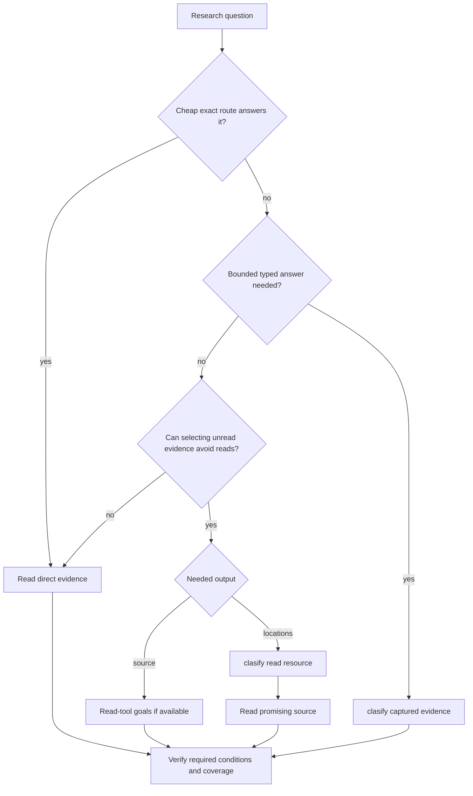
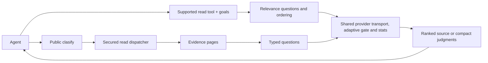

# Goals, relevance ranking, and clasify

Use `goals` when earlier relevant source could avoid later reads. Use `clasify` to locate a described target in unread source before a broad read, or to answer a needed typed question. Both use the configured classification provider; verify the deciding evidence.

## Ranked content or a clasify matrix

| Need | Route | What comes back |
|---|---|---|
| A known name, condition, or source range | Ordinary search, AST/LSP, or a bounded read | Direct evidence |
| Relevant evidence before less useful pages | A supported read tool with optional `goals` | Reordered source, a ranking receipt, and continuations |
| Which unread candidate or source window to inspect | `clasify` with a read resource | Judgments or locations, then source-read leads |
| A typed label for evidence already held | `clasify` with a `value` resource | The requested label; this does not save already-read context |

Prefer an adequate cheap exact route. A known file can still contain an unknown answer location; a known identifier or precise range often needs only a direct read. Semantic selection helps when the captured evidence supports the question and selection can avoid later reads. Reordering a page that you must read in full saves no context. File size, candidate count, a score, or an optional hint alone does not establish a benefit. Exhaustive audits still need their complete scope.



Do not repeat the same relevance decision in goals and clasify or reclassify unchanged evidence. Adding `goals` inside a `clasify` resource explicitly requests two stages; use that composition only for distinct questions. A needed typed judgment can be useful without saving context. Availability permits a call, but the runtime does not predict whether every explicit call will be economical.

## Quick start

Set up the [classification credential](AUTHENTICATION.md#classification-key-clasify). For goals, also enable [read-tool relevance ranking](CONFIGURATION.md#read-tool-relevance-ranking). Public `clasify` additionally requires beta. The [availability rules](#availability) keep these gates separate. Restart MCP after changing configuration.

To receive source in relevance order:

<!-- tool: localFetch -->
```json
{"queries":[{"path":"docs/guide.md","goals":["Evidence explaining how cancellation releases capacity while a request is still queued"]}]}
```

To locate evidence before receiving its body:

<!-- tool: clasify -->
```json
{"queries":[{"resources":[{"id":"guide","tool":"localFetch","query":{"path":"docs/guide.md"}}],"questions":[{"id":"where","type":"locate","ask":"Where does the document explain how cancellation releases capacity while a request is still queued?"}]}]}
```

Choose either route for that relevance decision. Follow a returned source-read lead or read the original `path` and line range. Discover current fields with `npx octocode schema localFetch --view query` or `npx octocode schema clasify --view query`; run a saved matrix with `npx octocode clasify --input request.json`.

## How goals rerank source

`goals` requests relevance scoring and descending ordering before the selected evidence is paged. Remote discovery ranks one provider page at a time. It is the reranking pass; no additional public `clasify` call is needed for the same question.

Four source-content tools accept optional goals when ranking and the provider are available. Other read tools have no `goals` or ranking-continuation controls; their ordinary search, structure, history, AST, LSP, and package behavior is unchanged. Public `clasify` remains independently configurable for locations and typed judgments. On eligible tools, accepting goals does not promise a provider call: protected operations or incomplete selections return `skipped` without classification.

| Tool | What can be ranked | Scope and limits |
|---|---|---|
| `localSearch` | Files containing sanitized matches | Complete selected view; lexical retrieval scope is unchanged |
| `localFetch` | Complete raw-text windows | Complete selected view, original line locations preserved |
| `ghSearchCode` | File hits and returned snippets | One provider page; no extra body reads |
| `ghGetFileContent` | Complete raw-text windows with `minify:"none"` | Selected view bound to resolved revision and path |

`ghSearchRepo`, `ghSearchHistory`, `artifactSearch`, `structureSearch`, `astSearch`, `lspSearch`, `ghStructure`, `ghGetHistoryItem`, and `astTopology` do not accept ranking controls. Mutation and clone tools do not accept goals. Public `clasify` uses its existing typed questions; hiding that public tool does not disable goals on the four supported reads.

Multiple goals use the highest score across goals: evidence relevant to **any** goal moves earlier. This does not prove that all requested conditions hold. Equal scores keep the original order.

The `ranking` receipt reports `ranked`, `partial`, `skipped`, or `fallback`, plus `scope: selectedView | providerPage`. A selected view is the requested selection, not the whole repository. A provider page says nothing about unseen pages. Candidate, evidence, and time budgets bound provider work. Unscored candidates remain after scored candidates in their original order; a partial ranking cannot establish the best result across the whole source. Provider failure preserves ordinary order.

Copy `next.*` unchanged. Its ranking plan fixes the order while replaying the same candidate set across pages and processes. A continuation to a new provider page starts a new page-local decision. Source, goals, selected view, or relevant configuration changes invalidate the plan. Exact verification uses original source locations without ranking again.

Representation choices remain authoritative: explicit non-relevance sorts, count/path-only searches, transformed or full-content fetches, byte reads, and streaming files can skip ranking. A single candidate cannot be reordered. See the [ranking reference](OCTOCODE_TOOLS.md#goal-based-relevance-ranking) for representation limits and continuation rules. `mainGoal` describes workflow intent; it does not enable ranking.

## Clasify flows and questions

| Flow | Resource | Question | Next step |
|---|---|---|---|
| Scout | An unread search or list | `relevant`; add `sufficient` if page completeness matters | Inspect promising candidates |
| Locate | Raw file evidence | `locate` | Read the returned source windows |
| Gate | An unread evidence page | `sufficient` | Verify the page; its read may still return the whole page |
| Judge | Evidence already held in `value` | A needed typed question | Use the label within its evidence scope |

A resource is `{id?, tool, query}` for an unread read, or `{id?, value}` for supplied evidence. Matrices live in `queries[]`. Each resource/page is judged independently; separate resources are not combined into a joint argument. Independent questions about the same evidence can share one matrix and one provider request per page.

### Questions

| Type | Answer |
|---|---|
| `relevant`, `supports`, `sufficient`, `adds` (`known` required) | P(yes) presets |
| `yesno` | P(yes), with optional true/false labels |
| `choice` | A label from a label-to-meaning map; include an unresolved option when needed |
| `score` | An ordered level from the supplied labels |
| `locate` | Source windows with `exists` and `probability` |

### Write questions that work

State the behavior, condition, and evidence needed. The provider sees the submitted evidence and question, not the agent's conversation.

- Goal: “Code showing how an aborted request releases capacity while still queued.”
- Locate: “Where is queued cancellation handled before execution starts?”
- Typed question: “Does this captured path release reserved capacity when the queued request is cancelled?”

Ask separate questions when separate conditions need separate answers. Add `sufficient` only when that answer changes the next step. Keep exact counts, calculations, and identity checks in deterministic tools. `prefilter` can narrow file evidence around useful literals; it also narrows what the judge can know.

### Agent prompt

> Choose the smallest adequate evidence route. Prefer exact searches and bounded reads when they answer the question. Use goals for source in relevance order, or clasify for locations, when selection can avoid later reads. Also use clasify when a bounded typed answer is itself needed. Use one semantic stage per relevance decision. Check scope and receipts. Verify deciding source, follow needed continuations unchanged, and keep missing evidence unresolved. Scores guide attention; they do not prove absence, identity, or finding validity.

## Read the scores

There is no universal accept, reject, or stopping score. Confidence describes the model's answer distribution, not verified correctness.

| Result | Interpretation and action |
|---|---|
| Relevant candidate | A promising place to inspect; verify the source |
| Sufficient judgment | The model thinks the captured page answers; confirm every required condition |
| Low relevance | Defer attention if appropriate; keep the candidate reachable |
| Locate `exists` and `probability` | Whether a window answers, and which window; do not multiply them into a new score |
| Partial coverage or an unjudged page | Evidence remains; continue or read it before a completeness claim |
| Error or insufficient evidence | Refine scope or obtain the missing source; do not turn it into “no” |

`best[questionId]` ranks located windows among the pages judged so far. Read hints can appear at query or page level; local windows may instead imply a read through `path`, `line`, and `endLine`. Preserve returned refs and snapshots. `carry` preserves a Locate walk's accumulated candidates; copy it through `next.clasify`.

## PR review, AST, and LSP

Use classification to prioritize inspection only when it can avoid work. Establish identities with LSP, structural conditions with AST, and findings with source and relevant executable checks.

| Situation | Useful route |
|---|---|
| Known predicate, definition, or reference | Precise AST, LSP, or direct source |
| Broad candidates whose snippets contain the deciding behavior | Optional relevance screening, then source verification |
| Returned rows omit a guard, callee, or build condition | Expand bounded evidence or refine the query first |
| One selected patch that must be reviewed | Read the patch directly |
| Missing callers, partial dynamic references, or an exhaustive audit | Resolve coverage; scores cannot close the gap |
| Optional typed second opinion on a cross-file claim | Supply one complete bounded evidence packet with revisions, then independently check its conclusion |

AST/LSP resources judge returned rows grouped by file; source behind their read hints is not automatically included. A file score is not a verdict on each reference. `localSearch`/`ghSearchCode` resources can hydrate files within budget; `candidateEvidence:"search"` retains snippets instead.

PR summaries do not expand into patches automatically. Request the needed sections, preserve `headSha`, `baseSha`, or `mergeCommitSha`, and verify deciding source at that revision. `locate` works on raw file evidence, not patches. Separate patch, caller, and test resources remain independent judgments.

The [PR/AST/LSP checks](../packages/octocode-benchmark/results/review-classification-2026-10-13.md) found candidate promotion but also confidently wrong regression and missing-context judgments. They do not support automated finding dismissal or a claim of better review accuracy.

## Let the tools hand off: goal-first

A supplied target and remaining candidate or source work can produce an optional `hints.clasify` lead. Hints suggest a possible next read; they neither invoke the provider nor certify a saving. Metadata-only search leads set `candidateEvidence:"search"` to avoid reading unseen file bodies. Use a lead only when it meets the routing rule, and then run it unchanged.

Search calls carrying goals and reads with an existing ranking plan do not receive another automatic classification lead. Ranked, partially ranked, and failed ranking attempts also do not trigger a second judgment. Explicit composition remains available for a distinct question.

A first raw `localFetch` of a streamed file can offer Locate when ranking reports `streamingSource` without judging any source. The optional request reuses the next bounded source window and its snapshot, starts at unread lines, and asks each explicit goal separately. It preserves the ordinary continuation and invokes no provider until the agent follows the hint. Exact, bounded, transformed, full-content, and already-complete reads do not receive this goal-derived handoff.

For other eligible handoffs, `mainGoal` and `reasoning` provide the target; they do not activate ranking. Exact-identifier leads use the cheaper text route. Unfinished raw local reads reuse the emitted unread window and snapshot; without an executable continuation, they do not offer Locate. GitHub requests retain the resolved revision when available.

## Shared internals, separate decisions



Ranking uses the lower-level classifier adapter, not recursive public tool dispatch. Public `clasify` obtains evidence through the normal secured read dispatcher. Both sanitize evidence and use the shared configured concurrency controls, deadlines, cancellation, and provider accounting.

Public matrix judgments reuse complete successful answers for 30 minutes in a process-local cache (up to 256 entries or 8 MiB of serialized answers). The key includes the endpoint, account, model, exact evidence including explicit nulls, and questions. Concurrent identical requests share provider work; each waiter keeps its own deadline and cancellation. A healthy waiter can start fresh after the leading caller stops. A failed provider answer is shared only with that in-flight group, not cached. Fresh ranking calls do not use this cache; ranked continuations reuse their saved order and bind it to the account and relevant settings. A clasify resource containing explicit goals performs both requested stages. Deferred candidates remain visible with their source-read leads; `next.clasify` alone need not revisit every explicitly unjudged candidate.

### Which model does what

The main agent chooses scope, uses tools, verifies evidence, and writes the answer. Octocode's adapter uses `jev-latest` for bounded relevance and typed judgments in both routes. The current contract has no per-query model selector. Record the actual provider version when it is available; an alias is not a fixed benchmark version. These checks do not establish a best main-agent or classifier model.

## How this can save context

Goals can bring deciding source into earlier pages. Clasify can keep unread bodies out of the main agent's context until selected source reads are needed. The benefit comes from avoiding later reads; consuming every page removes it. Reordering rows within one fully returned page does not reduce that page’s response tokens; metadata ranking can only help by avoiding later verification reads. Compare complete responses and required source reads against the cheapest adequate direct route, and account for provider usage separately.

The [revised-guidance benchmark](../packages/octocode-benchmark/results/selective-guidance-2026-10-13.md) tested 40 local, 30 GitHub, and 12 transfer questions with fresh Terra agents. Revised guidance reduced unnecessary goal calls locally and on the small transfer set, but agents still overused goals on GitHub. **General main-model token or monetary savings were not demonstrated:** revised GitHub input was 15.9% higher than JEV off across 28 valid pairs. Public `clasify` had no autonomous calls, so this experiment cannot compare its usefulness against goals. Quality was mostly tied; a wrong-function citation in a no-goals trace failed the source-verification guardrail without establishing a ranking regression. The report owns full measurements, uncertainty, and failure analysis.

Fresh fixed-route checks explain the useful boundary:

| Task | Sequential adequate source | Goals prefix | Adequate tested exact route |
|---|---:|---:|---:|
| Django callback rollback | 4,814 | 1,078–1,079 | 873 |
| Tokio close with outstanding permit | 3,433 | 1,292 | 1,016 |
| GitHub file fixture | 2,073 | 1,355 | 67 |

These are complete response tokens through retrospectively identified sufficient source, not autonomous stopping or net model savings. The GitHub full traversal costs 3,516 ranked versus 2,212 ordinary tokens. No complete traversal in the all-tool replay saved response tokens. Tokio Locate still missed a required permit condition despite high scores. PR/AST/LSP replays retained false judgments and verification overhead; they do not establish fewer false positives.

Count main-agent input/output and JEV usage separately. Cheap provider work pays off only when it avoids enough main-agent work; low JEV cost alone proves neither net savings nor faster completion. The benchmark preserves both usage ledgers and dated price scenarios. [Earlier source selection](../packages/octocode-benchmark/results/selective-semantics-2026-10-13.md), [all-tool ranking](../packages/octocode-benchmark/results/read-tool-ranking-2026-10-13.md), and [PR/AST/LSP checks](../packages/octocode-benchmark/results/review-classification-2026-10-13.md) remain separate experiments.

## Reference

### Output and limits

Results follow `queries[] → resources[] → pages[] → answers[questionId]`. They contain judgments and source locations, not bodies. `coverage:"partial"` means more scope remains; a page without answers or an error is explicitly unjudged. `extras:["details"]` adds full answers and runner-up windows; `extras:["stats"]` adds provider usage.

Evidence and request budgets are execution bounds, not usefulness thresholds. An oversized page reports `classificationContextTooLarge` with a source lead; unread remainder continues or remains explicitly unjudged. Changed sources reject stale continuation plans.

| Matrix limit | Value |
|---|---:|
| Queries per call | 5 |
| Resources / questions / cells per query | 25 / 25 / 25 |
| Cells per call | 50 |
| Pages judged per query per call | 48 |
| Evidence per resource per call (`maxChars`, default and maximum) | 1,000,000 characters |
| Characters per page | 80,000 |
| Hydrated files per search page / characters per file | 40 / 32,000 |
| Prefilter terms | 8 |
| Choice labels / score levels | 2–255 / 2–10 |
| Locate carry rows per question | 3 |

See [tool fields](OCTOCODE_TOOLS.md#semantic-assessment-reference), [CLI schema discovery](../packages/octocode/docs/OCTOCODE_CLI.md), and [ranking settings](CONFIGURATION.md#read-tool-relevance-ranking).

### Availability

A nonblank resolved classification API credential (`OCTOCODE_CLASSIFICATION_API` or `classification.api`) is required for both routes. Public `clasify` additionally requires `OCTOCODE_BETA=true` or home `local.beta:true`; goals instead require `ranking.enabled:true` and are available only on the four [supported reads](#how-goals-rerank-source). Beta and public-tool visibility do not gate goals. Provider setup and the present-but-blank API kill switch are in [authentication](AUTHENTICATION.md#classification-key-clasify); evidence disclosure is in [classification egress](SECURITY.md#classification-egress).

| API credential | Beta | Ranking | Public `clasify` | Read-tool `goals` |
|---|---|---|---|---|
| Missing or blank | Either | Either | Hidden | Omitted |
| Nonblank | Off | Off | Hidden | Omitted |
| Nonblank | Off | On | Hidden | Available on four tools |
| Nonblank | On | Off | Available | Omitted |
| Nonblank | On | On | Available | Available on four tools |

`tools.disabled` / `DISABLE_TOOLS=clasify` and `tools.enabled` / `TOOLS_TO_RUN` can further hide public `clasify`; an allowlist cannot bypass beta or the API requirement. Hiding it does not disable goals. Defaults leave beta and ranking off; no new setting is needed. Prefer goals when source ordering can avoid reads, and public `clasify` when a location or typed judgment is needed.

MCP and CLI resolve availability from configuration without contacting the provider. A real semantic request uses bounded retries and returns a typed provider error if the provider is unavailable; a later request in the same MCP session can succeed after recovery. Restart MCP after changing its configured key or settings, and inspect configured availability with `npx octocode config --json` and `npx octocode schema <tool> --view query`.

### Usage stats

With `OCTOCODE_ENABLE_STATS=true` and persistent storage, `<octocode-home>/stats.json` records `stats.clasify`: attempted `calls`, reported `input_tokens` and `output_tokens`, and `known_usage_calls` / `unknown_usage_calls`. Classification transport owns bounded POST retries; the HTTP client's implicit retries are disabled. Failed sends and explicit retries count as attempted calls, while missing provider receipts mean unknown usage, not zero. The admission gate controls concurrency and cooldown without retrying. Cached judgments add no requests. Use an isolated `OCTOCODE_HOME` for experiments and report provider work separately from caller context.
