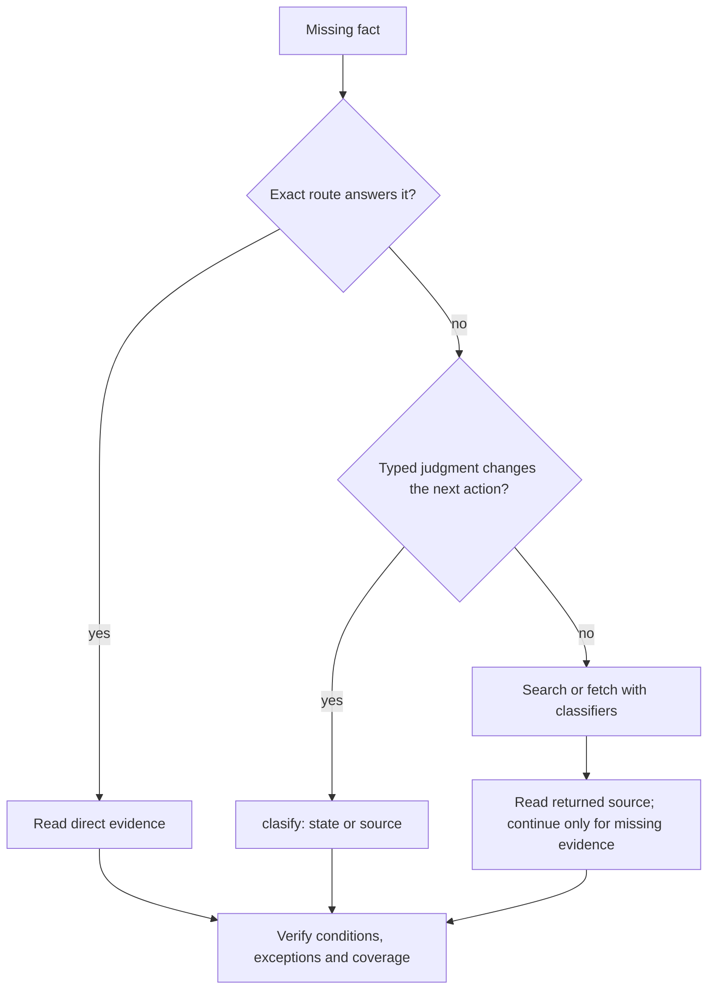
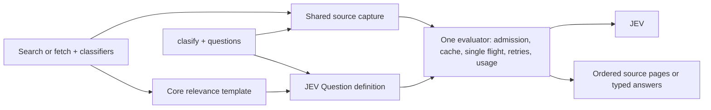

# Classifiers, relevance ranking, and clasify

Put `classifiers` on a search or fetch when choosing which evidence to read: Octocode judges the candidates internally and pages the useful source first. Use public `clasify` when a typed judgment itself changes your next action. Both run through the same classification mechanism; neither replaces reading the deciding source.

## Choose a route once

| Need | Route | What comes back |
|---|---|---|
| A known name, condition, or source range | Ordinary search, AST/LSP, or a bounded read | Direct evidence; no JEV call |
| Which captured candidates or windows to read first | `localSearch`, `localFetch`, `ghSearchCode`, or `ghGetFileContent` with `classifiers` | Source in relevance order, a `ranking` receipt, and continuations |
| A typed decision over unread source | `clasify` with a `source` reference | JEV answers, model, usage, and a read lead; no body |
| A typed decision over data you already hold | `clasify` with literal `state` | JEV answers, model and usage |
| Every match, a whole file, or an absence claim | Ordinary traversal of every page | All pages in the declared scope; ranking never proves completeness |

Prefer an adequate exact route. Ordering a page you must read in full saves nothing, and a separate `clasify` pass that repeats the relevance question already asked by `classifiers` only adds work.



## Quick start

Set up the [classification credential](AUTHENTICATION.md#classification-key-clasify). For `classifiers`, also enable [read-tool relevance ranking](CONFIGURATION.md#read-tool-relevance-ranking). Public `clasify` additionally requires beta. The [availability rules](#availability) keep these gates separate. Restart MCP after changing configuration.

Search with one self-contained question per missing fact:

<!-- tool: localSearch -->
```json
{"queries":[{"path":"src/cache","matchString":"expire","classifiers":["What does get return for an expired key in the local-memory cache?","In the local-memory cache, what does add return for an existing unexpired key?"]}]}
```

Ask a typed question about unread source without reading it first:

<!-- tool: clasify -->
```json
{"queries":[{"source":{"tool":"localFetch","query":{"path":"tests/cache.test.ts","ranges":["40-110"]}},"questions":{"cleanup_asserted":{"type":"noul","instructions":"Does the selected expired-entry test explicitly assert removal of expiry metadata?"}}}]}
```

Discover current fields with `npx octocode schema localSearch --view query` or `npx octocode schema clasify --view query`; run a saved request with `npx octocode clasify --input request.json`.

## Classifiers on search and fetch

`classifiers` is one field on four tools: one to five strings, each up to 1,000 characters. Each string names one piece of evidence: its subject, trigger and deciding conditions. Classifiers do not see your conversation or each other, so carry the conditions inside each question. `mainGoal` and `reasoning` are metadata; they never drive ranking.

| Tool | What is judged | Scope and skips |
|---|---|---|
| `localSearch` | Files containing sanitized matches | The captured match set; files/count views and an explicit sort or `reverse` skip ranking |
| `localFetch` | Complete raw line windows of the selection | The selected view; `fullContent`, byte windows and minified reads skip ranking |
| `ghSearchCode` | File hits and snippets on one provider page | One page of the default-branch index; a new page is new retrieval |
| `ghGetFileContent` | Complete raw line windows with `minify:"none"` | The selection at the resolved commit; the same skips as `localFetch` |

Other tools reject `classifiers`.

Each classifier string compiles, through one core-owned template, into a JEV Score question: no useful evidence / related background / direct evidence. Every admitted candidate is judged once, with all classifiers batched into one provider request. The current ordering moves a candidate earlier when it scores high for **any** classifier; equal scores keep the original order. A high score is not proof that a condition holds, and a low score never removes evidence.

The `ranking` receipt reports `ranked`, `partial`, `skipped` or `fallback`, plus `scope: selectedView | providerPage`. Candidate, character and time budgets bound provider work; unjudged candidates follow in their original order. A provider failure or deadline returns ordinary order with the reason. Copy `next.*` unchanged: its saved plan replays the same order across pages and processes without new JEV calls. A changed source, selection, classifier list or relevant setting rejects the old plan instead of mixing orders.

Retrieval results carry no automatic verification reread lead. Verify by reading the source already returned; request more only for a specific missing definition, condition or helper.

## clasify: JEV's three primitives

Each `queries[]` row holds keyed `questions` and exactly one of `state` or `source`. Questions use the provider's own field names:

| `type` | `criteria` | Answer fields |
|---|---|---|
| `noul` | Optional `{true, false}` meanings | `noul`: P(yes) over this state |
| `choice` | 2–255 `{label: meaning}`; add an insufficient-evidence label when the state may not decide | `choice`, `confidence`, every `probabilities` entry |
| `score` | 2–10 ordered levels, low to high | `score` (a zero-based, possibly fractional level), `confidence`, `probabilities`, `legend` |

`instructions` and criteria can be text, objects or arrays; structured values organize the question, they do not request generated JSON. Confidence measures how concentrated the distribution is, not whether the answer is correct. Independent questions about the same state share one provider request; dependent decisions compose in your own logic after the answers return. An optional per-row `model` overrides the configured model; the answer reports the model that actually answered.

### State or source

| Input | What Octocode does | What you receive |
|---|---|---|
| `state`: text, object or array | Sends it as data; an object holding a path or URL is never fetched | Answers, `model`, `usage` |
| `source: {tool: "localFetch", query: {path, ranges or fullContent}}` | Reads the selection through the authorized reader and binds its snapshot | Answers plus `hints.read` with the same path, ranges and snapshot |
| `source: {tool: "ghGetFileContent", query: {owner, repo, path, ref?, ranges or fullContent}}` | Resolves the ref to a commit, reads the selection, keeps the SHA | Answers plus `hints.read` pinned to that commit |
| `source: {url: "https://…#section"}` | Fetches the HTTPS page, extracts text, selects the fragment's section, and saves the capture | Answers, `source: {url, snapshot, expiresAt}`, and `hints.read` into the saved capture |

A file source needs explicit `ranges` or `fullContent:true`; the reader's default first page is never judged as the whole file. Captures are exact text (`minify:"none"`). A selection larger than the state limit fails the row with `classificationContextTooLarge`: narrow the ranges. A denied, missing or changed source fails the row before any JEV call. A failed row never becomes a negative answer.

`hints.read` reads exactly what was judged: same selection, snapshot or commit, no ranking state. A URL lead reads the saved extracted text through `localFetch`; its line numbers refer to that text, not the original HTML. After the capture expires the lead fails explicitly; it never fetches a newer page.

### Write questions that work

- One observable predicate per question: “Does this passage explicitly require restarting the service after credential rotation?”
- Choice for mutually exclusive alternatives, with an insufficient-evidence option when needed.
- Score for an ordered rubric whose levels you can act on.
- Not “check correctness”, arithmetic through scores, or several unrelated facts in one question.

## Read the answers

| Result | Interpretation and action |
|---|---|
| High-priority source from classifiers | A promising place to read; verify every required condition |
| `noul` near 0 | This state does not establish the fact; it is not absence elsewhere |
| `choice` with low `confidence` | The state does not separate the labels; read or narrow before acting |
| `score` between levels | The distribution spans levels; read `probabilities` and `legend` |
| `replayed: true` | Saved answers for an identical evaluation; `usage` is not new spend |
| Row `error` | Refine the source or retry; do not treat it as “no” |

## Shared mechanism



Retrieval passes the units it already captured to the evaluator; it never calls public `clasify`. `clasify` resolves its source through the same readers. Identical prepared state, questions and model reuse one validated answer from either entry point; different questions over the same source reuse the source bytes, not the answer. Only complete validated answers are cached (30 minutes, 256 entries, 8 MiB in memory; on disk only in persistent storage mode). Concurrent identical requests share one provider call; each waiter keeps its own deadline. Remote file bytes are keyed by commit SHA and reused across search, fetch and classification.

## Measurements

An integrated-ranking comparison (2026-10-14, eight fresh hosts) found that ordering an otherwise unchanged response increased total host tokens by 1.4–1.9%. Compact first-page delivery is being measured against ordinary paging before any default changes; ranking stays off by default. Earlier [revised-guidance](../packages/octocode-benchmark/results/selective-guidance-2026-10-13.md), [source selection](../packages/octocode-benchmark/results/selective-semantics-2026-10-13.md), [all-tool ranking](../packages/octocode-benchmark/results/read-tool-ranking-2026-10-13.md) and [PR/AST/LSP](../packages/octocode-benchmark/results/review-classification-2026-10-13.md) reports measured the removed goals/Locate/Scout contract; read them as history, not as examples.

Count host input plus output over the whole task, and JEV usage separately. Cheap provider work pays off only when it avoids enough host work.

## Reference

### Limits

| Limit | Value |
|---|---:|
| `classifiers` per call row / characters each | 1–5 / 1,000 |
| `clasify` rows per call | 5 |
| Questions per row | 1–25 |
| Characters of one state or captured selection | 32,000 |
| Choice labels / score levels | 2–255 / 2–10 |

See [tool fields](OCTOCODE_TOOLS.md#semantic-assessment-reference), [CLI schema discovery](../packages/octocode/docs/OCTOCODE_CLI.md), and [ranking settings](CONFIGURATION.md#read-tool-relevance-ranking).

### Availability

A nonblank resolved classification API credential (`OCTOCODE_CLASSIFICATION_API` or `classification.api`) is required for both routes. Public `clasify` additionally requires `OCTOCODE_BETA=true` or home `local.beta:true`; `classifiers` instead require `ranking.enabled:true`. Beta and public-tool visibility do not gate `classifiers`. A `clasify` source can name only readers that interface exposes; URL sources also need `localFetch` and persistent storage. Provider setup and the present-but-blank API kill switch are in [authentication](AUTHENTICATION.md#classification-key-clasify); evidence disclosure is in [classification egress](SECURITY.md#classification-egress).

| API credential | Beta | Ranking | Public `clasify` | `classifiers` |
|---|---|---|---|---|
| Missing or blank | Either | Either | Hidden | Omitted |
| Nonblank | Off | Off | Hidden | Omitted |
| Nonblank | Off | On | Hidden | Available on four tools |
| Nonblank | On | Off | Available | Omitted |
| Nonblank | On | On | Available | Available on four tools |

`tools.disabled` / `DISABLE_TOOLS=clasify` and `tools.enabled` / `TOOLS_TO_RUN` can further hide public `clasify`; an allowlist cannot bypass beta or the API requirement. When ranking is unavailable, schemas omit `classifiers` and `ranking`, and a saved call containing them is rejected. MCP and CLI resolve availability from configuration without contacting the provider. Inspect it with `npx octocode config --json` and `npx octocode schema <tool> --view query`.

### Usage stats

With `OCTOCODE_ENABLE_STATS=true` and persistent storage, `<octocode-home>/stats.json` records `stats.clasify`: attempted `calls`, reported `input_tokens` and `output_tokens`, and `known_usage_calls` / `unknown_usage_calls`, for both entry points. Failed sends and explicit retries count as attempted calls; missing provider receipts mean unknown usage, not zero. Cached answers add no requests. Use an isolated `OCTOCODE_HOME` for experiments.
