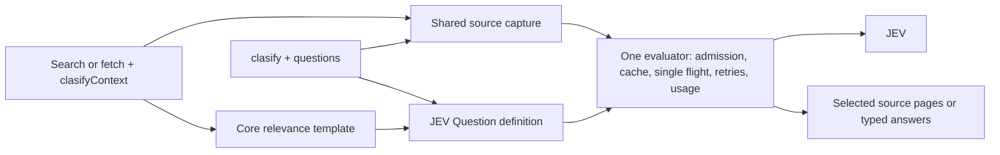

# Evidence selection and clasify

Supply `clasifyContext` on local/GitHub search or fetch to assess evidence internally and return relevant source only. Optional `mainGoal` and `reasoning` add research context to JEV. Use standalone `clasify` when typed answers about unread paths, URLs or images change the next action. Both use one evaluator.

## Choose a route once

| Need | Route | What comes back |
|---|---|---|
| A known name, condition, or source range | Ordinary search, AST/LSP, or a bounded read | Direct evidence; no JEV call |
| Filter many lexical search hits | Narrow path, globs and known file terms, then optional `clasifyContext` | Selected hit evidence, coverage and recovery |
| Relevant passages from known files are needed now | Batch `localFetch` or `ghGetFileContent` with `clasifyContext` | Selected passages immediately, coverage and recovery |
| A typed decision over unread source | `clasify` with a `source` reference | JEV answers, model, usage, and a read lead; no body |
| A typed decision over unread images | `clasify` with image `assets` referenced in the state or questions | JEV answers and captured image identities; no bytes |
| Available provider models | `clasify` with `operation:"models"` | Provider model names, descriptions, and release dates |
| A typed decision over data you already hold | `clasify` with literal `state` | JEV answers, model and usage |
| Every match, a whole file, or an absence claim | Ordinary traversal of every page | All pages in the declared scope; classification never proves completeness |

Prefer an adequate exact route. Ordering a page you must read in full saves nothing, and a separate `clasify` pass that repeats the relevance question already asked by `classifiers` only adds work.

For a list of documents, first decide what the next step needs. If it needs passages, batch classified fetches directly. If a typed answer will decide which documents to open or which action to take, screen unread source paths with standalone `clasify`. The source is acquired internally in both routes; the host sends paths and questions rather than copying file bodies.


## Quick start

Set up the [classification credential](AUTHENTICATION.md#classification-key-clasify). Public `clasify` additionally requires beta. The [availability rules](#availability) keep these gates separate. Restart MCP after changing configuration.

Search with one self-contained question per missing fact:

<!-- tool: localSearch -->
```json
{"queries":[{"path":"src/cache","matchString":"expire","contextLines":3,"clasifyContext":{"classifiers":["Does this code remove expiry metadata when a local-memory cache entry expires?"]}}]}
```

Ask a typed question about unread source without reading it first:

<!-- tool: clasify -->
```json
{"queries":[{"source":{"tool":"localFetch","query":{"path":"tests/cache.test.ts","ranges":["40-110"]}},"questions":{"cleanup_asserted":{"type":"noul","instructions":"Does the selected expired-entry test explicitly assert removal of expiry metadata?"}}}]}
```

Discover current fields with `npx octocode schema localSearch --view query` or `npx octocode schema clasify --view query`; run a saved request with `npx octocode clasify --input request.json`.

### Read relevant passages from known large files

When passages are needed now, batch the discovered paths and the deciding question in the fetch call:

<!-- tool: localFetch -->
```json
{"queries":[{"path":"docs/upgrade-guide.md","fullContent":true,"clasifyContext":{"classifiers":["Does this passage specify when a rolling upgrade may mix server versions?"]}},{"path":"docs/deployment-guide.md","fullContent":true,"clasifyContext":{"classifiers":["Does this passage specify when a rolling upgrade may mix server versions?"]}}]}
```

Replace the example paths with discovered files. Read the selected passages once; follow selected continuations only for evidence still needed. Check unknown coverage before concluding that no passage answers the question. Small focused files and known exact ranges usually need only ordinary fetch.

### Match first, then classify the surrounding evidence

Use `matchString` when the file is known and a literal can cheaply locate plausible passages. `contextLines` adds the nearby conditions JEV needs; `clasifyContext` then selects from that extracted view. It does not inspect the rest of the file. Positive `contextLines` may also complete a small enclosing declaration, so it is not a strict ±N maximum unless explicit ranges bound the view; `contextLines:0` disables that automatic completion. Prefer ordinary matched fetch when the resulting windows already answer the question.

<!-- tool: localFetch -->
```json
{"queries":[{"path":"src/cache/expiry.ts","matchString":"expire","contextLines":8,"clasifyContext":{"classifiers":["Does this passage show expiry metadata being removed when a cache entry expires?"]}}]}
```

The same selectors work on `ghGetFileContent` with repository identity and a ref. Explicit `ranges` bound the view; `block:true` deliberately widens to enclosing declarations. Set enough context to include the deciding condition, or use a known complete declaration/range. Twenty lines is not a universal context size: one statement can span many lines, and one minified line can contain a whole module. `contextLines:0` explicitly requests complete matching lines rather than the default compact byte excerpt for very long lines.

Returned gutters and `sourceLineRanges` refer to the original file, not positions in the filtered response. Gaps remain gaps. A selected window is a place to inspect; it does not mean every line in it supports the question. Preserve the snapshot or resolved commit when narrowing a follow-up read.

### Filter local code search before reading hits

Use path, include/exclude and known `fileHas`/`fileLacks` terms to narrow candidates cheaply. Then supply one atomic classifier when remaining hits need interpretation. Set enough `contextLines` to include nearby conditions; the default is zero. JEV sees bounded captured hit snippets per file, so a larger pageSize cannot expose a missing surrounding condition or an unread whole file.

If the decision needs the full file rather than its hits, use a classified fetch for passages or standalone `clasify.source` for a typed answer. Classification cannot recover a file excluded by lexical search.

### Screen several unread resources

When a typed answer will decide which plausible files to read or what action to take, pass their references to `clasify` before fetching their bodies into the host conversation. Use one row per resource and batch the rows in one call. A single Noul question is enough for an observable yes/no decision; use Choice when distinguishing support, contradiction and insufficient evidence changes the next action.

<!-- tool: clasify -->
```json
{"queries":[{"id":"rotation","source":{"tool":"localFetch","query":{"path":"docs/credential-rotation.md","fullContent":true}},"questions":{"restart_free":{"type":"noul","instructions":"Does this guide explicitly describe rotating credentials without restarting the service?"}}},{"id":"deployment","source":{"tool":"localFetch","query":{"path":"docs/deployment.md","fullContent":true}},"questions":{"restart_free":{"type":"noul","instructions":"Does this guide explicitly describe rotating credentials without restarting the service?"}}}]}
```

Octocode reads the selected files internally and returns their typed answers and source identities. For GitHub, use `source.tool:"ghGetFileContent"` with `owner`, `repo`, `path`, `ref` and the selection; for a web document use `source:{url:"https://…"}`. Discover file targets before classifying a folder. Put references in `source` or image `assets`; placing a path in literal `state` does not read it.

Use the answers to choose the next read. For a source-backed research claim, fetch the deciding passage with `matchString` or a smaller range, preserving the returned snapshot/ref and the original selection's scope. Read more when conditions, exceptions or supporting definitions remain missing. The optional whole-selection read lead is a starting point, not a requirement to read the entire winner. If the task only needs a typed classification, that answer may already finish it.

Batch independent questions about the same resource together, and include only questions whose answers change the next action. Do not classify content merely to repeat a judgment already made by retrieval `clasifyContext`. Compare the complete classification-plus-read exchange with an adequate ordinary search/read; classification pays off only when avoided reading exceeds its added tool and context cost.

## Classifiers on search and fetch

`clasifyContext` is optional on four tools. Its `classifiers` array contains one to five atomic evidence questions, each nonblank and at most 1,000 characters. Supplied `mainGoal` and `reasoning` are optional additional context on every question. Use reasoning for a short search rationale, not private chain of thought. None of these fields exposes the host's conversation to JEV.

Fetch candidates are independent, source-addressed windows targeting 2,048 characters, separated at omitted source spans. Ordinary line views preserve whole lines; implicit long-line match excerpts retain byte-omission markers and original line coordinates. These windows are not semantic sections or whole declarations. A question requiring joint facts from separate windows can remain unknown. Use a complete standalone source selection for a joint typed decision, or inspect the deciding ranges together. `longContext` does not merge inline windows or override candidate, character and deadline budgets. No optimal chunk size has been established.

| Tool | What is assessed | Scope |
|---|---|---|
| `localSearch` | Sanitized matched-line bundles per file | Collected lexical matches; content views only |
| `ghSearchCode` | Available hit evidence on one provider page | Default-branch index; filename-only hits remain unknown |
| `localFetch` | Source-addressed windows from the extracted raw view | Supplied ranges/matches, or the file before output paging |
| `ghGetFileContent` | The same raw windows | Source at the resolved commit |

Questions compile through one core-owned three-level Score rubric: no useful evidence, related background, direct evidence. A candidate is selected if any question assigns direct evidence more than half the probability mass. It is excluded only if every question assigns no useful evidence more than half. Otherwise it is unknown. These are selection rules, not calibrated confidence or proof. Selected files/windows retain source order; their context lines may include background.

Only selected bodies enter the default response. `selection` always reports status (`complete`, `partial`, `unavailable`), scope (`selectedView`, `providerPage`), unit (`files`, `chunks`), and total/selected/excluded/unknown item counts. The partitions sum to the total candidate count. Failed or unassessed candidates stay unknown; a provider error never causes a raw-body fallback or a negative judgment.

Copy selected-result paging calls unchanged. Their `selection` token replays the bound decision without another JEV call. `next.unfiltered` explicitly recovers the complete original view, including selected evidence, without classification. It is an enrichment route, not a requirement to read everything after a sufficient scoped answer. Use it for completeness or unresolved coverage, and name withheld scope. Local recovery uses a snapshot; GitHub file recovery uses a commit. GitHub search recovery reruns the same provider page and can reflect index changes.

Search still retrieves only lexical candidates. Search count/path-only views, explicit minified fetches, fresh byte windows and streamed sources reject context selection with recovery. Omitted fetch minify resolves to raw text; ordinary GitHub omission retains standard minification. `fullContent` remains compatible and output still pages. Oversized selected lines may use generated byte continuations; source gutters and gap markers preserve original positions.

`clasifyContext.longContext:true` opts into JEV's long-context header through the shared evaluator. Candidate, serialized-state-character and deadline budgets remain in force under `classification`; they do not measure tokens or include question/envelope overhead. Questions and optional research context participate in cache identity. A source, assessment, model or policy change invalidates a saved decision.

Other tools reject `clasifyContext`. Omit it for cheap exact reads and exhaustive traversal. Standalone `clasify` remains the explicit way to inspect unread resource contents; inline search does not silently fetch full files behind filename hits.

## clasify: JEV's four primitives

Each evaluation row holds keyed `questions` and exactly one of `state` or `source`. A separate `{operation:"models"}` row discovers the provider model catalog without an evaluation. Questions use the provider's own field names:

| `type` | `criteria` | Answer fields |
|---|---|---|
| `noul` | Optional `{true, false}` meanings | `noul`: P(yes) over this state |
| `choice` | 1–255 `{label: meaning}`; add an insufficient-evidence label when the state may not decide | `choice`, `confidence`, every `probabilities` entry |
| `score` | 1–100 ordered levels, low to high | `score` (a zero-based, possibly fractional level), `confidence`, `probabilities`, `legend` |
| `box` | No criteria; name the visible object in `instructions` | `box: {top, bottom, left, right}` normalized to 0–1, and nullable `confidence` |

`instructions` may be omitted or null. Supplied instructions and criterion meanings can be text, objects or arrays; structured values organize the question, they do not request generated JSON. Confidence measures how concentrated the distribution is, not whether the answer is correct. Independent questions about the same state share one provider request; dependent decisions compose in your own logic after the answers return. An optional per-row `model` overrides the configured model (`classification.model` / `OCTOCODE_CLASSIFICATION_MODEL`, else the provider default); the answer reports the model that actually answered. Pin an exact model for reproducible results.

### State or source

| Input | What Octocode does | What you receive |
|---|---|---|
| `state`: text, object or array | Sends it as data; an object holding a path or URL is never fetched | Answers, `model`, `usage` |
| `source: {tool: "localFetch", query: {path, ranges or fullContent}}` | Reads the selection through the authorized reader and binds its snapshot | Answers plus `hints.read` with the same path, ranges and snapshot |
| `source: {tool: "ghGetFileContent", query: {owner, repo, path, ref?, ranges or fullContent}}` | Resolves the ref to a commit, reads the selection, keeps the SHA | Answers plus `hints.read` pinned to that commit |
| `source: {url: "https://…#section"}` | Fetches the HTTPS page, extracts text, selects the fragment's section, and saves the capture | Answers, `source: {url, snapshot, expiresAt}`, and `hints.read` into the saved capture |

A file source needs explicit `ranges` or `fullContent:true`; the reader's default first page is never judged as the whole file. Captures are exact text (`minify:"none"`). A selection larger than the state limit fails the row with `classificationContextTooLarge`: narrow the ranges or explicitly set `longContext:true` for the higher limit. This opts into JEV's long-context header; the provider can still reject the context. A denied, missing or changed source fails the row before any JEV call. A failed row never becomes a negative answer.

`hints.read` reads exactly what was judged: same selection, snapshot or commit, no selection token. A URL lead reads the saved extracted text through `localFetch`; its line numbers refer to that text, not the original HTML. The capture lives under `<home>/tmp/capture/url/<snapshot>/`; `expiresAt` follows `storage.cloneCache.ttl`, and the daily cache sweep removes captures older than that. A changed or removed capture fails the lead explicitly (`staleSnapshot` or not found); it never fetches a newer page.

### Locate a passage with typed questions

Standalone `clasify` evaluates the complete source selection once. Its `hints.read` identifies that selection; it is not an answer-specific citation. For a location decision, keep the source as a path and use Choice labels for known original line ranges. Pair that question with an independent Noul existence question. The provider documents this [line-ID search pattern](https://docs.typesafe.ai/cookbooks/semantic_find); it does not require a new primitive or generated line-number text.

<!-- tool: clasify -->
```json
{"queries":[{"source":{"tool":"localFetch","query":{"path":"docs/upgrade-guide.md","ranges":["40-99"]}},"questions":{"exists":{"type":"noul","instructions":"Does the selected source explicitly state when a rolling upgrade may mix server versions?"},"where":{"type":"choice","instructions":"Which original source range most directly states when a rolling upgrade may mix server versions? Choose unknown if no range addresses it.","criteria":{"lines_40_59":"Original source lines 40-59","lines_60_79":"Original source lines 60-79","lines_80_99":"Original source lines 80-99","unknown":"No listed range addresses the question"}}}}]}
```

Use ranges discovered from an outline or a known bounded selection. Choice accepts at most 255 labels; enumerating hundreds of lines also adds host input and output. Coarse ranges can be cheaper than individual line labels. Read the chosen range with enough neighboring context, intersected with the original selection, and keep its snapshot/ref. A low existence result, unknown label or ambiguous distribution leaves location unresolved. Do not treat a top Choice probability as independent confidence for that passage: its probabilities compete and sum to one.

Choice returns one preferred location, so it cannot establish all supporting sites. If a question requires several independent passages, use classified fetch or separate atomic questions. A simultaneous `where` question locates material about the research question; it cannot inspect another question's returned answer. To verify a classification, read the source or make a subsequent dependent call. Do not silently split whole-source Noul/Choice/Score questions into window-level questions: absence, universal claims and cross-range relationships change meaning.

### Unread images and model discovery

Reference PNG or JPEG images in an `assets` map. Each key must occur in a string value inside `state` or `questions`, including structured instructions or criteria. Use distinct placeholder keys; the provider substitutes the captured image at that position. An unused asset fails before image acquisition. Octocode does not crawl images embedded in a text page.

<!-- tool: clasify -->
```json
{"queries":[{"model":"jev-1.14.0","state":"Inspect image_1.","assets":{"image_1":{"type":"image","source":{"tool":"localFetch","query":{"path":"screenshots/settings.png"}}}},"questions":{"contains_save":{"type":"noul","instructions":"Is a Save button visibly present in image_1?"},"save_location":{"type":"box","instructions":"Locate the Save button in image_1."}}}]}
```

An image source is a local `{tool:"localFetch",query:{path,snapshot?}}`, GitHub `{tool:"ghGetFileContent",query:{owner,repo,path,ref?}}`, or `{url:"https://…"}` reference. An image URL must point directly to PNG/JPEG bytes and have no fragment; text URL fragments select sections. Images have no text ranges or minification. Octocode reads the original bytes through the existing access and network policy, detects PNG/JPEG dimensions, resolves GitHub refs to commits, and sends the images with the provider's image opt-in header. It does not resize them. The model can reject an image that passes Octocode's admission limits.

The result's `assets` map reports each captured origin, digest `snapshot`, format, byte size, dimensions, saved `path`, and `expiresAt`. Inspect that saved image with an image-capable reader when its details matter. There is no text-fetch lead for binary bytes. Image capture requires persistent storage and an available `localFetch` reader; the referenced GitHub reader must also be available. Saved images share the existing capture retention policy.

Discover model IDs before pinning one:

<!-- tool: clasify -->
```json
{"queries":[{"operation":"models"}]}
```

This returns `models` entries with `name`, `description`, and `release_date`. Evaluation rows report the actual answering model. Image tests establish support for the tested model and input; they do not establish OCR quality or audio/video support.

The October 15 native CLI checks passed PNG/JPEG questions, including Box, on `jev-preview`, which resolved to `jev-1.14.0`. A separate check on the same PNG passed Noul/Choice/Score on `jev-1.13.0` but Box alone returned HTTP 400. That identifies a failing request combination, not its cause or a complete model-capability table. Select a model and request shape tested for the primitive you need; Octocode does not silently switch models after a rejection. The provider's [Box example](https://docs.typesafe.ai/sdk/python/api/types/questions) also selects the preview model.

### Write questions that work

- One observable predicate per question: “Does this passage explicitly require restarting the service after credential rotation?”
- Choice for mutually exclusive alternatives, with an insufficient-evidence option when needed.
- Score for an ordered rubric whose levels you can act on.
- Not “check correctness”, arithmetic through scores, or several unrelated facts in one question.

## Read the answers

| Result | Interpretation and action |
|---|---|
| Selected source from clasifyContext | A promising place to read; verify every required condition |
| `noul` near 0 | This state does not establish the fact; it is not absence elsewhere |
| `choice` with low `confidence` | The state does not separate the labels; read or narrow before acting |
| `box` with null confidence | The provider did not supply confidence; inspect the saved image before relying on the location |
| `score` between levels | The distribution spans levels; read `probabilities` and `legend` |
| `replayed: true` | Saved answers for an identical evaluation; `usage` is not new spend |
| Row `error` | Refine the source or retry; do not treat it as “no” |

## Shared mechanism



Retrieval passes the units it already captured to the evaluator; it never calls public `clasify`. `clasify` resolves its source through the same readers. Identical prepared state, questions, model, image bytes, and capability options reuse one validated answer from either entry point; different questions do not reuse an answer. GitHub fetch and classification reuse bytes at the resolved commit; local files and HTTPS URLs are reacquired to check current content. Saved URL captures are immutable inspection evidence, not an HTTP response cache. Only complete validated answers are cached (30 minutes, 256 entries, 8 MiB in memory; on disk only in persistent storage mode). Concurrent identical requests share one provider call; each waiter keeps its own deadline. GitHub file bytes are keyed by commit SHA; code-search snippets remain a separate provider response.

## Measurements

An integrated-ranking comparison (2026-10-14, eight fresh hosts) found that ordering an otherwise unchanged response increased total host tokens by 1.4–1.9%. That historical ordering behavior is replaced by context-triggered filtering; whole-agent savings for the new selector must be measured separately. Earlier [revised-guidance](../packages/octocode-benchmark/results/selective-guidance-2026-10-13.md), [source selection](../packages/octocode-benchmark/results/selective-semantics-2026-10-13.md), [all-tool ranking](../packages/octocode-benchmark/results/read-tool-ranking-2026-10-13.md) and [PR/AST/LSP](../packages/octocode-benchmark/results/review-classification-2026-10-13.md) reports measured the removed goals/Locate/Scout contract; read them as history, not as examples.

Count host input plus output over the whole task, and JEV usage separately. Cheap provider work pays off only when it avoids enough host work.

The October 15 [native API and research evaluation](../.octocode/octocode-eval-benchmark/2026-10-15-jev-e2e/README.md) exercised all four primitives and unread source capture. In eight local/GitHub research runs, none of the four hosts allowed to classify chose that route, so their token differences cannot be attributed to JEV. A separate two-host synthetic document task required classification before reading: all four document judgments and both answers were correct, but total host tokens fell only 2.8% (54,342 to 52,837). A fresh replication after clarifying Choice criteria used valid input immediately and saved 10.7% (44,842 to 40,034), also with correct answers. Both missed the frozen 15% target. Tool output fell much more, which demonstrates why output bytes alone are insufficient. These exposed development tasks establish neither a universal saving, a causal wording effect, nor a best chunk size.

## Reference

### Limits

| Limit | Value |
|---|---:|
| `clasifyContext.classifiers` per call row / characters each | 1–5 / 1,000 |
| `clasify` rows per call | 5 |
| Questions per row | 1–25 |
| Complete serialized state characters, normal / `longContext:true` | 32,000 / 256,000 |
| Choice labels / score levels | 1–255 / 1–100 |
| Image assets per evaluation row | 8 |
| Image bytes, each / combined per row | 8 MiB / 16 MiB |
| Image pixels / maximum width or height | 16,777,216 / 8,192 |

The state limit includes JSON escaping and captured source identity, so a raw text selection can reach the limit before its character count does. These are Octocode admission limits, not promises that every model accepts every admitted input. Score output remains the provider's zero-based rubric value; a 1–10 presentation is a caller-defined display, not confidence.

See [tool fields](OCTOCODE_TOOLS.md#semantic-assessment-reference), [CLI schema discovery](../packages/octocode/docs/OCTOCODE_CLI.md), and [selection settings](CONFIGURATION.md#context-selection).

### Availability

A nonblank resolved classification API credential (`OCTOCODE_CLASSIFICATION_API` or `classification.api`) enables context selection on available readers. There is no separate ranking switch. Public `clasify` additionally requires beta; its visibility does not gate inline selection. Source adapters remain subject to reader availability and storage/access policies. See [authentication](AUTHENTICATION.md#classification-key-clasify) and [classification egress](SECURITY.md#classification-egress).

| API credential | Beta | Public `clasify` | `clasifyContext` |
|---|---|---|---|
| Missing or blank | Either | Hidden | Omitted |
| Nonblank | Off | Hidden | Available on four readers |
| Nonblank | On | Available | Available on four readers |

Tool allowlists/denylists still apply. Without a configured classification credential, schemas omit context/selection controls, discovery omits classification guidance, and an explicit context request fails clearly. With a credential, guidance mentions only the exposed inline and/or standalone routes. Configuration enables the capability; it does not prove remote authentication or provider health. Discovery makes no provider request. Inspect with `npx octocode config --json` and `npx octocode schema <tool> --view query`. Calls without context perform ordinary retrieval and make zero JEV requests.

### Usage stats

With `OCTOCODE_ENABLE_STATS=true` and persistent storage, `<octocode-home>/stats.json` records `stats.clasify`: attempted `calls`, reported `input_tokens` and `output_tokens`, and `known_usage_calls` / `unknown_usage_calls`, for both entry points. Failed sends and explicit retries count as attempted calls; missing provider receipts mean unknown usage, not zero. Cached answers add no requests. Use an isolated `OCTOCODE_HOME` for experiments.
