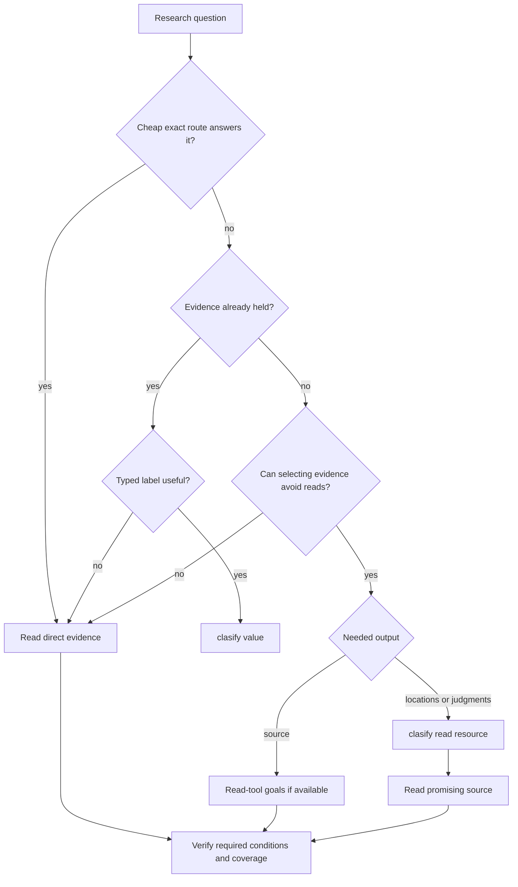
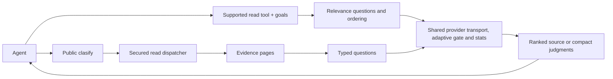

# Goals, relevance ranking, and clasify

Use `goals` when useful source should arrive first. Use `clasify` when locations or typed judgments should arrive before source bodies. Both use the configured classification provider; choose the output that advances the question and verify the deciding evidence.

## Ranked content or a clasify matrix

| Need | Route | What comes back |
|---|---|---|
| A known name, condition, or source range | Ordinary search, AST/LSP, or a bounded read | Direct evidence |
| Relevant evidence before less useful pages | A supported read tool with optional `goals` | Reordered source, a ranking receipt, and continuations |
| Which unread candidate or source window to inspect | `clasify` with a read resource | Judgments or locations, then source-read leads |
| A typed label for evidence already held | `clasify` with a `value` resource | The requested label; this does not save already-read context |

Prefer an adequate cheap exact route. Semantic selection helps when the target is described, the captured evidence can support the question, and selecting evidence can avoid later reads. File size, candidate count, a score, or an optional hint alone does not establish a benefit. Exhaustive audits still need their complete scope.



Use one semantic stage per relevance decision. Adding `goals` inside a `clasify` resource explicitly requests two stages; use that composition only for distinct questions. Availability permits a call, but the runtime does not predict whether every explicit call will be economical.

## Quick start

Set up the [classification credential](AUTHENTICATION.md#classification-key-clasify). For goals, also enable [read-tool relevance ranking](CONFIGURATION.md#read-tool-relevance-ranking). Ranking is disabled by default; CLI and MCP expose optional `goals` only when ranking is enabled and `clasify` is available. Restart MCP after changing configuration.

To receive source in relevance order:

<!-- tool: localFetch -->
```json
{"queries":[{"path":"docs/guide.md","goals":["Evidence explaining how cancellation releases capacity while a request is still queued"]}]}
```

To locate evidence before receiving its body:

<!-- tool: clasify -->
```json
{"queries":[{"resources":[{"id":"guide","tool":"localFetch","query":{"path":"docs/guide.md"}}],"questions":[{"id":"where","type":"locate","ask":"Where does the document explain how cancellation releases capacity while a request is still queued?"}]}]}
```

Choose either route for that relevance decision. Follow a returned source-read lead or read the original `path` and line range. Discover current fields with `npx octocode schema localFetch --view query` or `npx octocode schema clasify --view query`; run a saved matrix with `npx octocode clasify --input request.json`.

## How goals rerank source

`goals` requests relevance scoring and descending ordering before the selected evidence is paged. Remote discovery ranks one provider page at a time. It is the reranking pass; no additional public `clasify` call is needed for the same question.

All 13 clasify-readable tools accept optional goals when available (`astTopology` is CLI-only). Accepting goals does not promise a provider call: operations that preserve structure, explicit order, or incomplete selections return `skipped` without classification.

| Tool | What can be ranked | Scope and limits |
|---|---|---|
| `localSearch` | Files containing sanitized matches | Complete selected view; lexical retrieval scope is unchanged |
| `localFetch` | Complete raw-text windows | Complete selected view, original line locations preserved |
| `ghSearchRepo` | Repository rows and selected metadata | One provider page; exact lookup and explicit sort skip |
| `ghSearchCode` | File hits and returned snippets | One provider page; no extra body reads |
| `ghGetFileContent` | Complete raw-text windows with `minify:"none"` | Selected view bound to resolved revision and path |
| `ghSearchHistory` | PR, issue, or commit records | One provider page; explicit sorting stays authoritative |
| `artifactSearch` | Package discovery records | One provider page; exact package/version lookup skips |
| `structureSearch` | Flat file rows | Complete selection only; trees and incomplete walks skip |
| `astSearch` | File groups with returned match evidence | Complete selection only; single-file outlines and syntax trees skip |
| `lspSearch` | File groups of references or implementations | Complete file groups only (`groupByFile:true`); identity and structural operations skip |
| `ghStructure` | None | Tree ordering conveys structure; zero-call skip |
| `ghGetHistoryItem` | None | Section cursors and patch/hunk ordering are preserved; zero-call skip |
| `astTopology` | None | Graph, path, cycle, and diagnostic ordering are preserved; zero-call skip |

Mutation and clone tools do not accept goals. Public `clasify` uses its existing typed questions.

Multiple goals use the highest score across goals: evidence relevant to **any** goal moves earlier. This does not prove that all requested conditions hold. Equal scores keep the original order.

The `ranking` receipt reports `ranked`, `partial`, `skipped`, or `fallback`, plus `scope: selectedView | providerPage`. A selected view is the requested selection, not the whole repository. A provider page says nothing about unseen pages. Candidate, evidence, and time budgets bound provider work. Unscored candidates remain after scored candidates in their original order; a partial ranking cannot establish the best result across the whole source. Provider failure preserves ordinary order.

Copy `next.*` unchanged. Its ranking plan fixes the order while replaying the same candidate set across pages and processes. A continuation to a new provider page starts a new page-local decision. Source, goals, selected view, or relevant configuration changes invalidate the plan. Exact verification uses original source locations without ranking again.

Representation choices remain authoritative: explicit non-relevance sorts, count/path-only searches, transformed or full-content fetches, byte reads, and streaming files can skip ranking. A single candidate cannot be reordered. See the [ranking reference](OCTOCODE_TOOLS.md#goal-based-relevance-ranking) for representation limits and continuation rules. `mainGoal` describes workflow intent; it does not enable ranking.

## Clasify flows and questions

| Flow | Resource | Question | Next step |
|---|---|---|---|
| Scout | An unread search or list | `relevant`; add `sufficient` if page completeness matters | Inspect promising candidates |
| Locate | Raw file evidence | `locate` | Read the returned source windows |
| Gate | An unread evidence page | `sufficient` | Verify the page; its read may still return the whole page |
| Judge | Evidence already held in `value` | A needed typed question | Use the label within its evidence scope |

A resource is `{id?, tool, query}` for an unread read, or `{id?, value}` for supplied evidence. Matrices live in `queries[]`. Each resource/page is judged independently; separate resources are not combined into a joint argument. Independent questions about the same evidence can share one matrix and one provider request per page.

### Questions

| Type | Answer |
|---|---|
| `relevant`, `supports`, `sufficient`, `adds` (`known` required) | P(yes) presets |
| `yesno` | P(yes), with optional true/false labels |
| `choice` | A label from a label-to-meaning map; include an unresolved option when needed |
| `score` | An ordered level from the supplied labels |
| `locate` | Source windows with `exists` and `probability` |

### Write questions that work

State the behavior, condition, and evidence needed. The provider sees the submitted evidence and question, not the agent's conversation.

- Goal: “Code showing how an aborted request releases capacity while still queued.”
- Locate: “Where is queued cancellation handled before execution starts?”
- Typed question: “Does this captured path release reserved capacity when the queued request is cancelled?”

Ask separate questions when separate conditions need separate answers. Add `sufficient` only when that answer changes the next step. Keep exact counts, calculations, and identity checks in deterministic tools. `prefilter` can narrow file evidence around useful literals; it also narrows what the judge can know.

### Agent prompt

> Choose the smallest adequate evidence route. Prefer exact searches and bounded reads when they answer the question. Use optional goals for source in relevance order, or clasify for locations and needed labels, when selection can avoid later reads. Use one semantic stage per relevance decision. Check captured scope and ranking or coverage receipts. Verify deciding source conditions, follow needed continuations unchanged, and keep missing evidence unresolved. Scores guide attention; they do not prove absence, identity, or finding validity.

## Read the scores

There is no universal accept, reject, or stopping score. Confidence describes the model's answer distribution, not verified correctness.

| Result | Interpretation and action |
|---|---|
| Relevant candidate | A promising place to inspect; verify the source |
| Sufficient judgment | The model thinks the captured page answers; confirm every required condition |
| Low relevance | Defer attention if appropriate; keep the candidate reachable |
| Locate `exists` and `probability` | Whether a window answers, and which window; do not multiply them into a new score |
| Partial coverage or an unjudged page | Evidence remains; continue or read it before a completeness claim |
| Error or insufficient evidence | Refine scope or obtain the missing source; do not turn it into “no” |

`best[questionId]` ranks located windows among the pages judged so far. Read hints can appear at query or page level; local windows may instead imply a read through `path`, `line`, and `endLine`. Preserve returned refs and snapshots. `carry` preserves a Locate walk's accumulated candidates; copy it through `next.clasify`.

## PR review, AST, and LSP

Use classification to prioritize inspection only when it can avoid work. Establish identities with LSP, structural conditions with AST, and findings with source and relevant executable checks.

| Situation | Useful route |
|---|---|
| Known predicate, definition, or reference | Precise AST, LSP, or direct source |
| Broad candidates whose snippets contain the deciding behavior | Optional relevance screening, then source verification |
| Returned rows omit a guard, callee, or build condition | Expand bounded evidence or refine the query first |
| One selected patch that must be reviewed | Read the patch directly |
| Missing callers, partial dynamic references, or an exhaustive audit | Resolve coverage; scores cannot close the gap |
| Optional typed second opinion on a cross-file claim | Supply one complete bounded evidence packet with revisions, then independently check its conclusion |

AST/LSP resources judge returned rows grouped by file; source behind their read hints is not automatically included. A file score is not a verdict on each reference. `localSearch`/`ghSearchCode` resources can hydrate files within budget; `candidateEvidence:"search"` retains snippets instead.

PR summaries do not expand into patches automatically. Request the needed sections, preserve `headSha`, `baseSha`, or `mergeCommitSha`, and verify deciding source at that revision. `locate` works on raw file evidence, not patches. Separate patch, caller, and test resources remain independent judgments.

The [PR/AST/LSP checks](../packages/octocode-benchmark/results/review-classification-2026-10-13.md) found candidate promotion but also confidently wrong regression and missing-context judgments. They do not support automated finding dismissal or a claim of better review accuracy.

## Let the tools hand off: goal-first

A supplied target and remaining candidate or source work can produce an optional `hints.clasify` lead. Hints suggest a possible next read; they neither invoke the provider nor certify a saving. Metadata-only search leads set `candidateEvidence:"search"` to avoid reading unseen file bodies. Use a lead only when it meets the routing rule, and then run it unchanged.

Read calls already carrying `goals` or a ranking plan do not receive another automatic classification lead. Explicit composition remains available for a distinct question. `mainGoal` and `reasoning` provide the target for eligible handoffs; they do not activate ranking. Exact-identifier leads use the cheaper text route. Full-content, anchored, or transformed reads retain their requested purpose.

## Shared internals, separate decisions



Ranking uses the lower-level classifier adapter, not recursive public tool dispatch. Public `clasify` obtains evidence through the normal secured read dispatcher. Both sanitize evidence and use the shared configured concurrency controls, deadlines, cancellation, and provider accounting.

Public matrix judgments have a process-local cache. Fresh ranking calls do not share that judgment cache; ranked continuations reuse their saved order. A clasify resource containing explicit goals performs both requested stages. Deferred candidates remain visible with their source-read leads; `next.clasify` alone need not revisit every explicitly unjudged candidate.

### Which model does what

The main agent chooses scope, uses tools, verifies evidence, and writes the answer. Octocode's adapter uses `jev-latest` for bounded relevance and typed judgments in both routes. The current contract has no per-query model selector. Record the actual provider version when it is available; an alias is not a fixed benchmark version. These checks do not establish a best main-agent or classifier model.

## How this can save context

Goals can bring deciding source into earlier pages. Clasify can keep unread bodies out of the main agent's context until selected source reads are needed. The benefit comes from avoiding later reads; consuming every page removes it. Reordering rows within one fully returned page does not reduce that page’s response tokens; metadata ranking can only help by avoiding later verification reads. Compare complete responses and required source reads against the cheapest adequate direct route, and account for provider usage separately.

The [red/white evaluation](../packages/octocode-benchmark/results/selective-semantics-2026-10-13.md) corrected a grader that kept reading after adequate evidence had arrived. These are retrospective sufficient-source prefixes in `o200k_base` tokens, not observed autonomous stopping:

| Task | Sequential read | Goals | Cheapest tested exact route |
|---|---:|---:|---:|
| Django callback rollback, two repeats | 4,814 | 1,051–1,058 | 266, phrase selected after results |
| Tokio close with an outstanding permit, one run | 3,433 | 1,254 | 1,016 |

Goals reduced context by about 78% and 63% against sequential reading; exact queries won both comparisons without classifier work. Tokio Locate returned insufficient source despite a high score. All real classifier work in that check totaled 48 requests, 97,050 reported input tokens, and 9,182 output tokens, including unsuccessful work. This establishes neither net token/dollar savings nor automatic route-choice reliability.

The [earlier local-ranking study](../packages/octocode-benchmark/results/local-ranking-2026-10-13.md) retains its broad-route comparisons and controls where exact or exhaustive work cost more. The [review study](../packages/octocode-benchmark/results/review-classification-2026-10-13.md) retains PR/AST/LSP failures and complete source-read costs. Their measurements apply to those conditions, not universal score or size thresholds.

The [all-tool evaluation](../packages/octocode-benchmark/results/read-tool-ranking-2026-10-13.md) checks each of the 13 tools separately. In one GitHub file fixture, goals moved sufficient source from page 5 to page 2: 2,073 → 1,367 response tokens, a retrospective 34.1% reduction. Reading every page instead cost 60.3% more, and an exact phrase read needed only 67 tokens with no classifier call. No complete traversal in that run saved response tokens; metadata ordering did not eliminate its required source verification.

Enabling the MCP goals surface added 372 tokenizer-counted tokens to the loaded tool catalog. The bounded real-provider run resolved `jev-latest` to `jev-1.13.0` and used 29 requests with 13,679 reported input / 551 output tokens. Structural skips made no provider calls but still added response overhead. These single paired fixtures support keeping ranking opt-in, using exact routes when adequate, and checking whether earlier evidence actually avoids later reads.

### Autonomous Terra comparison

The [40-local / 30-GitHub paired benchmark](../packages/octocode-benchmark/results/terra-goals-2026-10-13.md) offered goals and clasify to fresh `gpt-5.6-terra` sessions using the local Octocode build. Every final pair completed and received independent source-checked grading. This single development pass **did not demonstrate general token savings**:

| Corpus | Terra-only input tokens, on/off | 95% interval | Observable characters, on/off |
|---|---:|---:|---:|
| 40 local questions | 1.119 | 1.002–1.256 | 1.044 |
| 30 GitHub questions | 1.064 | 0.968–1.171 | 1.012 |
| 8 Terraform questions, within local | 1.080 | 0.813–1.403 | 1.035 |

Ratios below one mean less usage. Correctness was similar; local wall time increased about 19.5%. Goals were used in 59 of 70 on-arm questions, but public clasify was never called. Many goal requests skipped single candidates, exact lookups, or structural views. Some cheaper on-arm answers came from narrower lexical queries or fewer reads; one Terraform case grew 6.3× after a broader file filter even though both goal requests skipped. The report retains every question, provider failures, cached-input accounting and all retry costs. These results support optional selection when it can avoid reads, and do not establish direct clasify adoption, reduced false positives, or net monetary savings.

JEV tokens are separate from the Terra ratios above. At [TypeSafe's published rate](https://typesafe.ai/blog/introducing-system-one-models-and-jev) of $0.042 per million input tokens with free output, the 581,317 known JEV input tokens cost about **$0.0244** across both campaigns; 18 aborted requests have unknown usage. Successful JEV HTTP requests had medians of 366 ms locally and 400 ms on GitHub, including startup probes. The report includes separate token accounts, verified pricing sources, a cache-aware dollar scenario and latency distributions. Cheap classification can pay for itself by avoiding a small amount of expensive model work, but this run does not establish that saving or a workflow speedup.

The same architecture audit removed candidate preparation when ranking is disabled, unavailable, unsupported, a singleton, or replaying a saved order. An 8 MB development probe fell from about 1.22 seconds to 0.34 seconds with identical output; both benchmark arms include that optimization. See the report for memory bounds and measurement limits.

## Reference

### Output and limits

Results follow `queries[] → resources[] → pages[] → answers[questionId]`. They contain judgments and source locations, not bodies. `coverage:"partial"` means more scope remains; a page without answers or an error is explicitly unjudged. `extras:["details"]` adds full answers and runner-up windows; `extras:["stats"]` adds provider usage.

Evidence and request budgets are execution bounds, not usefulness thresholds. An oversized page reports `classificationContextTooLarge` with a source lead; unread remainder continues or remains explicitly unjudged. Changed sources reject stale continuation plans.

| Matrix limit | Value |
|---|---:|
| Queries per call | 5 |
| Resources / questions / cells per query | 25 / 25 / 25 |
| Cells per call | 50 |
| Pages judged per query per call | 48 |
| Evidence per resource per call (`maxChars`, default and maximum) | 1,000,000 characters |
| Characters per page | 80,000 |
| Hydrated files per search page / characters per file | 40 / 32,000 |
| Prefilter terms | 8 |
| Choice labels / score levels | 2–255 / 2–10 |
| Locate carry rows per question | 3 |

See [tool fields](OCTOCODE_TOOLS.md#semantic-assessment-reference), [CLI schema discovery](../packages/octocode/docs/OCTOCODE_CLI.md), and [ranking settings](CONFIGURATION.md#read-tool-relevance-ranking).

### Availability

`clasify` requires a nonblank `OCTOCODE_CLASSIFICATION_API`. Provider setup, the optional host, and the blank-value kill switch are in [authentication](AUTHENTICATION.md#classification-key-clasify). Evidence disclosure is described under [classification egress](SECURITY.md#classification-egress).

MCP checks the provider at startup; authentication, quota, or connection failures can hide clasify and goals in that session. The CLI does not probe during schema discovery; provider failure is reported when called. Restart MCP after changing provider configuration. Use `npx octocode config check OCTOCODE_CLASSIFICATION_API` and the live schema to inspect availability.

### Usage stats

With `OCTOCODE_ENABLE_STATS=true` and persistent storage, `<octocode-home>/stats.json` records `stats.clasify`: attempted `calls`, reported `input_tokens` and `output_tokens`, and `known_usage_calls` / `unknown_usage_calls`. Failed attempts and retries count; missing receipts mean unknown usage, not zero. Cached judgments add no requests. Use an isolated `OCTOCODE_HOME` for experiments and report provider work separately from caller context.
