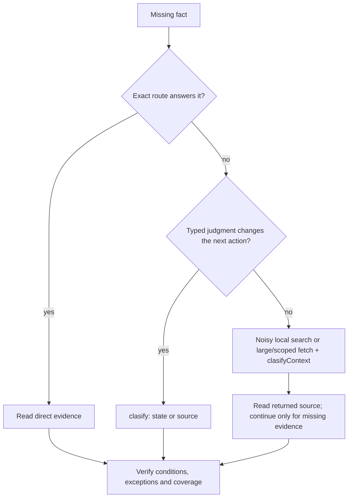
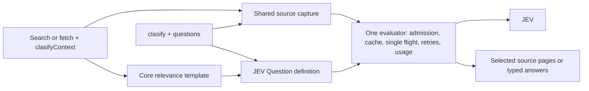

# Evidence selection and clasify

Use `clasifyContext` for noisy local search, large local fetches, and scoped GitHub fetches that still contain many irrelevant passages. JEV selects evidence before the host reads it. Keep exact reads and GitHub search ordinary. Use beta `clasify` when a typed answer about unread files, URLs or images decides which resources to inspect. Both routes use one evaluator; optional row `mainGoal` and `reasoning` add research context.

The current priorities come from the [2026-10-15 paired CLI measurements](../.octocode/octocode-eval-benchmark/2026-10-15-jev-flow-review-v2/README.md):

| Workflow | Tool argument + result tokens | Decision |
|---|---:|---|
| Noisy local search | 10,585 → 1,061 (−90%) | Use selection after lexical narrowing |
| Large local fetch | 8,542 → 600 (−93%) | Select passages when the exact location is unknown |
| Scoped GitHub fetch | 2,807 → 775 (−72%) | Pin the ref, narrow the view, then select |
| Exact local read | 184 → 243 (+32%) | Read directly; omit classification |

These are case-specific tool-I/O measurements, not whole-agent savings or guaranteed quality improvements. The GitHub search comparison left every candidate unknown and did not support promotion. Its classifier field remains available for experiments, but is not a recommended route. Count recovery and final evidence reads when evaluating a workflow.

## Choose a route once

| Need | Route | What comes back |
|---|---|---|
| A known name, condition, or source range | Ordinary search, AST/LSP, or a bounded read | Direct evidence; no JEV call |
| Filter many local lexical search hits | Narrow path, globs and known file terms, then optional `clasifyContext` | Selected hit evidence, coverage and recovery |
| Relevant passages from large local files or scoped GitHub files | Batch `localFetch` or `ghGetFileContent` with `clasifyContext` | Selected passages, coverage and recovery |
| A typed decision over unread source | `clasify` with a `source` reference | JEV answers, model, usage, and a read lead; no body |
| A typed decision over unread images | `clasify` with image `assets` referenced in the state or questions | JEV answers and captured image identities; no bytes |
| A typed decision over data you already hold | `clasify` with literal `state` | JEV answers, model and usage |
| Available provider models | `clasify` with `operation:"models"` | Model names, descriptions, and release dates |
| Every match, a whole file, or an absence claim | Ordinary traversal of every page | All pages in the declared scope; classification never proves completeness |

Prefer an adequate exact route. Classifying a page you must read in full saves nothing, and a `clasify` pass that repeats a relevance question already asked by `classifiers` only adds work. For a list of documents: if the next step needs passages, batch classified fetches; if a typed answer decides which documents to open, screen their paths with `clasify`. Either way Octocode reads the source internally; the host sends paths and questions, not file bodies.



## Quick start

Set the [classification key](AUTHENTICATION.md#classification-key-clasify); `clasify` also needs beta ([availability](#availability)). Restart the MCP server after changing configuration. Discover fields with `npx octocode schema localSearch --view query` or `npx octocode schema clasify --view query`; run a saved request with `npx octocode clasify --input request.json`.

Search with one self-contained question per missing fact:

<!-- tool: localSearch -->
```json
{"queries":[{"path":"src/cache","matchString":"expire","contextLines":3,"clasifyContext":{"classifiers":["Does this code remove expiry metadata when a local-memory cache entry expires?"]}}]}
```

Ask a typed question about unread source without reading it first:

<!-- tool: clasify -->
```json
{"queries":[{"source":{"tool":"localFetch","query":{"path":"tests/cache.test.ts","ranges":["40-110"]}},"questions":{"cleanup_asserted":{"type":"noul","instructions":"Does the selected expired-entry test explicitly assert removal of expiry metadata?"}}}]}
```

### Read relevant passages from known large files

Batch the discovered paths with the deciding question:

<!-- tool: localFetch -->
```json
{"queries":[{"path":"docs/upgrade-guide.md","fullContent":true,"clasifyContext":{"classifiers":["Does this passage specify when a rolling upgrade may mix server versions?"]}},{"path":"docs/deployment-guide.md","fullContent":true,"clasifyContext":{"classifiers":["Does this passage specify when a rolling upgrade may mix server versions?"]}}]}
```

Read the selected passages once; follow selected continuations only for evidence still needed. Check unknown coverage before concluding that no passage answers. Small files and known exact ranges usually need only an ordinary fetch.

Inline selection already returns source. Do not fetch the same complete deciding passage again merely to verify the classification. Read more only when a required condition is missing, the excerpt is clipped, or the claim requires broader coverage. Standalone `clasify` returns judgments without bodies, so its deciding source may still need a read.

### Match first, then classify the surrounding evidence

When the file is known and a literal locates plausible passages, use `matchString` with enough `contextLines` for the deciding conditions; `clasifyContext` then selects from that extracted view and never inspects the rest of the file. Positive `contextLines` may complete a small enclosing declaration, so it is not a strict ±N unless `ranges` bound the view; `contextLines:0` disables that completion and returns complete matching lines instead of compact excerpts of very long lines. `block:true` widens to enclosing declarations. Prefer an ordinary matched fetch when its windows already answer.

<!-- tool: localFetch -->
```json
{"queries":[{"path":"src/cache/expiry.ts","matchString":"expire","contextLines":8,"clasifyContext":{"classifiers":["Does this passage show expiry metadata being removed when a cache entry expires?"]}}]}
```

The same selectors work on `ghGetFileContent` with repository identity and a ref. Gutters and `sourceLineRanges` refer to the original file; gaps stay gaps. A selected window is a place to inspect, not proof that every line supports the question. Keep the snapshot or resolved commit when narrowing a follow-up read.

### Filter local code search before reading hits

Narrow candidates with path, include/exclude and `fileHas`/`fileLacks`, then add one atomic classifier when the remaining hits need interpretation. JEV sees bounded hit snippets per file (`contextLines` defaults to 0), so a larger `pageSize` cannot expose a missing surrounding condition. If the decision needs the whole file, use a classified fetch or `clasify` with a `source`. Classification cannot recover a file lexical search excluded.

### Screen several unread resources

Pass the references to `clasify`, one row per resource, batched in one call. One Noul question fits an observable yes/no decision; use Choice when separating support, contradiction and insufficient evidence changes the next action.

<!-- tool: clasify -->
```json
{"queries":[{"id":"rotation","source":{"tool":"localFetch","query":{"path":"docs/credential-rotation.md","fullContent":true}},"questions":{"restart_free":{"type":"noul","instructions":"Does this guide explicitly describe rotating credentials without restarting the service?"}}},{"id":"deployment","source":{"tool":"localFetch","query":{"path":"docs/deployment.md","fullContent":true}},"questions":{"restart_free":{"type":"noul","instructions":"Does this guide explicitly describe rotating credentials without restarting the service?"}}}]}
```

For GitHub use `source.tool:"ghGetFileContent"` with `owner`, `repo`, `path`, `ref` and the selection; for a web page use `source:{url:"https://…"}`. Discover file targets before classifying a folder. A path inside literal `state` is never read.

Use the answers to choose the next read. For a source-backed claim, fetch the deciding passage with `matchString` or a smaller range, keeping the returned snapshot or ref. If the task only needs a typed classification, the answer may finish it. Batch independent questions about one resource, and ask only questions whose answers change the next action. Classification pays off only when the reading it avoids exceeds its added tool and context cost.

## Classifiers on search and fetch

`clasifyContext` is optional on four tools. Its `classifiers` array holds one to five atomic evidence questions, each nonblank and at most 1,000 characters. Row `mainGoal` and `reasoning` add context to every question (keep reasoning a short search rationale); none of these fields exposes the host conversation to JEV.

| Tool | What is assessed | Scope |
|---|---|---|
| `localSearch` | Sanitized matched-line bundles per file | Collected lexical matches; content views only |
| `ghSearchCode` | Available hit evidence on one provider page | Default-branch index; filename-only hits stay unknown |
| `localFetch` | Source-addressed windows from the extracted raw view | Supplied ranges or matches, or the file before output paging |
| `ghGetFileContent` | The same raw windows | Source at the resolved commit |

Fetch candidates are independent windows of about 2,048 characters, split at omitted source spans; they are not semantic sections or whole declarations, so a question needing facts from separate windows can stay unknown. For a joint decision, use one complete `clasify` source selection or read the deciding ranges together. `longContext:true` opts into JEV's long-context header; it does not merge windows or lift the [fixed selection budget](CONFIGURATION.md#fixed-internal-limits) (64 candidates, 131,072 characters, 10 s per operation).

Each question compiles to one core-owned three-level Score rubric: no useful evidence, related background, direct evidence. A candidate is **selected** if any question gives direct evidence more than half the probability, **excluded** only if every question gives no useful evidence more than half, and **unknown** otherwise. These are selection rules, not calibrated confidence. Selected items keep source order.

Only selected bodies enter the default response. `selection` reports status (`complete`, `partial`, `unavailable`), scope (`selectedView`, `providerPage`), unit (`files`, `chunks`), and total, selected, excluded and unknown counts, which sum to the total. A failed or unassessed candidate stays unknown; a provider error never falls back to raw bodies or becomes a negative judgment.

Copy selected-result paging calls unchanged: their `selection` token replays the bound decision without another JEV call. `next.unfiltered` recovers the complete original view without classification; use it for completeness or unresolved coverage, and name withheld scope. Local recovery uses a snapshot, GitHub file recovery a commit; GitHub search recovery reruns the provider page and can reflect index changes.

Search count and path-only views, explicit minified fetches, fresh byte windows and streamed sources reject `clasifyContext` with recovery. An omitted fetch `minify` resolves to raw text. Other tools reject `clasifyContext`; inline search never fetches full files behind filename hits.

## clasify: JEV's four primitives

Each evaluation row holds keyed `questions` and exactly one of `state` or `source`. A separate `{operation:"models"}` row lists the provider's models. Questions use the provider's field names:

| `type` | `criteria` | Answer fields |
|---|---|---|
| `noul` | Optional `{true, false}` meanings | `noul`: P(yes) over this state |
| `choice` | 1–255 `{label: meaning}`; add an insufficient-evidence label when the state may not decide | `choice`, `confidence`, every `probabilities` entry |
| `score` | 1–10 ordered levels, low to high | `score` (a zero-based, possibly fractional level), `confidence`, `probabilities`, `legend` |
| `box` | None; name the visible object in `instructions` | `box: {top, bottom, left, right}` normalized to 0–1, and nullable `confidence` |

`instructions` may be omitted or null. Instructions and criterion meanings can be text, objects or arrays; structure organizes the question, it does not request generated JSON. Confidence measures how concentrated the distribution is, not correctness. Independent questions about one state share one provider request; compose dependent decisions in your own logic. A row `model` overrides the configured model (`OCTOCODE_CLASSIFICATION_MODEL`, else the provider default); the answer names the model that answered. Pin an exact model for reproducible results.

### State or source

| Input | What Octocode does | What you receive |
|---|---|---|
| `state`: text, object or array | Sends it as data; a path or URL inside it is never fetched | Answers, `model`, `usage` |
| `source: {tool: "localFetch", query: {path, ranges or fullContent}}` | Reads the selection through the authorized reader and binds its snapshot | Answers plus `hints.read` with the same path, ranges and snapshot |
| `source: {tool: "ghGetFileContent", query: {owner, repo, path, ref?, ranges or fullContent}}` | Resolves the ref to a commit and reads the selection | Answers plus `hints.read` pinned to that commit |
| `source: {url: "https://…#section"}` | Fetches the HTTPS page, extracts text, selects the fragment's section, and saves the capture | Answers, `source: {url, snapshot, expiresAt}`, and `hints.read` into the saved capture |

A file source needs explicit `ranges` or `fullContent:true`. Captures are exact text (`minify:"none"`). A selection over the state limit fails with `classificationContextTooLarge`: narrow the ranges or set `longContext:true` (the provider can still reject it). A denied, missing or changed source fails the row before any JEV call, and a failed row never becomes a negative answer.

`hints.read` reads exactly what was judged: same selection, snapshot or commit. A URL lead reads the saved extracted text through `localFetch`, so its line numbers refer to that text, not the HTML. Captures live under `<home>/tmp/capture/url/<snapshot>/` and expire after 24 hours; a changed or removed capture fails the lead (`staleSnapshot` or not found) and never fetches a newer page.

### Locate a passage with typed questions

`clasify` judges the whole selection once; `hints.read` names that selection, not an answer-specific citation. To locate a passage, keep the source as a path, ask a Choice question whose labels are known line ranges, and pair it with an independent Noul existence question (the provider's [line-ID search pattern](https://docs.typesafe.ai/cookbooks/semantic_find)).

<!-- tool: clasify -->
```json
{"queries":[{"source":{"tool":"localFetch","query":{"path":"docs/upgrade-guide.md","ranges":["40-99"]}},"questions":{"exists":{"type":"noul","instructions":"Does the selected source explicitly state when a rolling upgrade may mix server versions?"},"where":{"type":"choice","instructions":"Which original source range most directly states when a rolling upgrade may mix server versions? Choose unknown if no range addresses it.","criteria":{"lines_40_59":"Original source lines 40-59","lines_60_79":"Original source lines 60-79","lines_80_99":"Original source lines 80-99","unknown":"No listed range addresses the question"}}}}]}
```

Take ranges from an outline or a known bounded selection; coarse ranges cost less than per-line labels. Read the chosen range with neighboring context and keep its snapshot or ref. A low existence result, an `unknown` label or a flat distribution leaves the location unresolved; Choice probabilities compete and sum to one, so the top one is not independent confidence. Choice returns one location, so it cannot establish every supporting site: use classified fetch or separate questions for that. Do not split whole-source questions into window-level ones: absence, universal claims and cross-range relationships change meaning.

### Unread images and model discovery

Reference PNG or JPEG images in an `assets` map. Each key must appear in a string value inside `state` or `questions`; the provider substitutes the image there. An unused key fails before acquisition. Octocode does not crawl images embedded in a text page.

<!-- tool: clasify -->
```json
{"queries":[{"model":"jev-1.14.0","state":"Inspect image_1.","assets":{"image_1":{"type":"image","source":{"tool":"localFetch","query":{"path":"screenshots/settings.png"}}}},"questions":{"contains_save":{"type":"noul","instructions":"Is a Save button visibly present in image_1?"},"save_location":{"type":"box","instructions":"Locate the Save button in image_1."}}}]}
```

An image source is `{tool:"localFetch",query:{path,snapshot?}}`, `{tool:"ghGetFileContent",query:{owner,repo,path,ref?}}`, or `{url:"https://…"}` pointing directly at PNG/JPEG bytes, with no fragment. Octocode reads the original bytes under the access and network policy, checks the dimensions against the [limits](#limits) without resizing, resolves GitHub refs to commits, and sends the images with the provider's image opt-in header. The provider still validates encoding and model compatibility. Images and Box are experimental ([provider image limits](https://docs.typesafe.ai/images#limits)).

The result's `assets` map reports each image's origin, digest `snapshot`, format, size, dimensions, saved `path`, and `expiresAt`; inspect the saved file with an image-capable reader when details matter. Image capture needs persistent storage and an available `localFetch` reader (and the GitHub reader for GitHub images).

List model IDs before pinning one; each entry has `name`, `description`, and `release_date`:

<!-- tool: clasify -->
```json
{"queries":[{"operation":"models"}]}
```

Pin a model tested for the primitive you need: on 2026-10-15, Box passed on `jev-1.14.0` and returned HTTP 400 on `jev-1.13.0`. Octocode never switches models after a rejection.

### Write questions that work

- Search snippets: ask whether the captured evidence addresses one fact, such as “Does this snippet show expiry metadata being removed?” A missing surrounding condition remains unknown; classification cannot recover a lexical miss.
- Code or documentation: name one stated condition, such as “Does this function return CANCELLED before enqueueing when request.cancelled is true?” Select enough source for both operations. Keep correctness, vulnerability proof and cross-file reasoning with the host.
- Images: ask a visible fact, such as “Does screen show both Browser and Renderer containers?” Use `state:{screen:"image_1"}` with one asset reference and group independent questions about `screen` in the same row. Avoid repeated image references in each question.
- Choice for mutually exclusive alternatives, with an insufficient-evidence option when needed.
- Score for an ordered rubric whose levels you can act on, not exact counting or arithmetic. Scores are zero-based, possibly fractional levels, not automatically a 1–10 rating.
- Pair Box with an independent presence question. Use coordinates only after presence is supported and inspect the image before acting; Box can return coordinates for an absent object. Sibling answers do not condition one another.

The [image development set](../.octocode/octocode-eval-benchmark/2026-10-15-jev-images-v1/README.md) answered all 42 presence questions correctly, while Box met the overlap threshold on 7/9 cases and exact counts were less reliable. Grouping five independent questions about one image reduced tool argument/result tokens by 73.6% in one paired run. These results support visible-fact scouting and grouping, not general design judgment or proven savings against a host vision model.

### AST and LSP candidates

Keep AST structural matches and LSP definitions, references and callers ordinary. They establish different evidence: syntax and symbol identity. Neither accepts `clasifyContext`; filtering identity edges would invalidate exhaustive reference or reachability claims.

When AST or LSP produces many candidate locations whose bodies are expensive to read, those returned paths and ranges can feed the existing `clasify.source` route. Classify only to choose the next body reads; retain the original candidate list, unknowns and coverage. First try a more precise structural pattern, lexical filter or bounded read. Do not add a second classifier implementation or imply that a semantic judgment verifies an LSP edge. This follow-up route needs workload-specific measurement before promotion alongside the three priorities above.

In a [synthetic 20-function comparison](../.octocode/octocode-agentic-prompts/2026-10-15-jev-routing/ast-paired.json), AST discovery plus all body reads used 9,593 tool-I/O tokens. Classifying the 20 source ranges and reading the single positive used 5,590 (−41.7%), with all 20 judgments correct. A precise ordinary search plus one read used only 640. The exact LSP definition query used 171. This supports selective follow-up when candidate bodies genuinely need interpretation; it does not justify classifying precise searches or identity results. JEV usage was separate: 13,546 input and 400 output tokens.

## Read the answers

| Result | Interpretation and action |
|---|---|
| Selected source from `clasifyContext` | A promising place to read; verify every required condition |
| `noul` near 0 | This state does not establish the fact; it is not absence elsewhere |
| `choice` with low `confidence` | The state does not separate the labels; read or narrow before acting |
| `box` with null confidence | No provider confidence; inspect the saved image before relying on the location |
| `score` between levels | The distribution spans levels; read `probabilities` and `legend` |
| `replayed: true` | Saved answers for an identical evaluation; `usage` is not new spend |
| Row `error` | Refine the source or retry; it is not a “no” |

## Shared mechanism



Retrieval passes the units it already captured to the evaluator; it never calls public `clasify`, which resolves sources through the same readers. Identical prepared state, questions, model, image bytes and options reuse one validated answer from either entry point. GitHub bytes are reused at the resolved commit; local files and URLs are reacquired to check current content. Only complete validated answers are cached: 30 minutes, 256 entries and 8 MiB in memory, and on disk only in persistent storage mode. Concurrent identical requests share one provider call; each waiter keeps its own deadline.

## Measure the cost

Count host input plus output over the whole task, and JEV usage separately: tool output alone overstates savings. In the 2026-10-15 [evaluation](../.octocode/octocode-eval-benchmark/2026-10-15-jev-e2e/README.md), hosts allowed to classify never chose to on eight research runs, and a document task that required classification saved 2.8–10.7% of host tokens with correct answers. Neither establishes a universal saving.

## Reference

### Limits

| Limit | Value |
|---|---:|
| `clasifyContext.classifiers` per row / characters each | 1–5 / 1,000 |
| `clasify` rows per call | 5 |
| Questions per row | 1–25 |
| Complete serialized state characters, normal / `longContext:true` | 32,000 / 256,000 |
| Choice labels / score levels | 1–255 / 1–10 |
| Image assets per evaluation row | 8 |
| Image bytes, each / combined per row | 8 MiB / 16 MiB |
| Image width and height, each | 256–1,568 pixels, inclusive |
| Image total pixels | 78,400–2,458,624, inclusive |

The state limit includes JSON escaping and source identity, so raw text can reach it before its own character count does. These are Octocode admission limits; a model may still reject an admitted input. Field details: [tool reference](OCTOCODE_TOOLS.md#semantic-assessment-reference).

### Availability

A nonblank `OCTOCODE_CLASSIFICATION_API` (or `classification.api`) enables `clasifyContext` on the available readers. Public `clasify` additionally needs beta (`OCTOCODE_BETA`); its visibility never gates inline selection. See [authentication](AUTHENTICATION.md#classification-key-clasify) and [classification egress](SECURITY.md#classification-egress).

| API key | Beta | Public `clasify` | `clasifyContext` |
|---|---|---|---|
| Missing or blank | Either | Hidden | Omitted |
| Nonblank | Off | Hidden | Available on four readers |
| Nonblank | On | Available | Available on four readers |

Tool allow and deny lists still apply. Without a key, schemas omit the selection controls, discovery omits classification guidance, and an explicit context request fails clearly. Configuration enables the capability; it does not prove the key works, and discovery makes no provider request. Inspect with `npx octocode config --json` and `npx octocode schema <tool> --view query`. Calls without context make no JEV request.

### Usage stats

With `OCTOCODE_ENABLE_STATS=true` and persistent storage, `<octocode-home>/stats.json` records `stats.clasify` for both entry points: attempted `calls`, reported `input_tokens` and `output_tokens`, and `known_usage_calls` / `unknown_usage_calls`. Failed sends and retries count as calls; a missing provider receipt means unknown usage, not zero. Cached answers add no requests. Use an isolated `OCTOCODE_HOME` for experiments.
