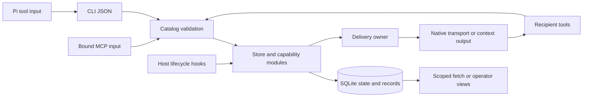

# Communication runtime

CLI, MCP, hooks and host adapters share one Python store and SQLite protocol. The npm package adds a Node launcher (`bin/`, `dist/`) to the Python runtime in `scripts/`; portable archives ship only `OPERATING.md` and `scripts/`. The companion skill in the repository's `skills/` folder carries guidance and routes operations to the npm CLI.

## Boundaries and owners

CLI and MCP converge at `Store.call`; MCP does not execute the CLI dispatcher.
Pi bound tools launch the CLI. Host hooks also use lifecycle and delivery methods directly.

| Owner | Responsibility and contract |
| --- | --- |
| `catalog.json`, `catalog.py`, `validation.py` | Command inputs, record payload schemas, tool profiles, discovery, and validation |
| `protocols.py` | Message kinds named after known protocols: cross-reference checks the schema cannot state (check-back, decision options, handoff leases, pinned `document:` evidence, RACI informed) and body rendering from the catalog slots |
| `cli.py`, `mcp.py` | Bounded ingress, command routing, output framing, and bound MCP identity; managed MCP owns its lifecycle |
| `store.py` and capability modules | Workspace/identity checks, current state, messaging, leases, documents, health, and scoped history |
| `schema.sql`, `database.py` | Storage identity/fingerprint, transactions, constraints, indexes, and atomic event triggers |
| `registry.py` | Per-process registry entry for a non-default `--database`, which the Pi extension reads ([format](scripts/docs/DB.md#active-database-registry)) |
| `records.py` | Unified envelopes, visibility, indexed filters, fixed-ceiling pagination, and generic memory/event writes |
| `dispatch.py`, `transport.py` | Attempt tokens and delivery ownership; native I/O and transport-specific receipts |
| `proxy.py` | Requested worker lifecycle and host process supervision |
| `host_hooks.py`, Pi modules, `hooks/` | Host events, context budgets, durable Pi receipts, and optional structured-edit admission |
| `view.py`, `view_data.py`, `dashboard/` | Local read-only operator views and bundled UI; no frontend build |

`catalog.json` owns public field definitions; `catalog.py` owns the tool profile presets. `schema.sql` owns persisted structure and invariants.
Discovery combines these sources; no interface maintains a second command or record schema.
`src/build.mjs` refreshes `scripts/octocode_config.py` from the config package and generates `communication/_version.py` from `package.json`. CLI and MCP version reporting use that release version.

## Three representative flows

### Request and final reply

`CLI/MCP input → catalog validation → kind → protocols.message_slots → Store.send → one write transaction → message, recipients, and record triggers → send receipt`.

The kind field fixes reply policy and wake. The transaction validates live sender identity, repository coordination scope, routing, idempotency key, and the kind's cross-references, and stores the slots with the rendered body.
`complete` with `outcome` and a BLUF `reply` creates the correlated final answer and parent acknowledgement atomically; in the same transaction it enforces a requested check-back, delivers copies to RACI informed peers, and moves handed-off leases.
FYI completion acknowledges received IDs without creating a reply. A failed transition rolls back.

### Delivery and handling

`delivery owner → prepare → stage/token commit → host I/O → submitted or uncertain receipt → recipient complete`.

External I/O occurs outside the staging transaction. One-time submission and recipient acknowledgement are separate states.
Ambiguous/staged attempts require inspected recovery; expiry or restart does not authorize replay.
Hooks emit full envelopes or fetch references within the host budget. Deferred rows remain eligible for later events.
Pi reconciles receipt tokens with its durable host ledger before confirmation.

### Scoped history and operator audit

`bound fetch → read snapshot → repository/participant visibility → indexed query → resolved envelope → executable continuation`.

Message bodies live once in immutable `messages`; `records.py` resolves them into `data`.
The append-only `records` stream uses `{recordId,path,from,to,type,timestamp,branch?,data}`.
Operational tables enforce current presence, leases, recipients, replies, and attempts; hot inbox checks require no event replay.
FTS5 is derived searchable content. Generic JSON nulls remain intact; shared records retain `to:null`.
Participant fetch and workspace-wide operator dashboards/exports have different visibility boundaries.

## Preservation and compatibility

Peer discovery, messages, documents and shared records use the repository `coordinationScope`; leases, Git activity and native receiver checks use the actual worktree ([scope rules](scripts/docs/DB.md#identity-and-discovery)).

Session IDs route cooperating same-user processes; they are not credentials or filesystem isolation. `peers`, message senders and lease owners show exact IDs, and a CLI caller supplies its own `--session`, so any process that holds a peer's ID acts as that peer. A per-session secret would sit beside the ID: the database file, `db export` and process arguments are readable by the same OS user, so it would add no boundary and would need every host, hook and the Pi lease reader to carry it. The boundaries that hold are pinned by `tests/identity-trust.test.mjs`: no tool input names the acting session (bound MCP and Pi tools fix it at launch), an ID acts only in its own workspace and only while live, and native receipt and write checks compare the host session. Isolation between mutually distrusting agents needs separate OS users or databases.
Leases use canonical paths and frozen Unicode case folding. They are advisory; guards cover only reported operations.

The runtime opens only the exact current schema fingerprint and leaves any other database unchanged ([database identity](scripts/docs/DB.md#identity-and-discovery)).

## Documentation and verification

[README.md](README.md#documentation-map) maps every guide to its reader. [OPERATING.md](OPERATING.md) is the runtime operating guide: `skill` returns it and managed workers receive it, so edit it there only. `db protocol` serves [DB.md](scripts/docs/DB.md) verbatim.

The package manifest owns build, syntax, link, regression, smoke and packing commands. `src/pack-runtime.mjs` verifies the extracted archive; `src/release-smoke.mjs` exercises real CLI/MCP replies, leases, export and restore. Crash tests exercise real transaction and process boundaries; the opt-in `src/live-concurrency.mjs` soak keeps real Pi, Claude and Codex sessions across request waves ([operations](scripts/docs/OPERATIONS.md#verify-concurrent-native-workers)). Checks prove their named paths on the local platform, not arbitrary vendor versions or OS isolation.

## npm interfaces

The default npm executable serves MCP stdio; the `/cli` route and `./cli` subpath use `octocode-mcp-cli` (bundled at build time, not a published dependency) for validation, typed flags and help. Both launch the same Python runtime. The full 18-tool `tools/list` stays within 20 KiB including field descriptions (`tests/tool-selection.test.mjs`); profiles reduce it further.
