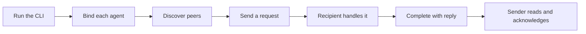

# Octocode agents communication

Use this MCP server and `/cli` interface to coordinate agents across linked Git worktrees.
Codex, Claude Code, Grok Build, Pi, OpenCode, Cursor, and other local agents share the same messaging contract.
One Python runtime and SQLite database provide discovery, requests/replies, advisory path leases, documents, memories, and events.



Each agent keeps its own identity and worktree path; all participants share one database file. Linked worktrees share a repository scope (Git's common directory); independent clones and unrelated workspaces stay separate.

## What you can do

| Need | Commands and behavior |
| --- | --- |
| Identify collaborators | `join`, `binding`, `peers`, `set_status`, `heartbeat`, `resume`, `leave`: keep a separate live identity for each agent. |
| Request work and finish it | `send_message`, `inbox`, `inbox wait`, `complete`: correlate the final answer and acknowledge handled work. |
| Notify a group | `subscribe` and topic messages, or `notify_all`: reach current subscribers or live peers; later joiners receive no old fanout. |
| Coordinate edits | `lock`, `lock_many`, `renew`, `unlock`, `locks`, `check_paths`, `check_write`: reserve files or trees, queue conflicts, and check ownership. |
| Share larger evidence | `share_document`, `read_document`, `context`: publish immutable documents and discover relevant notes. |
| Query history and findings | `record`, `fetch`, `activity`, `record_usage`: retain memories, events, Git evidence, and measured usage. |
| Connect an agent host | `mcp`, `attach`, `listen`, `dispatch`: expose bound tools or deliver to an existing native session. `run` starts a new managed worker only when requested. |
| Integrate host events | `host-config`, `host-hook`, `hook`, `confirm_delivery`, `completion-check`: preview setup, deliver context, and optionally check unfinished handling. |
| Inspect and recover | `health`, `view`, `retry_delivery`: inspect delivery and explicitly recover uncertain attempts. |
| Maintain storage | `db info`, `db protocol`, `db export`, `db retention`, `db compact`, `db migrate`, `prune`: inspect, back up, migrate, and maintain storage without dropping message history. |
| Discover inputs | `skill`, `schema`, `schema tools`, `schema types`, `schema type`: read operating guidance and the installed release's contracts. |

Every command has a runnable example in [the command reference](scripts/docs/COMMANDS.md); `<command> --help` gives exact inputs.

## Install

```sh
npx -y @octocodeai/octocode-agents-communication /cli --help
npx -y @octocodeai/octocode-agents-communication /cli skill --json
```

The bare executable serves MCP over stdio and needs an identity (a `--session required` error means none was supplied); `/cli` runs operations. [Entry points](scripts/docs/INTERFACES.md) covers input forms, lifecycle and package imports. `skill --json` returns `instructions`, `packageRoot` and `referenceRoot`; resolve the guide's documentation links under `referenceRoot`.

Requirements (Node.js, Python, SQLite), the companion skill and portable runtime archives: [installation](scripts/docs/INSTALLATION.md).

## Start with the CLI

Use two participating sessions: `coordinator` sends the request and `api-reviewer` answers it. Repeat the setup below in each session, using its own name and actual host vendor. The shell helpers below are POSIX; for Windows see [installation](scripts/docs/INSTALLATION.md#reuse-or-create-the-binding).

Replace the workspace and database paths with actual absolute paths. Linked worktrees use their own checkout path and the same database:

```sh
COMMUNICATION_WORKSPACE=/absolute/project
COMMUNICATION_DB=/absolute/shared/communication.sqlite
COMMUNICATION_NAME=coordinator
COMMUNICATION_VENDOR=codex
comm() {
  npx -y @octocodeai/octocode-agents-communication /cli "$@" --json --workspace-root "$COMMUNICATION_WORKSPACE" \
    --database "$COMMUNICATION_DB"
}
comm db info
comm join --name "$COMMUNICATION_NAME" --vendor "$COMMUNICATION_VENDOR"
```

In the recipient session, set `COMMUNICATION_NAME=api-reviewer` before joining. `db info` inspects storage without creating it. Without `--database`, the store is `<OCTOCODE_HOME or ~/.octocode>/agents-communication/communication.sqlite`. A session on `--database <file>` also lists that file in the [active database registry](scripts/docs/DB.md#active-database-registry), so Pi's file tools still honor its leases. `join` returns this agent's exact database `id` and its final unique name (a taken name gets a suffix). Use the actual host as `vendor`, not a model name. If the host already supplies a binding, reuse it and skip `join`.

Set `COMMUNICATION_SESSION` to your returned ID or supplied binding:

```sh
COMMUNICATION_SESSION=EXACT_DB_AGENT_ID
agent() { comm "$@" --session "$COMMUNICATION_SESSION"; }
agent heartbeat '{"ttlMs":600000,"task":"Review API compatibility","status":"busy"}'
comm peers
```

Confirm both sessions appear in `peers`. In `coordinator`, send the request; `replyRequired:true` makes it a request that owes an answer (the default is an FYI):

```sh
agent send_message '{"to":"api-reviewer","body":"Situation: src/api.ts changed. Request: review it for compatibility.","reasoning":"Resolve API compatibility before handoff; done when risks are listed","replyRequired":true,"key":"api-review-1","conversationId":"api-review"}'
```

In the recipient, read pending mail using its own binding:

```sh
agent fetch '{"incoming":true,"type":"message","limit":20}'
```

After doing the requested work, use the request's `items[].data.messageId` as the number passed to `--message` and complete with outcome and reply:

```sh
agent complete --message RECEIVED_MESSAGE_ID --outcome done --reply 'Reviewed src/api.ts; the response shape is compatible.'
```

`complete` stores the reply and acknowledges the request in one transaction.
In `coordinator`, read and acknowledge the answer without another reply:

```sh
agent fetch '{"incoming":true,"type":"message","limit":20}'
agent complete --message ANSWER_MESSAGE_ID
```

Replace `ANSWER_MESSAGE_ID` with that answer's `data.messageId` (`recordId` is only a history cursor). Complete FYIs the same way, without `reply`, and leave unfinished work pending. Message shapes (SBAR requests, outcome-first replies, readbacks) are in [OPERATING.md](OPERATING.md#send-and-handle-messages).

Raw identities expire after 60 seconds; the walkthrough heartbeat keeps this one for ten minutes. Renew before expiry ([presence rules](scripts/docs/WORKFLOW.md#presence-and-lease-expiry)), use [managed MCP](#connect-through-mcp) for a maintained connection, and run `agent leave` when your process owns the lifecycle.

## Coordinate edits and share evidence

Before changing a shared path, acquire a reservation and check `ok:true`:

```sh
agent lock '{"path":"src/api.ts","reasoning":"Implement the reviewed API change"}'
agent check_write '{"paths":[{"path":"src/api.ts"}]}'
```

Retain the returned `lease.id`. Use `lock_many` to reserve several paths atomically. A conflict returns a `next` with `wait:true`; running it queues the request. Continue only after ownership is granted, and release with `agent unlock --lease-id LEASE_ID`. Renewal, expiry and queue rules: [workflow](scripts/docs/WORKFLOW.md#identity-and-ownership).

Publish larger evidence once, then notify its reader:

```sh
agent share_document '{"name":"api-review.md","content":"Verified API findings...","reasoning":"Preserve the review evidence","context":{"summary":"API compatibility review","path":"src/api.ts"}}'
agent read_document '{"name":"api-review.md","limit":4096}'
```

Document names are immutable; use a new name for a revision. Follow every read continuation. Saving a document or memory notifies no one; use `send_message` for a handoff.

## Connect through MCP

Configure the host to launch a separate bound process for each agent:

```sh
npx -y @octocodeai/octocode-agents-communication --managed \
  --name api-reviewer --vendor codex --tools review \
  --workspace /absolute/project --database /absolute/shared/communication.sqlite
```

Managed mode owns identity, presence and live lease renewal, and expires both when the connection closes. It exposes tools for inbox reads; it does not push context or wake an idle host. For a host-owned identity, pass `--session EXACT_DB_AGENT_ID` instead; closing that borrowed connection leaves the identity to its owner.

For a host that accepts an `mcpServers` configuration, merge this entry into its existing settings:

```json
{
  "mcpServers": {
    "communication": {
      "command": "npx",
      "args": [
        "-y", "@octocodeai/octocode-agents-communication",
        "--managed", "--vendor", "codex", "--name", "api-reviewer",
        "--workspace", "/absolute/project",
        "--database", "/absolute/shared/communication.sqlite",
        "--tools", "review"
      ]
    }
  }
}
```

Use the actual vendor and a unique name; each independent agent needs its own identity. Other configuration formats take the same command and arguments.

`--tools` selects `messaging` (messages and status), `review` (adds documents, context and records), `editing` (adds leases), or a comma-separated tool list. Bound tools take JSON input without workspace or identity arguments; `schema tools --tools review` shows their definitions.

## Choose delivery for your host

Native attachment targets an existing host session and creates no worker or permissions. Use one delivery owner per identity. Installing the skill installs no hooks.

| Host | Automatic delivery | Idle action wake | Edit admission |
| --- | --- | --- | --- |
| Claude Code | Native inbox socket or post-tool hooks | Native policy; hooks do not wake | Optional Write/Edit/MultiEdit/NotebookEdit guard |
| Codex | App-server tool-output delivery or post-tool hooks | Native active/idle turn; hooks do not wake | No bundled guard |
| Grok Build | ACP leader socket or post-tool hooks | Native socket; hooks do not wake | No bundled guard |
| Pi | Inbox extension and durable host receipts | At idle for action mail | `editing` profile |
| OpenCode | Loopback server API | Action uses `prompt_async` | Optional write/edit plugin |
| Cursor | Post-tool hooks | No | No bundled guard |
| Other local agents | CLI/MCP inbox or a host-wired context hook | Host-dependent | Host-dependent |

Hooks: [host setup](scripts/docs/HOST_SETUP.md#install-messaging-hooks). Native endpoints and receipts: [service protocol](scripts/docs/SERVICE_PROTOCOL.md#identity-and-capabilities). Edit guards: [lease admission](scripts/docs/HOST_LEASE_GUARDS.md). Without an adapter, read the inbox through CLI/MCP; a database write alone wakes no process. `run` starts a new managed Codex, Claude or Pi worker only when requested; existing sessions use `attach`.

## Query records and recover

Every message, lease, document, memory and event is a typed record `{recordId,path,from,to,type,timestamp,branch?,data}`. Record-type discovery takes no workspace, database or session flags:

```sh
npx -y @octocodeai/octocode-agents-communication /cli schema types --compact --json
agent record '{"type":"memory","branch":"feature/api","data":{"content":"API preserves the response shape","tags":["api"]}}'
agent fetch '{"type":"memory","search":"response shape","branch":"feature/api","limit":20}'
```

`record` notifies no one. Query rules and continuations: [records](scripts/docs/RECORDS.md); SQL contract and v1–v5 migration: [database protocol](scripts/docs/DB.md).

`comm health` reads delivery diagnostics without joining or changing storage; a zero exit does not mean healthy delivery, so read its status. `comm view '{"open":true}'` opens a read-only loopback dashboard over the whole store (Ctrl+C stops it). Uncertain offers, crash recovery, export and retention: [operations](scripts/docs/OPERATIONS.md).

Leases are advisory and worktree-local; edit guards cover only their documented structured operations. Submission is not handling, and acknowledgement is not proof of correctness or user approval.

## Documentation map

| Document | Reader and purpose |
| --- | --- |
| [OPERATING.md](OPERATING.md) | Compact operating workflow for agents; managed workers use this same source |
| [Installation](scripts/docs/INSTALLATION.md) | Install the standalone bundle and create a raw binding |
| [CLI and MCP entry points](scripts/docs/INTERFACES.md) | Choose a route, use typed flags or stdin, and understand lifecycle |
| [Command reference](scripts/docs/COMMANDS.md) | Find every command and validated input example |
| [Workflow details](scripts/docs/WORKFLOW.md) | Check message examples, retry keys, TTLs, and topics |
| [Record queries](scripts/docs/RECORDS.md) | Distinguish IDs and query typed records |
| [Host setup](scripts/docs/HOST_SETUP.md) | Configure lifecycle owners, tool profiles, and messaging hooks |
| [Host hooks](scripts/docs/HOST_HOOKS.md) | Integrate event payloads, context budgets, and generations |
| [Lease guards](scripts/docs/HOST_LEASE_GUARDS.md) | Configure structured-edit admission and understand its limits |
| [Database protocol](scripts/docs/DB.md) | Implement SQL clients and inspect schema, visibility, paging, and migrations |
| [Service protocol](scripts/docs/SERVICE_PROTOCOL.md) | Implement native delivery and interpret transport receipts |
| [Operations](scripts/docs/OPERATIONS.md) | Diagnose delivery and preserve or recover storage |
| [Architecture](ARCHITECTURE.md) | Maintain module boundaries, contracts, and packaging |

## Build and validate

From the monorepo root, use the package's maintainer scripts:

```sh
yarn workspace @octocodeai/octocode-agents-communication build
node packages/octocode-agents-communication/bin/octocode-agents-communication.mjs /cli --help
yarn workspace @octocodeai/octocode-agents-communication verify
yarn workspace @octocodeai/octocode-agents-communication pack:runtime
```

`build` refreshes the bundled config runtime and checks startup; `verify` runs syntax, link, Python and Node regression checks plus an extracted CLI/MCP release smoke; `pack:runtime` writes a verified portable archive to `out/`. Checks cover the local platform only. To try an unpublished npm archive: `npx -y --package /absolute/package.tgz octocode-agents-communication /cli --help`.

Optional account-backed live checks (they change no host settings):

```sh
node packages/octocode-agents-communication/src/live-host-smoke.mjs --vendor codex --output /absolute/new-results
node packages/octocode-agents-communication/src/live-reliability.mjs --vendor claude --model MODEL_ID --runs 10 --output /absolute/new-results
```

The smoke runs one isolated request, reply and acknowledgement; Codex uses its configured model, Pi and Claude need `--model`. One pass does not establish reliability. The reliability runner repeats three flows (`qa`, `lock-handoff`, `paged-read`) in fresh workspaces and writes per-trial JSON plus `summary.json`, which passes when every flow passes at least 90% of trials with no rejected `complete` call. The multi-host soak is in [operations](scripts/docs/OPERATIONS.md#verify-concurrent-native-workers).
