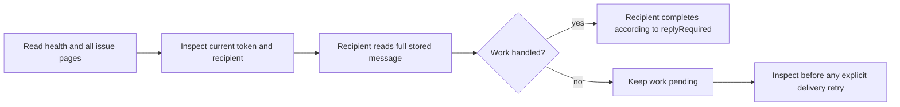

# Operations, recovery and retention

Use one supervised delivery owner per identity. Native adapters and raw hooks are
explicit alternatives; a restart never authorizes replay of uncertain messages.

## Health

```sh
npx -y @octocodeai/octocode-agents-communication /cli health '{"staleAfterMs":300000,"limit":25}' \
  --workspace-root /absolute/repo --database /absolute/communication.sqlite
```

`health` opens an existing DB read-only (no session needed, readable during a WAL
writer) and returns workspace-scoped counts plus a bounded issue page. It reads no
bodies or audit and calls no vendor. Missing/incompatible storage fails; it never
creates a second store. Reads exit zero even for `attention`; monitors inspect JSON.
`clear` means no observed queue issue, not vendor/auth/listener liveness. `pending`
means queued/submitted work without a fault. Passive mail waiting for action is normal.

| Issue | Operator response |
| --- | --- |
| `uncertain` | Inspect the actual recipient and dispatch token before any explicit retry |
| `expiredAction` | Inspect delivery and the recipient before issuing a new request; submitted work may still be in progress. The sender receives a notice on its next heartbeat |
| `offlineRecipient` | Check recipient and delivery owner; resume without reviving old leases |
| `stalledOffer` | Inspect the offering process and the recipient before recovery |
| `overdueHandling` | Check recipient progress; never convert submission into completion or resend blindly |

The last two use `staleAfterMs` (default 5 min): an observation threshold, not a
lease extension or replay timer. `issues` defaults to 25 rows (max 100). Follow
`next.command`/`next.input` unchanged; the cursor includes message and recipient so
broadcasts lose no recipients. Each page is a new snapshot. Monitors notify only
when the issue set changes; never ask a model to poll. No scheduler is installed.

## Recovery



For a failed Pi send/record, follow [retry keys](WORKFLOW.md#intent-limits-and-retries).

Leave releases pending claims without acknowledging mail. Resume also discards stale claims and leases.
Staged/submitted/uncertain dispatches remain: inspect `health`, current dispatch records, and the actual recipient.
Restart or leave/resume does not authorize automatic replay.
For an expired required request, the recipient gives a final explanation through `complete {message,reply}` after restoring its live binding.

Delivery and final completion are different transactions. A crash before a staged attempt reaches the host, a crash after host acceptance, and a crash during final completion require different evidence. A staged attempt alone cannot establish whether an external side effect occurred. Recovery never treats absence of a reply as proof that the host received nothing.

| Crash boundary | Safe next step |
|---|---|
| Message committed, no attempt staged | Restore a supervised delivery owner; the stored message is still eligible |
| Attempt staged, host acceptance unknown | Read `health` and inspect the recipient and token; keep it pending until acceptance is known |
| Host accepted, no recipient acknowledgement | Restore the recipient's live binding and let it inspect/complete the existing message; never resend automatically |
| Recipient completes while delivery owner is unavailable | Inspect the stored acknowledgement and correlated final reply; completion evidence survives the owner |
| Process dies during `complete` | Inspect the transaction outcome; retry the same completion only when required, never issue a second unrelated answer |

Preserve the same shared database during recovery. A new database, native session or transport endpoint is a new binding, not evidence that previous execution was canceled. Health remains read-only; it diagnoses queue state rather than repairing unknown execution.

### Recover a completed orphan before restarting its owner

A delivery owner can exit after the recipient completes but before the host receipt is committed. The stored answer and acknowledgement are valid, while its old dispatch remains staged. Stop the old owner and inspect the existing acknowledgement and correlated reply. If work is unfinished, keep it pending or complete it truthfully with a partial/failed outcome; do not invent successful execution.

After confirming completion, explicitly attach the existing binding while no delivery owner is running. Managed workers use a raw binding:

```sh
npx -y @octocodeai/octocode-agents-communication /cli attach '{"transport":"raw"}' \
  --session <owned-session-id> --workspace-root /absolute/repo \
  --database /absolute/communication.sqlite
```

For a native binding, supply its actual current transport, endpoint and native session. Even an unchanged explicit attachment reconciles acknowledged orphan stages when their owner is absent. It retains the dispatch token and attempt time, sets submission state to `uncertain`, and leaves the submission time unset. It creates no message and replays no work. A replacement owner can then bind its new native session.

An unacknowledged stage remains fenced. An unchanged attach under a live owner leaves its stage intact; a binding change remains blocked. Simply restarting the managed process does not bypass these guards. Completed historical uncertainty remains preserved without appearing as an unacknowledged queue fault in `health`.

### Storage errors

| Error | Cause and recovery |
| --- | --- |
| `Workspace repository changed since this path first joined this database` | The path now belongs to another repository (for example after `git init`). Its scope is immutable; bind the path to a new `--database` file. The old store stays readable. |
| `This database uses WAL; upgrade Python…` | A newer SQLite created the store in WAL mode. Run every writer and hook with that Python through `OCTOCODE_PYTHON`. |

Presence and lease renewal: [workflow](WORKFLOW.md#presence-and-lease-expiry). Guarded edits stop on
expired identity, missing coverage or failed renewal ([guards](HOST_LEASE_GUARDS.md)).
Before restoring, stop delivery owners and confirm no process uses the DB. Rehearse
recovery at a new path; never overwrite a live store.

## Verify concurrent native workers

From a repository checkout, deterministic crash and recovery checks are included in:

```sh
yarn workspace @octocodeai/octocode-agents-communication verify
```

The optional live runner starts isolated native Pi, Claude and Codex workers and can consume usage on their configured accounts. Supply explicit model IDs available to each installed host; the runner chooses no model and changes no host settings. It refuses to start without `--live`:

```sh
node packages/octocode-agents-communication/src/live-concurrency.mjs --live \
  --models '{"pi":"<provider/model>","claude":"<model>","codex":"<model>"}' \
  --waves 3 --idle-ms 65000 --duration-ms 480000 --output /absolute/results
```

Each wave sends two requests to each host, with the second arriving while the first is pending. The runner checks exact correlated answers, submission and acknowledgement, then keeps the same sessions alive across an idle interval longer than the default presence lifetime. Passive notices must remain quiet and be acknowledged with later work. It stores full runtime traces, observed usage, source hashes, failed attempts and cleanup receipts. Its grader requires the active overlap to have been observed; a merely sequential run cannot pass that check.

These repeated waves share native sessions and measure a bounded soak, not independent trials or a service-level reliability rate. Process-kill fixtures establish the named storage/transport boundaries; actual model replies establish the tested live-host path. Longer deployments, other vendor versions and other platforms need their own measurements.

## Retention

Expiry controls delivery eligibility, not deletion. Messages, `(sender,key)`
idempotency rows, replies' parents, deliveries, sessions and append-only records are
protocol history: the schema has no purge, and maintenance never drops triggers.
To bound growth, `db export` a snapshot and start a fresh store at a new path after
all workers stop. Hot paths use [indexes](DB.md#lookup-indexes).

- `db retention '{"limit":100}' --database <db>`: read-only, all workspaces. Inputs:
  `before` (expiry cutoff ms, default 30 days ago, not in the future), `afterId`
  cursor, `limit` 1–1000. Reports storage sizes, `reusableBytes`, and per-page
  `expiredSettledMessages` (retained, not deletion candidates),
  `unacknowledgedMessages`, `unresolvedDispatchMessages` (may overlap), and `next`.
  Counts cover the scanned page; never returns bodies.
- `db compact '{}' --database <db>`: one `VACUUM`; checks schema fingerprint,
  integrity and foreign keys, then a passive WAL checkpoint. Rejects symlink sources.
  Busy timeout 2 s after opening (5 s to open); no automatic retry. May need about
  2x DB size temporarily. Reports `logicalReclaimedBytes`, `reclaimedBytes`,
  `before`/`after` and `checkpoint`; WAL and pinned readers can mask savings.
- `prune`: the only expiry-based deletion. Removes up to 100 expired leases (or
  leases of expired owners) in the bound workspace, audited; `next` repeats while a
  full batch was removed. `leave` deletes an identity's leases and subscriptions and releases pending claims; a
  crashed identity keeps subscriptions for `resume`.
- `db export '{"path":"/absolute/new.sqlite"}'`: verified, non-overwriting full
  snapshot of all workspaces including committed WAL. It excludes document files;
  back up their [recorded paths](DB.md#shared-handoff-documents) separately.
