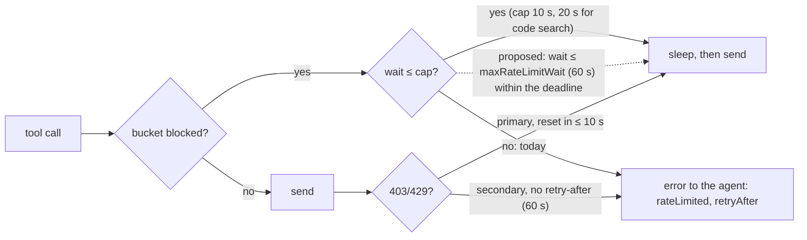
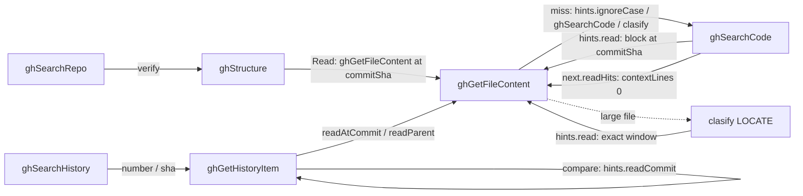

# Octocode v20 MCP vs gh-lean — 2026-10-09 (30 × 1)

## Verdict

**Correctness is tied, gh-lean is leaner, and time is a near tie.**

- **Correctness:** the blind judge scored Octocode 8.8 and gh-lean 9.2, both 9 in whole points.
  Octocode was more correct on 7 questions, gh-lean on 13, and 10 were the same (sign test
  p = 0.26, a tie).
- **Characters:** gh-lean is an agent driving `gh` with `--json/--jq/--limit` and
  `grep -n`/`sed -n` windows. It used **0.71× Octocode's characters** (per-question geometric
  mean, 95% CI 0.58–0.85; leaner on 24 of 30 questions).
- **Time:** gh-lean took 1.08× as long (CI 0.97–1.21).
- **Calls:** Octocode needed fewer calls (80 vs 142) and fewer turns.

Octocode's losses come from four fixable causes, in order of size:

1. **Wide reads:** Octocode reads back about 1.9× more text (248k vs 134k characters). File
   reads are the bulk: whole files, 50–400-line ranges and 12–75 context lines, where gh-lean
   grepped for the lines it needed (median 382 characters) and then cut a window. Octocode
   already has that grep mode (`contextLines:0`, checked live in section 4); agents just
   aren't told.
2. **Unprojected history reads:** compare, PR and commit reads return everything (median 3.7k,
   max 18k). gh-lean projected one field with `--jq` (median 40 characters).
3. **Rate limits fail fast:** any GitHub limit over 10 s (20 s for the code-search window)
   becomes an error. With three parallel agents, the first MCP batch had 17 rate-limit
   failures and 5 of 30 runs were starved. On two of them *every* call failed and the agent
   answered without evidence. Those runs were rerun one at a time.
4. **No structured read for JSON:** a `matchString` window on package.json hides which section
   a line belongs to. Q14 scored 4/10 for calling a `devDependencies` entry a dependency, where
   gh-lean's `--jq` projection was exact.

The first five changes in sections 5–6 should close most of the 29% gap without losing
Octocode's call and turn advantage.

## What ran

| | |
|---|---|
| Arms | `mcp`: Octocode MCP, local build, clasify off, its server instructions as the only primer · `gh-lean`: read-only `gh` plus `grep`/`sed -n`/`head`/`jq` filters, brief `compare/arms/gh-lean.md` |
| Agents | `claude -p --model claude-sonnet-5-5`, one fresh process per question; no settings, CLAUDE.md, skills or memory; empty working directory |
| Judge | gpt-5.5 via pi, blind X/Y (seeded order, tool names redacted), ground truth rebuilt with read-only `gh` |
| Measurement | Characters from each agent's transcript: tool calls written, tool results read, and the final answer. Time from `result.json` (wall clock and model time) |
| Build | Repo HEAD `3a612899d` plus the uncommitted tree. Native addon pinned at `6c800b84…`. MCP bundle `dd8eaadd…` at campaign start; another session rebuilt it during the day, so the 5 serial reruns may have used the newer bundle (`61d4dfdb…`) |

## Results

| | Octocode v20 MCP | gh-lean |
|---|---:|---:|
| Correctness (mean, whole points) | 8.8 (9) | 9.2 (9) |
| More correct on (same on 10) | 7 | 13 |
| Median characters per question | 8,168 | 6,068 |
| Characters, gh-lean ÷ Octocode (geo mean) | | **0.71×** (0.58–0.85) |
| Median seconds per question | 16.5 | 19.4 |
| Mean seconds: model + tools | 13.9 + 3.0 | 15.2 + 3.1 |
| Tool calls / failed | 80 / 3 | 142 / 3 |
| Cost (Sonnet only) | $2.61 | $2.49 |

### Workflow ratings

Ratios are gh-lean ÷ Octocode per question (geometric mean). For characters, below 1× means
gh-lean used fewer. For time, above 1× means gh-lean took longer.

| Workflow (questions) | Chars gh-lean÷Octocode | Time gh-lean÷Octocode | Correctness Octocode / gh-lean | Rating | Main issue |
|---|---:|---:|---|---:|---|
| Code lookup (Q1, 8, 9, 12, 19, 20, 24) | 0.79× | 1.10× | 9.6 / 9.6 | **8** | Context windows wider than the answer; otherwise the best workflow |
| History: PR, issue, commit, compare (Q3, 5, 13, 15, 22, 25) | 0.69× | 1.19× | 9.3 / 9.2 | **7** | Strongest answers (Q3, Q5, Q13 10/10) but unprojected reads (Q22: 13.5k vs 1.5k read) |
| Discovery and docs (Q2, 26, 27, 29, 30) | 0.71× | 0.90× | 8.2 / 8.6 | **6** | Wide pages to confirm single facts (Q2: a 10-repo page plus all refs, 5.1k, vs one projected lookup, 0.1k); Q29/Q30 left parts Unknown even after the serial rerun |
| Multi-file flow trace (Q4, 6, 11, 17, 21, 23, 28) | **0.57×** | 0.94× | 8.6 / 8.6 | **6** | Biggest character gap: a 20k whole-file read and a 17k range read (Q21: 53.6k vs 11.0k read) |
| Config / package.json (Q7, 10, 14, 16, 18) | 0.84× | 1.40× | **8.0 / 10.0** | **5** | Only workflow where Octocode is less correct: section membership is lost in windows |

### Tool ratings

"Description" is the description review's 1–10 score for how well the text leads an agent to
the leanest correct read. "Overall" also weighs measured behavior.

| Tool | Calls | Chars read | Median per call | Description | Overall | What hurts |
|---|---:|---:|---:|---:|---:|---|
| `ghGetFileContent` | 41 | 136,971 | 1,997 | 5 | **5** | Whole files and wide ranges look as cheap as narrow reads; the grep-only mode (`contextLines:0`) exists but nothing tells agents; no JSON projection; `ranges` format hidden from the published schema |
| `ghGetHistoryItem` | 10 | 60,322 | 3,690 | 6 | **6** | Powerful and accurate, but heavy by default: compare 9k with no sections, patches 18k from directory globs; `patchRanges` unpublished |
| `ghSearchCode` | 22 | 38,076 | 756 | 7 | **7** | Hit lines often answer, but the description sends agents straight to a file read; `concise` unpublished; fan-out burns the 10-per-minute code-search limit |
| `ghStructure` | 4 | 4,223 | 1,092 | 7 | **7** | Lean. Used through `refs` (1.9k) only to turn a branch into a SHA; gh-lean did that in 40 characters |
| `ghSearchHistory` | 1 | 4,727 | 4,727 | 7 | **7** | Page size 30 by default; `concise` unpublished |
| `ghSearchRepo` | 2 | 3,829 | 1,914 | 7 | **6** | A 10-repo page (3.1k) to confirm one repository's language and default branch |
| GitHub throttling layer | n/a | n/a | n/a | n/a | **5** | Ahead of octokit on detection and sharing, but its fail-fast cap starved 5 of 30 runs in the first batch |

## 1. Throttling and retries vs octokit/plugin-throttling

**Short version:** Octocode's limiter is more capable than octokit's, but it gives up much
sooner. Octokit's `onRateLimit` handler can wait out the whole limit with no cap. Octocode
returns an error once a wait passes 10 s, or 20 s for the code-search window. GitHub's
`code_search` limit is 10 requests a minute, so most waits there run 20–60 s. Three agents
sharing one token hit that wall.

| Behavior | plugin-throttling | Octocode | Gap |
|---|---|---|---|
| Groups | global 10; auth 1; search 1 per 2 s; write 1 per 1 s; notifications 1 per 3 s (`src/index.ts:28-55`) | global 10; search, code_search, graphql, write, auth 1 each; plus a `code_search` 10-per-minute window (`github/src/budget.rs:122-136`) | Parity, plus a code-search lane |
| Detection | `x-ratelimit-remaining: 0`; secondary by message text (`index.ts:163, 181-187`) | Same, plus 429 and 403-with-retry-after; learns every bucket from headers and blocks before sending (`budget/classify.rs:19-39`, `budget.rs:586`) | Octocode ahead |
| Wait or fail | The handler decides; returning `true` sleeps until reset with no cap (`index.ts:213-216`) | Retries only if the wait is ≤ 10 s and within the deadline (`transport.rs:32-34` says so, `:561-565`) | **Main gap** |
| Secondary limit without retry-after | Waits 60 s if the handler agrees | 60 s is over the cap, so never retried; it also counts toward the circuit breaker (`transport.rs:527-529`) | Always surfaces |
| Across processes | Redis connection (README) | JSON file under `~/.octocode/tmp/ratelimit`, merged under a lock (`budget/persist.rs:152`) | No Redis needed, but reserving a slot happens **outside** the lock (`budget.rs:453, 492-549`), so processes can take the same slot; this caused the raw 403 |
| Configuration | `onRateLimit` / `onSecondaryRateLimit` handlers | Only `network.maxRetries` and `network.timeout`; no wait setting | No knob |

What the agents saw:

- `GitHub code search window is full; request not sent.` (`budget.rs:518-523`)
- `GitHub API rate limit exhausted; request not sent until the limit resets.` (`budget.rs:272-273`;
  the gate at `:460` uses the 10 s cap, not 20 s)
- GitHub's raw `API rate limit exceeded for user ID…` (`transport.rs:501, 506-525`, which keeps
  GitHub's text)

On Q30 the agent re-sent the same failing call three times, so the `retryAfter` metadata isn't
steering it either.

**Fixes, ranked:**

1. **Separate rate-limit waits from the request timeout.** Add `network.maxRateLimitWait`
   (default about 60 s, one code-search window) and use it in place of the 10 s cap for primary
   limits, secondary limits and the code-search window (`transport.rs:41-48, 561-565`;
   `budget.rs:130, 460, 513-518`; `runtime/src/runtime/github.rs:156-159, 253-255`). Most of the
   17 rate-limit failures in the first MCP batch become 20–60 s waits. Check the MCP host's
   tool-call timeout first.
2. **Reserve slots atomically across processes:** re-read the shared state and take the slot
   inside the file lock (`budget.rs:453, 492-549`; `persist.rs:131-152`). This removes the
   overrun behind the raw 403.
3. **Use one code-search cap:** the pre-send gate uses 10 s while the window allows 20 s
   (`budget.rs:460` vs `:514`).
4. **Retry a secondary limit once.** Octokit's handler allows it, though its README example
   retries only primary limits. Count one burst as a single circuit failure
   (`transport.rs:528, 545`).
5. **Give the agent one consistent rate-limit message** with the wait in plain words ("retry in
   40 s; meanwhile read known paths"), keeping GitHub's text as detail (`transport.rs:506-525`).
6. **Spend fewer code searches:** a 5-query batch plus up to 5 `extensions` is up to 25 searches
   against a 10-per-minute limit. Run extensions as one OR query where GitHub allows it, or count
   the fan-out against the batch.

Keep what Octocode already does better:

- blocking before sending, and the code-search window;
- sharing across processes without Redis;
- broader secondary-limit detection, and keying by host and token;
- the response cache with ETags, the circuit breaker, and jittered 5xx backoff.

## 2. Where the characters go

| | Octocode | gh-lean |
|---|---:|---:|
| Total characters, 30 questions | 337,340 | 227,339 |
| Read back from tools | 248,148 (74%) | 134,090 (59%) |
| Written in tool calls | 16,162 (5%) | 25,564 (11%) |
| Final answers | 73,030 (22%) | 67,685 (30%) |

Answers are about the same size, so the gap is what the agent reads back. Octocode writes fewer
characters in total (16k vs 26k) because batching means fewer calls; per call it writes slightly
more (202 vs 180).

**How gh-lean stayed lean** (142 calls), by technique:

| Technique | Share of calls | Median read |
|---|---:|---:|
| Raw file media | 53% | 483 |
| `grep` filter | 44% | 382 |
| `--jq` projection | 42% | **40** |
| `sed -n` window | 13% | 1,380 |
| `head`/`tail` cap | 11% | n/a |

The pattern is **find, then read**: the matching lines with their numbers first, then a window
of exactly the lines needed.

**How Octocode's file reads were spent** (52 `ghGetFileContent` queries):

- **32 used `matchString`.** The agent set `contextLines` itself in 31 of them: 12 five times;
  0, 2 and 3 four times each; up to 45 and 75.
- **15 used `ranges`**, one "300-690" returning 17k.
- **5 used `fullContent`**, up to 20k.
- **None used `block:true`.**

So the default of 10 context lines isn't the lever; whole-file reads and wide windows are.
Successful reads are 81% content and 19% envelope (`lastModified`, `lastModifiedBy`,
`matchedLines`, `commitSha`, path).

## 3. Per-question findings

| Q | What happened | Lesson |
|---|---|---|
| Q21 LangChain graph | Octocode read `index.ts` whole (20k), then 17k and 9k of `ReactAgent.ts`; gh-lean grepped the same files (40–6k per call). Octocode also sent `ranges` as an HTML-escaped string (`"[&quot;523-730&quot;]"`) and got "String does not match required pattern". A literal `a\|b\|c` matchString found nothing, and the hint blamed letter case | Lean-read order in the description; describe the `ranges` item and echo the bad value; say `\|` is literal unless `regex` |
| Q14 Vitest → Vite | Octocode 4/10: it called a `devDependencies` entry a dependency because the window hid the section header. gh-lean 10/10 | JSON files need a projection (`jsonPath`) or the enclosing key path on matched lines |
| Q16, Q18 package.json | Correct, but judged softer: section membership was inferred from match lines | Same fix as Q14 |
| Q22 axios compare | A compare with no sections returned 9.1k; gh-lean's `--jq` returned 946 | Compare and commit summaries should be compact by default; offer field selection |
| Q13 redis issue and PR | The issue and PR bodies came back as 9.4k; gh-lean capped the body with `head -c 2500` | A `maxChars` per section, or summary first |
| Q2 sindresorhus/is | Discovery was asked for, but `ghSearchRepo` returned a 10-repo page (3.1k) and `refs` every branch and tag (1.9k) to confirm one language and one default branch; gh-lean's single projected `gh api repos/…` returned 113 characters | `concise` search rows; a one-ref lookup (see ghStructure options) |
| Q29, Q30 (first run) | Every call rate-limited; the agent answered from memory | Throttling fixes 1–2; the harness now marks such runs invalid and reruns them |
| Q4, Q5 axios and Vue | Octocode 10/10 and fuller than gh-lean (8/10) | History and flow reads are a real strength; keep them, just narrower |
| Q24 buildFullPath | Octocode 10 vs 9, and leaner (one ghSearchCode with hit lines answered) | "A hit line that answers ends it" works; make it the default instruction |

## 4. Live workflow checks

Run on 2026-10-09 against the Octocode MCP in this repo, mostly on `axios/axios` at
`1a94bdbd`. Sizes are the characters the agent receives.

| Workflow | Call | Result | Verdict |
|---|---|---|---|
| Search → read | `ghSearchCode keywords:[buildFullPath] path:lib` | 4 files with grep-style hit lines, `commitSha`, and `hints.read` = the declaration with `block:true` at that SHA | **Works well** |
| Grep-only read | `matchString:[maxRedirects, beforeRedirect]`, `contextLines:0` | 27 matching lines, about 2k characters. The list and `regex:"rust"` forms return the same | **Works**, but undocumented. Gap markers are confusing: `[4 gaps in lines 317-1079]` comes before hits that sit inside that span |
| Literal `\|` | `matchString:"maxRedirects\|beforeRedirect"` | Empty; hint: "No line contains this case-sensitive text; run hints.ignoreCase" | **Bug:** the hint blames letter case. It should say `\|` is literal: use a list or `regex` |
| Declaration | `matchString:"export default function buildFullPath"`, `block:true` | The whole function with its JSDoc, plus `blocks:[{line 68, endLine 76}]` | **Works** |
| Line range | `ranges:["690-700"]` | Exactly 11 lines, small envelope | **Works** |
| Bad range | `ranges:["690:700"]` | "String does not match required pattern" | **Weak error:** no expected format, no echo of the value |
| Outline | `minify:"symbols"` on a 310-line file | About 600 characters mapping every method with its line span | **Excellent:** the cheapest way to plan a read, but nothing points to it before a big read |
| package.json membership | `matchString:"\"vite\""`, `contextLines:2` on `vitest/package.json` | Hits on lines 19, 133, 169, 221. No window shows which section 133 or 221 belongs to | **Reproduces Q14:** section membership is invisible |
| Large read paging | `ranges:["1-1607"]` on http.js | First 375 lines (about 15k), `next.continue` with offset 375, plus a batch warning | **Pagination works and is lossless**, but no hint suggests the outline or matchString first |
| Search paging | `pageSize:3` | `next.nextPage` plus `next.readHits`, a ready `contextLines:0` read of every hit in the first file | **Works well** |
| PR summary | `pullRequest` 11024, no sections | About 1.2k: counts, SHAs, body preview, `hints.readFiles` | **Works**, lean |
| PR patches | `sections:[patches]`, `include:[lib/**]`, `matchString:"protocol"`, `contextLines:2` | Only the matching hunks, `next.readFullPatches`, and reads of the file at the PR head and at its parent | **Works well** |
| Compare | `compare v1.18.0...v1.19.0`, `sections:["files"]` | 30 changed files **plus 30 commit headlines** (about 7k), two paging cursors | **Over-returns:** commits come back although only files were asked for |
| Refs | `ghStructure operation:refs` | Every branch plus 30 tags (about 2.7k) | **Heavy** when the agent needs one SHA |
| clasify LOCATE | "where does http.js choose the transport when maxRedirects is 0" | Best window 1166–1173 (line 1169 is `else if (maxRedirects === 0)`) plus 480–487, page scores, `hints.read` for the window; about 700 characters | **Works and is correct.** Provider calls cost time and tokens outside this count |

### Tool relations (handoffs)

The tools point to each other through `hints.*` and `next.*`, with the SHA carried along:

What works: search → read, history → file at the right SHA, miss → alternatives, and the
locate → read loop. Gaps:

- **A big read has no "plan first" hint.** A 1,607-line `ranges` read should offer the outline
  (600 characters) and a `contextLines:0` read before returning 15k.
- **Compare files have no per-file read hint.** Only `readCommit` is offered; a
  `readAtHead`/`readPatch` for a chosen file would fit the PR pattern.
- **Refs have no "use this SHA" handoff.** The listing can't be narrowed to one ref.
- **The `|` miss** sends the agent to ignore case instead of to the list or `regex` form.

### Pagination

Every paged tool carries an exact, runnable continuation (`next.continue`, `next.nextPage`,
`next.nextFilePage`, `next.readHits`, `next.readFullPatches`), and file paging is lossless by
line offset. Two costs remain:

- **The same fact is said four ways:** `warnings`, `next`, `pagination` and `isPartial`.
- **The first page of a wide read is already large** (15k), so paging protects completeness
  but not the context window.

### clasify

It works with the configured provider key: correct window, page scores, and a runnable read.
Agents never chose it (0 calls in 30 sessions of the clasify A/B campaign), because these
questions name their targets. Its value shows on described targets in large files, the case the
LOCATE check above exercised. That needs its own question set before any token-savings claim.

## 5. Options per tool

Each option says what changes, why, how (where) and its cost. "Pick" is the recommendation.

### ghGetFileContent (rating 5)

| Option | Why | How | Cost |
|---|---|---|---|
| **A. Teach the grep mode** (pick, first) | The mode exists and works (27 hits in 2k); agents set contextLines 3–75 and read whole files | Description: "contextLines:0 returns only matching lines; then ranges ≤40" (`descriptions.ts:45-46`) | Text only |
| **B. Plan-first hint on big reads** (pick) | 5 whole-file reads (up to 20k) and wide ranges (up to 17k) | When a read with no matchString would exceed about 6k, add `hints.outline` (symbols) and `hints.grep` (contextLines:0) next to the first page | Small native change in the read hint builder |
| **C. JSON-aware reads** (pick for config files) | Q14 lost 6 points on section membership; reproduced live | Either a `jsonPath`/`keys` field returning just the subtree, or prefixing each JSON hit with its key path (`devDependencies.vite`) | Native: parse JSON/YAML/TOML for the requested file |
| D. Fix the `\|` hint and the bad-range error | Two failed retries in Q21; confirmed live | Miss hint: "`\|` is literal; pass a list or regex"; error: echo the value and show `"start-end"` (`schema.rs:411`, `_fetchContent.ts:44-46`) | Small |
| E. Lower the default contextLines from 10 to 3 | Sets the anchor value | `limits.ts:76-77` | Small; agents usually override it |

### ghGetHistoryItem (rating 6)

| Option | Why | How | Cost |
|---|---|---|---|
| **A. Compare honors `sections`** (pick) | `sections:["files"]` still returns 30 commit headlines (about 4k of 7k) | Return commits only when asked or when no sections were given | Native, small |
| **B. Files first, narrow patches** (pick) | Patches with directory globs cost 18k; `include` + `matchString` worked live and returned only the hunks | Description: "files, then patches for ≤3 paths with matchString or patchRanges, contextLines ≤3"; publish `patchRanges` (`publishedSchema.ts:93`) | Text plus one published field |
| C. Cap bodies | An issue plus PR body was 9.4k (Q13); gh-lean capped at 2.5k | A `maxChars` per section, or keep `bodyPreview` and page the rest | Native, small |
| D. Per-file hints on compare | The compare only offers `readCommit` | Add `readPatch`/`readAtHead` for the top changed files | Native, small |

### ghSearchCode (rating 7)

| Option | Why | How | Cost |
|---|---|---|---|
| **A. "A hit line that answers ends it"** (pick) | Hit lines are grep output with a SHA; Q24 answered from one search | Description and instructions (`descriptions.ts:41-42`, `instructions.ts:19`) | Text only |
| **B. Spend fewer searches per call** (pick) | A 5-query batch with up to 5 extensions is up to 25 searches against a 10-per-minute limit; Octocode's runs hit the limit | OR extensions into one query where GitHub allows it; count fan-out against the code-search window before sending | Native |
| C. Publish `concise` | Flat `path` rows for triage | `publishedSchema.ts:54-65` | One field |

### ghStructure (rating 7)

| Option | Why | How | Cost |
|---|---|---|---|
| **A. Resolve one ref** (pick) | `refs` returns every branch and 30 tags (2.7k) to get one SHA; gh-lean did it in 40 characters | `operation:"refs"` with `ref:"v1.x"` returns just that name and SHA (or `defaultBranch` with its SHA) | Native, small |
| B. Keep tree reads as they are | Lean in the campaign (4 calls, 4.2k) | n/a | n/a |

### ghSearchHistory and ghSearchRepo (rating 7 and 6)

| Option | Why | How | Cost |
|---|---|---|---|
| **A. Publish `concise`** (pick) | One-line rows for triage; both tools already support it | `publishedSchema.ts:39-53, 84-92` | One field each |
| B. Smaller default pages | History defaults to 30 rows, repos to 20 | pageSize 10 (`limits.ts:42, 49`) | Small; continuations already exist |

### clasify (no rating: not exercised by these questions)

| Option | Why | How | Cost |
|---|---|---|---|
| **A. Measure it where it should win** (pick) | Works (checked live) but was never chosen on named-target questions | A small question set of described targets in large unread files; arms with and without clasify | Benchmark only |
| B. Offer it from big-read hints | The read-miss hint already offers clasify; big reads don't | Part of ghGetFileContent option B | Shares that change |

### Throttling layer (rating 5)

See section 1: a configurable rate-limit wait (about 60 s), atomic slot reservation across
processes, one code-search cap, and a single secondary-limit retry.

## 6. Instructions and descriptions (`octocode-mcp-host/packages/octocode-core`)

Ranked by expected effect. Paths are under `src/toolContract/` unless noted.

1. **Lean-read order in the `ghGetFileContent` description** (`descriptions.ts:45-46`). Text:
   "Start with matchString and contextLines:0 for just the matching lines (a list is OR; `|` is
   literal unless regex), then ranges of ≤40 lines; fullContent only for small files (see
   totalLines)." Targets the 5 whole-file reads and the 17k range reads, the bulk of the 137k
   read by this tool.
2. **A `<reads>` rule in the server instructions** (`instructions.ts:18-24`): "A hit line that
   answers ends it. Read regions, not files." The gh-lean brief carried this cue and the MCP
   arm had only the server's instructions, so the product should carry it.
3. **History: files first, then ≤3 exact paths of patches with matchString or patchRanges and
   contextLines ≤3** (`descriptions.ts:49-50`), and publish `patchRanges`
   (`publishedSchema.ts:93`). Targets the 60k read by history tools.
4. **A JSON projection for structured files:** a `jsonPath` (or `keys`) field on
   `ghGetFileContent`/`localFetch`, or the enclosing key path on each matched line of a JSON
   file. This fixes Q14's error and is leaner than an unminified full read.
5. **Publish `concise`** for `ghSearchCode`, `ghSearchRepo` and `ghSearchHistory`
   (`publishedSchema.ts:39-92`): rows about 30–50% smaller. Default `ghSearchHistory` pageSize to 10.
6. **Describe the `ranges` item** (`_fetchContent.ts:44-46`, a `.describe('"start-end", 1-based')`
   that survives publishing) and echo the rejected value in the native error
   (`octocode-native/.../validate/schema.rs:411`).
7. **Move envelope fields to `debug`:** `pagination` (`outputSchemas.ts:322`), `lastModified` and
   `lastModifiedBy` (`:619-626`), and `matchedLines` (`outputEvidence.ts:37-40`, already shown in
   the line gutter). About 150–250 characters per read.
8. **Cap pre-built read hints at ±10 lines:** `hints.readBlock` offered windows of 100+ lines,
   steering agents to bigger reads.
9. **Lower `DEFAULT_READ_CONTEXT_LINES` from 10 to 3** (`limits.ts:76-77`). Agents override it
   most of the time, so the effect is small, but it sets the anchor value.

## 7. Invalid runs and harness fixes

| Problem | Fix |
|---|---|
| Another session deleted the native addon mid-campaign; 8 MCP runs had no tools | Runs whose MCP server never connected are invalid (`status.json`). Campaigns now snapshot the MCP bundle and native package into `$CAMP/build/`, so a rebuild elsewhere can't affect them |
| The MCP bundle was rebuilt mid-day | Disclosed under What ran. The snapshot prevents this in future campaigns |
| gh-lean's first run hit 27 refusals for shell variables and `cd`, plus 3 for `;` chains | Brief: one command per call, no variables or chains. All 30 rerun: failures fell from 31 to 3 |
| Rate-limit-starved runs measured our shared token, not the tool | A run with half or more calls rate-limited is invalid for every arm; Q8, Q9, Q28, Q29 and Q30 were rerun one at a time and re-judged |
| The judge's read-only gh guard called itself and hung | `REAL_GH` is resolved before PATH changes; the guard refuses to call itself (test added) |
| 13 judgments hit provider connection errors that failed silently | Retries with backoff, reports a missing verdict, skips questions already judged |

## 8. After: minimal responses and `extras` (same day, 10-question subset)

**What changed** (RFC `.octocode/octocode-rfc-generator/2026-10-09-minimal-responses-extras/RFC.md`; uncommitted):
- `debug` is replaced by `extras` (`hints|details|stats|receipts|echo|diagnostics`), named once in the instructions.
- Lead `hints.*` on successful rows are opt-in, except recovery and skipped-scope leads.
- `ghGetFileContent` defaults to `minify:"standard"`, and its description gives the lean read order.
- Warnings no longer restate `next.*` or point at hidden leads.
- `lastModified` and `matchedLines` are opt-in.

**How it ran:** a `mcp-extras` arm in this campaign (snapshot `build-extras/`) on Q1–Q5, Q14, Q17, Q19, Q21 and Q28, one pass, 3 runners in parallel. Q17 was rerun alone after a rate limit. The arm was judged blind against the gh-lean answers above.

| | Before (`mcp`) | After (`mcp-extras`) | gh-lean |
|---|---:|---:|---:|
| Correctness, mean of the same 10 | 8.4 | **8.6** | 8.5 / 8.7 (each judging pass) |
| Characters, gh-lean ÷ Octocode (geo mean, 10 Qs) | 0.55× | **0.69×** | 1× |
| Octocode after ÷ before (geo mean) | | **0.79×** | |
| `ghSearchCode` read back | 27.6k | **12.7k** (−54%) | |
| `ghGetFileContent` read back | 88.3k | **59.4k** (−33%) | |
| Reads with `contextLines:0` | 1 of 22 | 5 of 22 | |

| Q | Correctness before → after (gh-lean) | Characters before → after (gh-lean) |
|---|---|---|
| Q1 | 9 → 10 (9) | 4,265 → 2,677 (2,759) |
| Q2 | 8 → 9 (10) | 8,469 → 6,723 (1,607) |
| Q3 | 10 → 10 (10) | 8,004 → 6,699 (6,775) |
| Q4 | 10 → 9 (8) | 11,535 → 7,773 (6,775) |
| Q5 | 10 → 10 (8) | 24,474 → 23,258 (23,548) |
| Q14 | 4 → 4 (10) | 2,906 → 2,900 (3,167) |
| Q17 | 10 → 10 (10) | 11,807 → 10,548 (9,242) |
| Q19 | 8 → 8 (8) | 14,530 → 18,496 (7,236) |
| Q21 | 8 → 8 (8) | 60,769 → 31,185 (17,939) |
| Q28 | 7 → 8 (6) | 32,967 → 21,780 (11,801) |

Octocode is now leaner than or level with gh-lean on Q1, Q3, Q5 and Q14, and more correct on Q4, Q5 and Q28. One pass, so per-question noise is large (Q19 went up with the same tools).

**What the transcripts teach:**
1. **Hints were the cheapest win.** Removing lead objects from successful rows halved `ghSearchCode` with no correctness change; agents build reads from the row's path, `commitSha` and lines.
2. **Wide match lists are now the biggest cost.** Q28 read 13.2k from one call with 3–4 common literals (`char_limit`, `threshold_percent`) at `contextLines` 1–2. Q21 read 9.5k with `contextLines:12`. gh-lean greps first and windows second.
3. **Range discipline is still weak.** Q19 asked for `440-560` and `963-1075` (9.3k), and Q21 for `625-740`. "≤40 lines" in the description is not followed.
4. **Agents opt out of the compact view** when exact text matters: `minify:"none"` on 4 of 22 reads. The default helps only reads that don't care.
5. **Unchanged gaps:**
   - Q14 is still 4/10: JSON section membership needs a projection (option C in section 5).
   - Q2 spends 4k on discovery: a 10-repo page and every ref, where gh-lean used 113 + 40 characters (ghStructure option A, a `concise` repo lookup).

**Next levers, by these numbers:**
- (a) A first-page budget for multi-literal `matchString` reads, with the rest in `next` (lossless), or a hit-count preview.
- (b) Clamp or warn on ranges over 40 lines with an outline hint.
- (c) A JSON key-path on hits.
- (d) A single-ref `refs` lookup and an exact-repo lookup.

## Caveats

- **One pass.** Intervals are across questions, not across repeated runs.
- **Same brief style, different sources.** gh-lean's brief spelled out lean reading, while
  Octocode relied on its own server instructions. That's the product as shipped, and fixes 1–2
  in section 6 close it.
- **Public questions.** Q21 and Q25 informed earlier Octocode guidance (see `MATRIX.md`); none
  of these findings depend on them alone.
- **Rerun questions.** Q8, Q9, Q28, Q29 and Q30 were judged on their serial reruns; Q29 and Q30
  still scored 7 to gh-lean's 9.

Raw runs, transcripts, verdicts and superseded runs are in
`campaigns/lean-vs-mcp-114934-2026-10-09/` (gitignored). Committed data:
[runs/lean-vs-mcp-114934-2026-10-09.json](runs/lean-vs-mcp-114934-2026-10-09.json).
