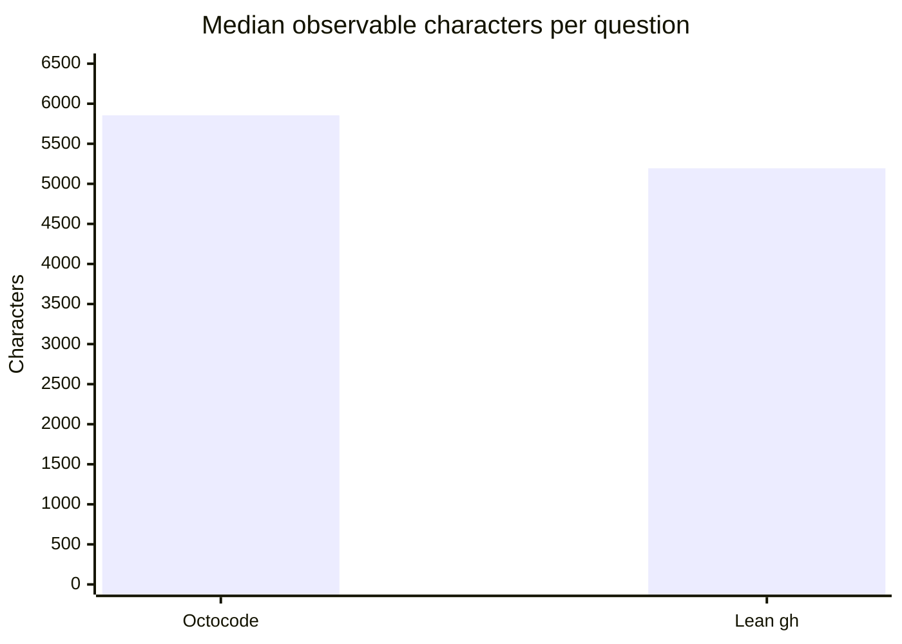

# Local release review: Octocode MCP versus lean gh

The current build does not demonstrate a context saving over lean `gh` on this public question set. Correctness rounds to **9/10 for both arms**; Octocode uses **1.31×** the observable characters (95% paired bootstrap interval **1.16–1.47×**) and is leaner on **5/30** questions. Deterministic correctness findings in the [release review](../../../.octocode/octocode-architect/2026-10-16-release-readiness.md) independently block release.

## What ran

| Setting | Value |
|---|---|
| Corpus | github-v2, Q1–Q30; public exploratory questions |
| Arms | Frozen local Octocode 20.2.0 MCP; lean GitHub CLI |
| Researcher | Fresh isolated Claude sessions, claude-sonnet-5-5, both arms |
| Judge | Codex CLI, gpt-6.1-sol; randomized X/Y answer order, tool identities redacted, independent read-only source checks |
| Repetitions | One pass; 60/60 valid solver runs, 30/30 judged pairs |
| Retries | No solver retries; no failed judge subprocesses in the scored campaign |
| Calibration | Synthetic correct/wrong/unsupported/appropriately uncertain answers scored 10/1/4/10; no human calibration |
| Features | Classification disabled in solver MCP; zero goals or clasify calls |
| Build | Local development build on macOS arm64; frozen before solving |
| Revision | 042896d473bfdab33fd8e5ce624e16f9eb8c3530 plus existing local changes |
| Native addon SHA256 | 2c5b6fca90afe92eee7ed90c0fc0410f4fefaaab619f92af37e8ab4e021d7824 |
| MCP entry SHA256 | 3068512297ae019e2af394bc8591be2c4d66bd7ce9a758be57545232e16e83d5 |

The source tree changed during other release checks. The benchmark used a frozen copy of the rebuilt MCP, native addon, config, core and TypeScript server. Its preflight passed. Leak scanning found no agent-visible question leakage; product hits were generic dependency and subprocess identifiers. This is a comparison against lean `gh`, not a previous Octocode release.

## Measurements

Observable characters include tool arguments, returned content and final answers, counted as Unicode code points. They exclude hidden model reasoning and are distinct from provider token usage.

| Metric | Octocode MCP | Lean gh |
|---|---:|---:|
| Median observable characters per question | 5,854.5 | 5,194 |
| Correctness, whole points | 9/10 | 9/10 |
| Exact mean correctness | 8.60 | 8.57 |
| More correct / tied / less correct | 5 / 22 / 3 | 3 / 22 / 5 |
| Leaner questions | 5/30 | 25/30 |
| Tool calls | 73 | 118 |
| Failed tool calls | 0 | 1 |
| Median elapsed solver run | 13.58 s | 13.67 s |

The paired geometric mean uses one ratio per question. Its 95% interval resamples 30 questions with replacement 20,000 times, seed 42. The bootstrap describes this question sample; it does not estimate run-to-run model variation. Raw judge rankings were Octocode 9, gh 19, tie 2. Two judges declined the supplied character tiebreak, so use correctness comparisons and measured character ratios separately.

## Where the difference comes from

| Question | MCP / gh characters | Observed behavior |
|---|---:|---|
| Axios release comparison, Q22 | 2.34× | MCP requested files and patches for lib/** in the first comparison, delivering 15,577 result characters. gh first selected a compact metadata and file inventory. |
| LangChain createAgent flow, Q21 | 2.01× | MCP used six calls, including three file responses of roughly 7–14k characters; gh used eight narrower calls. Both answers incompletely enumerated conditional hook targets. |
| ESLint parser chain, Q16 | 2.12× | MCP made three small reads; gh made two field-focused reads. Both were correct. |
| Axios buildFullPath, Q24 | 0.52× | One MCP search located the signature and call sites; gh used six calls. Both overgeneralized compatibility claims. |
| VS Code keybinding dispatch, Q8 | 0.64× | One MCP search supplied the relevant declarations; gh used three calls. |

Correctness needs separate attention: on Q14, Octocode's answer treated a Vite devDependency as a regular dependency (4 versus 10). On Q2 it relied on indexed search to establish absence instead of inspecting the requested file (7 versus 10). Q26, Q28 and Q29 favored Octocode because it verified required source or flow details that the other answer omitted. These are answer-level findings, not automatically tool defects.

## Calls and tokens

| Octocode tool | Calls | Failed calls |
|---|---:|---:|
| ghSearchCode | 20 | 0 |
| ghGetFileContent | 37 | 0 |
| ghSearchRepo | 2 | 0 |
| ghStructure | 3 | 0 |
| ghSearchHistory | 2 | 0 |
| ghGetHistoryItem | 9 | 0 |

The sole gh failure was HTTP 422 after requesting a nonexistent `master` commit in follow-redirects. The run recovered; that call remains counted. No Octocode tool errors occurred in the scored campaign.

| Reported Claude Sonnet 5.5 usage | Octocode MCP | Lean gh |
|---|---:|---:|
| Input tokens | 1,326,540 | 710,394 |
| Output tokens | 39,133 | 40,717 |
| Cache split | Unavailable | Unavailable |

The token totals are provider-reported per-turn usage, not unique context size. Startup/model preflight and judge calibration are outside the scored runs. Judge token/cost accounting is unavailable from this Codex fallback; classification has no campaign usage. No monetary saving is inferred. Separate live classification probes are not pooled here.

## Limits and artifacts

This is one pass on public questions, with an automated judge and no human reference grading. The judge provider originally configured by the harness was unavailable; the supported Codex fallback passed the synthetic sanity check. Live refs can move between solving and judgment; source citations preserve the revisions actually verified. Background builds and tests make timing unsuitable for a performance-release claim. No cross-platform or optimized release binary was benchmarked.

[Complete measured data](runs/release-review-rebuilt-2026-10-15.json) retains all 60 runs and 30 judgments. [Current matrix](MATRIX.md) and [local dashboard](index.html) retain corpus and runner-model distinctions. A shareable Claude artifact was not created because that publishing API is unavailable in this environment.
