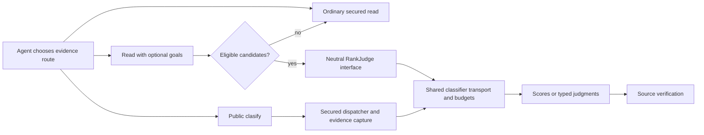

# Terra with and without JEV — 40 local and 30 GitHub questions

**Keep relevance ranking opt-in. This autonomous comparison does not demonstrate general token savings.** All 70 question pairs completed and received independent source-checked judgments. JEV-on increased Terra-only reported input tokens by 11.9% locally and 6.4% on GitHub; the GitHub interval includes no change. Terraform's eight-question slice is inconclusive. No primary comparison meets the preregistered benefit bar: at least 10% fewer observable characters, an interval below 1, and correctness within one point.

The architecture improvement is separately measurable: bypassing unnecessary candidate preparation reduced an 8 MB file-read probe from 1.22–1.23 s to about 0.34 s while preserving byte-identical output. That optimization was included in both frozen benchmark arms.

[Machine-readable analysis](terra-goals-2026-10-13.json) · [Local dashboard](../local-goals/local-goals.html) · [Local matrix](../LOCAL_MATRIX/report.md) · [GitHub matrix](../overview/MATRIX.md) · [Local runs](../local40-terra-goals-2026-10-13/run.json) · [GitHub runs](../github30-terra-goals-2026-10-13/run.json)

## What ran

- Locally built Octocode 20.2.0, immutable runtime snapshots; `gpt-5.6-terra`, medium reasoning, fresh Codex session per attempt. No inherited memory, plugins, project instructions, shell, or alternative research tools. Same ordinary question and brief in both arms; semantic calls were optional.
- Off: classification key blank, ranking disabled, goals/clasify absent from live discovery. On: ranking enabled and real provider available; observed provider version `jev-1.13.0` behind the `jev-latest` alias.
- [40 local questions](../../local/datasets/goals-v2) across nine pinned clones: lodash, Tokio, Django, Prometheus, Guava, Excalidraw, Redis, Newtonsoft.Json, Terraform. [Repository revisions and tracked-tree hashes](../../local/datasets/goals-v2/repositories.json). Terraform means repository research, with no infrastructure execution: Q33–Q40 on v1.14.7, commit `c0fcd5b52b08f607fbd1e2f164b323f7523146c9`.
- [30 existing GitHub questions](../../external/questions). Returned revisions and pinned refs were retained. Time-dependent discovery was interleaved; it is not a fixed historical GitHub corpus.
- One pass per arm: 140 valid final cells, 141 actual solver attempts. One local Q11 infrastructure-invalid attempt was retained and retried once; no GitHub retries. No valid unfavorable answer was rerun.
- Independent `claude-sonnet-5-5` judge, randomized X/Y, source verification, whole-point rubric. All 70 judgments made source-tool calls. Calibration controls scored 10/0/0/10 for correct/wrong/unsupported/appropriately-unresolved answers; there was no human calibration.
- Budget: 600 s and stop after the first observed excess over 30 tool calls, at most four research/judge processes combined. The first excess dispatch would remain counted. Private evaluator paths were denied through direct and nested MCP reads; all four frozen-surface leakage checks passed.

This is a development comparison on exposed/public questions, not a sealed acceptance test or a comparison of main-agent models. Offering goals also adds a schema and public clasify tool: the experiment measures that complete optional feature surface, not the isolated causal effect of a reranker.

Frozen live MCP catalogs grew from 5 tools/7,502 serialized characters to 6/10,600 locally, and from 12/18,804 to 13/22,929 for GitHub. These are catalog characters, not measured model tokens. Thus even sessions that skip classification receive a larger available tool surface.

## Paired measurements

Ratios are **on/off**; below 1 uses less. Geometric means are across questions, with seeded 10,000-resample question bootstrap 95% intervals. Characters include observable tool arguments, MCP text results, and final answers; they exclude unexported internal prompt framing. Reported Codex input tokens include a cached subset. Do not add cached tokens a second time.

| Corpus | Valid pairs | Characters ratio [95% CI] | Terra input tokens ratio [95% CI] | Wall time ratio [95% CI] | Fewer characters on |
|---|---:|---|---|---|---:|
| Local | 40/40 | 1.044 [0.904, 1.222] | 1.119 [1.002, 1.256] | 1.195 [1.052, 1.362] | 18/40 |
| Terraform | 8/8 | 1.035 [0.650, 1.857] | 1.080 [0.813, 1.403] | 1.122 [0.747, 1.595] | 4/8 |
| GitHub | 30/30 | 1.012 [0.890, 1.166] | 1.064 [0.968, 1.171] | 1.005 [0.845, 1.206] | 15/30 |

| Corpus | Median characters off → on | Median seconds off → on | Correctness off / tie / on (>1 point) |
|---|---:|---:|---:|
| local | 11,231 → 13,678 | 27.8 → 30.7 | 2 / 38 / 0 |
| github | 12,898 → 13,266 | 52.6 → 54.0 | 1 / 28 / 1 |

Rounded mean correctness: local 10/10 in both arms, GitHub 9/10 in both, Terraform 9/10 in both. Exact noisy means are retained in JSON. Terraform has one off win and seven within-one ties. Local Q1's two-point gap is only citation precision despite correct facts; Q37 omits a diagnostic subject and cites an assignment one line early. Source review supports the observations, while their penalty sizes are grader-sensitive. Local Q30/Q34 one-point differences are also sensitive and counted as ties. No local verdict establishes hallucination reduction.

GitHub's decisive gaps concern completeness: on wins Q10 by tracing Axios's configured CJS build input through Rollup; off wins Q19 by reaching Node's native spawn implementation. Independent checks at revisions `cf744d2` and `c883ccf` support both. Neither is evidence that the other answer fabricated facts.

Uncached-input ratios are exploratory: local 1.072 [0.895, 1.295], GitHub 1.193 [0.952, 1.486]. Output-token ratios are local 1.001 [0.927, 1.086], GitHub 0.980 [0.873, 1.100]. JEV tokens are accounted separately. The price-weighted scenario below uses each provider’s rates; it does not establish actual billed savings.

### Predefined local task types

| Type | Questions | Characters on/off [95% CI] | Terra input on/off [95% CI] |
|---|---:|---|---|
| exact | 13 | 0.911 [0.745, 1.075] | 1.050 [0.903, 1.187] |
| broad | 16 | 1.012 [0.805, 1.373] | 1.072 [0.902, 1.279] |
| call-binding | 7 | 1.449 [0.950, 2.157] | 1.398 [0.944, 2.034] |
| structural | 3 | 1.043 [0.933, 1.137] | 1.050 [1.047, 1.054] |
| uncertainty | 1 | 1.037 (one case) | 1.321 (one case) |

These small strata do not justify task-specific thresholds. No multiple-comparison-adjusted claim is made. The one-case stratum provides no population interval.

## Per-tool impact and actual adoption

Goals were supplied in 30/40 local and 29/30 GitHub questions: 112 local and 253 GitHub goal queries. **Public `clasify` calls: zero. Ranked-plan replay queries: zero.** This measures autonomous goals usage; it cannot establish direct clasify adoption or continuation efficiency. Counts below are final valid runs. Calls can batch multiple queries. Query errors can occur inside an otherwise successful MCP envelope.

| Tool | Calls off / on | Goal queries | Ranked / skipped / fallback | Tool-exchange chars off / on |
|---|---:|---:|---:|---:|
| `astSearch` | 1 / 3 | 1 | 0 / 1 / 0 | 549 / 2,446 |
| `localFetch` | 65 / 67 | 63 | 20 / 40 / 3 | 224,148 / 208,059 |
| `localSearch` | 46 / 49 | 43 | 16 / 24 / 3 | 297,326 / 270,428 |
| `lspSearch` | 0 / 1 | 1 | 0 / 0 / 0 | 0 / 1,214 |
| `structureSearch` | 5 / 4 | 4 | 1 / 2 / 1 | 7,180 / 32,607 |
| `artifactSearch` | 2 / 1 | 1 | 0 / 1 / 0 | 1,233 / 731 |
| `ghGetFileContent` | 87 / 75 | 125 | 49 / 73 / 1 | 464,928 / 393,347 |
| `ghGetHistoryItem` | 10 / 11 | 10 | 0 / 9 / 0 | 68,758 / 65,974 |
| `ghSearchCode` | 30 / 35 | 68 | 35 / 33 / 0 | 95,218 / 190,943 |
| `ghSearchHistory` | 1 / 1 | 2 | 2 / 0 / 0 | 3,211 / 1,920 |
| `ghSearchRepo` | 17 / 13 | 14 | 0 / 14 / 0 | 5,832 / 5,862 |
| `ghStructure` | 30 / 29 | 33 | 0 / 33 / 0 | 9,233 / 12,488 |

Per-tool totals describe selected workflows, not a randomized efficiency estimate for each tool. One LSP query and one history-item query failed before returning a ranking receipt.

- Search/fetch/file-list ranking genuinely ran. It preserved every candidate and its source identity. Most local fetch skips were single candidates (38); GitHub fetch had 61 such skips. Reordering a fully returned page cannot shrink that page.
- `ghStructure` preserved tree ordering (33 skips). Exact `ghSearchRepo`/`artifactSearch` lookups skipped (14/1). History detail preserved section/patch order (9 skips). These calls added receipts without semantic work.
- Autonomous AST usage was sparse: 1 off/3 on calls; its one goal request skipped an incomplete selection. The sole LSP call failed with `anchorUnresolved`, so this campaign proves no successful autonomous LSP benefit.
- Separate applicability controls cover all local tools: 11 passes, including a fresh isolated TypeScript LSP navigation and CLI-only `astTopology` and `astRewrite` preview/apply/inverse on a disposable tree. HCL AST support and Go language-server availability were absent; C# parsing had recovery limitations. These controls are not scored agent answers.
- `astTopology` accepts goals but preserves graph ordering; it is CLI-only. Rewrite and clone tools do not accept goals. The earlier [13-read-tool evaluation](../read-tool-ranking-2026-10-13/report.md) and hermetic 112-pass/8-applicability-skip suite cover operations not selected by Terra.

### Where the difference came from

Local Q5 used 56% fewer characters with goals, but the on agent also added a precise lexical `fileHas` filter and used three calls instead of six. Q34 used about half the characters after ranking; ordinary and semantic workflows read different ranges. Neither isolates classification as the cause.

Local Q32 used 3.46× the characters with goals because it missed a nullable signature and took extra discovery steps; its goal calls skipped single candidates. Terraform Q40 used 6.30× the characters after adding `*.go` to a file-name search, producing a much broader selection. Both its goal requests skipped. Q39 used fewer characters even though provider work failed and subsequent requests fell back. These are route-choice outcomes, not proof that ranking itself saves or costs that amount.

Use an exact route when an identifier, predicate, path, or range answers the question. Use goals when bringing sufficient source into an earlier page can avoid later reads. Use public clasify for unread-source locations or a required typed judgment, then verify deciding source. Do not stack goals and clasify for the same decision, infer identity from relevance, or discard findings based on classifier confidence. Earlier [selective semantics](../selective-semantics-2026-10-13/report.md) and [PR/AST/LSP checks](../review-classification-2026-10-13/report.md) retain the targeted benefits and confidently wrong judgments.

## Costs and failures, including unsuccessful work

Terra and JEV are separate accounts throughout: the earlier input-token ratios contain **Terra only**, never Terra plus JEV. Cached input is already included in total Terra input. These all-attempt totals include the invalid Q11 attempt and its retry; paired efficacy metrics use final valid answers only.

| Corpus / arm | Terra attempts | Terra total input | Terra cached subset | Terra uncached input | Terra output |
|---|---:|---:|---:|---:|---:|
| local / off | 40 | 1,928,439 | 1,417,984 | 510,455 | 34,150 |
| local / on | 41 | 2,171,708 | 1,657,344 | 514,364 | 34,570 |
| github / off | 30 | 3,173,744 | 2,600,960 | 572,784 | 46,812 |
| github / on | 30 | 3,390,690 | 2,733,056 | 657,634 | 44,743 |

| Corpus / JEV-on | JEV attempts | Unknown-usage attempts | JEV known input | JEV known output | Known JEV cost at list price |
|---|---:|---:|---:|---:|---:|
| local | 422 | 11 | 214,527 | 7,921 | $0.009010 |
| github | 577 | 7 | 366,790 | 10,890 | $0.015405 |

JEV totals include availability/startup probes and the invalid attempt, without adding runtime stats again. All 999 traced attempts finished at the proxy; 981 returned known usage, 18 aborted without usage. Known totals are lower bounds: 581,317 input and 18,811 output tokens. Off-arm calls are prevented by configuration; there is no fabricated zero-usage trace. Solver monetary cost was not reported.

The 18 provider aborts occurred on broad candidate sets: local Q20 (4), Terraform Q39 (7), GitHub Q5 (7). Native ranking returned ordinary-order fallback after about 10 seconds; Q39's later small requests reported provider unavailable. Evidence remained reachable. This is an efficiency limitation, not a reason to silently raise deadlines or discard candidates.

Local query errors: off had one missing path and one invalid fetch query; on had one unresolved LSP anchor. GitHub off had four missing-file query errors and one invalid query; on had two missing-file query errors plus a failed history-item MCP call. Transport/envelope failures are counted separately in JSON. Research recovered and every final answer was valid.

The invalid local Q11 attempt had already produced an answer before an `EPERM` during runner completion; it remains excluded from paired efficacy ratios and included in budgets (80,530 input, 934 output, four JEV requests). A post-run lifecycle fix waits briefly for natural exit after stdout closes and preserves unexpected-error tracebacks. A real child-process regression reproduces the old failure and passes after the fix; the original EPERM mechanism remains probable because its traceback was unavailable.

Preparation is additional: five Terra smokes/preflights used 84,434 input / 848 output tokens; two metered JEV setup batches used 1,112 input / 80 output. Earlier provider-availability probes have unknown usage. Judge calibration used 1,651 total tokens.

Local judging: 40 attempts for 40 verdicts, 670,389 reported total tokens, model-reported $1.7009. These dollar receipts are not independently verified billing.
Github judging: 30 attempts for 30 verdicts, 743,149 reported total tokens, model-reported $1.7117. These dollar receipts are not independently verified billing.

### Price-weighted calculation

At published standard short-context rates, Terra input / cached input / output cost **$2 / $0.20 / $12 per million tokens**; cache writes cost $2.50 per million. [OpenAI model pricing](https://developers.openai.com/api/docs/models/gpt-5.6-terra). JEV input costs **$0.042 per million**, and output is free. [TypeSafe pricing](https://typesafe.ai/blog/introducing-system-one-models-and-jev). Rates checked 2026-10-13. JEV input is therefore about 47.6× cheaper than ordinary Terra input and 4.76× cheaper than cached Terra input.

Let `U = Terra total input − cached input`, `C = cached input`, `W = cache-written input` (a subset of U), `O = Terra output`, and `J = JEV input`. The standard short-context API calculation in dollars is `(2U + 0.2C + 0.5W + 12O + 0.042J) / 1,000,000`. This accounts for [cache writes without double counting](https://developers.openai.com/api/docs/guides/prompt-caching).

The frozen Codex receipts do not report W, actual billing, or per-request service/context pricing. The **base scenario** below omits the unknown cache-write premium, context/service multipliers, and unknown aborted JEV usage. It is a rate-weighted illustration, not an invoice or a net-cost verdict. Standard short-context cache-write sensitivity is base plus `0` to `0.5U / 1,000,000`; this is not a bound on all possible charges.

| Corpus / arm | Terra base scenario, all attempts | Additional known JEV | Combined base scenario | Possible cache-write premium |
|---|---:|---:|---:|---:|
| local / off | $1.714307 | $0.000000 | $1.714307 | $0–$0.255227 |
| local / on | $1.775037 | $0.009010 | $1.784047 | $0–$0.257182 |
| github / off | $2.227504 | $0.000000 | $2.227504 | $0–$0.286392 |
| github / on | $2.398795 | $0.015405 | $2.414200 | $0–$0.328817 |

Across both campaigns, known JEV work costs **$0.024415** at list price, plus unreported usage from 18 aborted requests. JEV is a small expense here; the conclusion does not come from charging JEV tokens at Terra rates.

| Final valid pairs only | Combined base-scenario on/off [95% CI] |
|---|---:|
| Local | 1.073 [0.966, 1.197] |
| GitHub | 1.098 [0.973, 1.236] |
| Terraform | 1.011 [0.752, 1.368] |

These exploratory price-weighted ratios differ from raw input-token ratios because cached input is cheaper and output has its own rate. All intervals include no change under this base scenario; missing charges prevent a billed-cost conclusion. The invalid attempt belongs in total spending above, not in successful-pair ratios.

For scale: 100,000 JEV input tokens cost $0.0042. Before other overhead, avoiding 2,100 ordinary Terra input tokens, 21,000 cached Terra input tokens, or 350 Terra output tokens would cover that amount. This is a marginal break-even calculation, not evidence that these savings occurred.

### Request latency versus workflow latency

| Corpus | Successful JEV requests | JEV HTTP median | JEV HTTP p95 | Aborted requests |
|---|---:|---:|---:|---:|
| local | 411 | 366 ms | 2202 ms | 11 |
| github | 570 | 400 ms | 2925 ms | 7 |

These are measured network-inclusive HTTP durations, including startup probes and the retained invalid attempt. JEV typically answered in under half a second here. Multiple requests can occur per ranking operation; their durations must not be treated as one agent step or subtracted from wall time when intervals overlap. Terra inference-only latency is unavailable, so this study cannot estimate a same-decision model speed ratio. End-to-end paired wall time remains local 1.195×, GitHub 1.005×, and Terraform 1.122×; faster individual classification does not guarantee a faster research workflow.

## Architecture, memory and verification

Schemas and prompts remain in core; config generation owns the contract; native owns execution, security, paging and ranking; CLI/MCP remain adapters. Ranking calls the lower classifier adapter through `RankJudge`, not recursive public dispatch. Public clasify captures evidence through normal secured reads. Explicit goals inside clasify deliberately request both stages; they are not automatically composed.

The optimization moves a shared eligibility/replay gate ahead of candidate JSON construction and sanitization. Disabled, unavailable, singleton, unsupported and saved-order cases avoid preparation. Rankings keep deterministic tie order, all evidence, and continuations bound to source/goals/settings/provider/scope. Plan checksums detect change; they are not secret authentication tokens.

Memory is bounded: search memo 64 entries/16 MiB/60 s; response cache 8 entries/32 MiB; file reads above 10 MiB use streaming and skip ranking. Development-profile 8 MB/80k-line probes: disabled-goals first read 1.22 s/96.9 MB → 0.34 s/81.7–81.9 MB; replay 1.23 s/102.6 MB → 0.34 s/86.9–87.1 MB. Plain read stayed around 0.33 s/80.4 MB. Search time moved 4.15 → 3.65–3.70 s, but RSS was noisy and supports no memory claim. Baseline was one sample, after was three; six relevant outputs were byte-identical. This is a local performance probe, not production capacity testing.

Before freezing: 3,512 Rust tests passed (five ignored), native lint/format/build, eight script tests, five native-interface tests, type checking and contract checks passed; all-tool ranking acceptance returned 112 passes and eight applicability skips. Local question/source manifest and isolation checks passed. After scoring, the core instruction wording was corrected from “local goals” to “read-tool goals”; its four-character snapshot delta was regenerated and all 664 core tests/lint/build passed. Frozen trials retain the prior wording. No efficacy claim is made for this wording or the post-run runner fix.

Final repository verification passed with `node skills-dev/octocode-dev/scripts/dev.mjs verify`. The canonical core → contract → native → CLI/MCP rebuild completed, followed by contract checks, fresh CLI config/schema reads, and 112 ranking acceptance passes with eight applicability skips. The final benchmark package check passed 38 Python tests and one Node proxy test. An independent audit matched all 70 question rows, 32 bootstrap intervals, per-tool totals, retry/provider accounting, and both frozen runtime manifests. Local and GitHub dashboards were visually checked.

The benchmark now supports a portable pinned local catalog, frozen Terra/MCP trials, live provider metering, retained retries, blinded source checks, per-tool receipts, unknown-usage accounting, and corpus-separated reports. The dashboard's correctness counts now implement the documented one-point tie rule. Results below preserve every question and all unfavorable outcomes.

## Every local question

Characters include final answers; scores are whole-point off/on. These single observations are not repeatability estimates.

| Question | Characters off | Characters on | On/off | Terra input tokens off / on | Correctness off / on |
|---|---:|---:|---:|---:|---:|
| Q1 | 3,631 | 3,393 | 0.934 | 30,266 / 31,420 | 10 / 8 |
| Q2 | 11,523 | 13,011 | 1.129 | 31,960 / 47,328 | 9 / 9 |
| Q3 | 6,123 | 4,529 | 0.740 | 42,232 / 31,817 | 9 / 10 |
| Q4 | 1,432 | 1,884 | 1.316 | 19,569 / 31,198 | 10 / 10 |
| Q5 | 15,949 | 6,958 | 0.436 | 84,900 / 43,935 | 9 / 10 |
| Q6 | 18,246 | 14,235 | 0.780 | 47,015 / 35,855 | 9 / 10 |
| Q7 | 15,884 | 15,877 | 1.000 | 60,713 / 50,580 | 9 / 9 |
| Q8 | 16,252 | 19,576 | 1.205 | 35,964 / 39,690 | 10 / 9 |
| Q9 | 3,433 | 4,342 | 1.265 | 29,914 / 42,711 | 9 / 10 |
| Q10 | 11,383 | 8,064 | 0.708 | 32,008 / 56,643 | 9 / 10 |
| Q11 | 4,470 | 6,946 | 1.554 | 30,276 / 55,528 | 9 / 9 |
| Q12 | 23,762 | 19,041 | 0.801 | 74,293 / 61,267 | 9 / 9 |
| Q13 | 2,976 | 3,135 | 1.053 | 30,070 / 31,473 | 10 / 10 |
| Q14 | 5,555 | 3,140 | 0.565 | 51,990 / 31,581 | 9 / 9 |
| Q15 | 7,993 | 14,485 | 1.812 | 42,403 / 47,974 | 10 / 10 |
| Q16 | 4,291 | 4,005 | 0.933 | 30,450 / 31,900 | 10 / 10 |
| Q17 | 8,026 | 9,003 | 1.122 | 42,599 / 45,088 | 10 / 10 |
| Q18 | 43,196 | 42,123 | 0.975 | 48,311 / 49,624 | 10 / 9 |
| Q19 | 13,696 | 25,182 | 1.839 | 35,341 / 104,970 | 10 / 10 |
| Q20 | 37,072 | 36,399 | 0.982 | 127,742 / 117,684 | 10 / 10 |
| Q21 | 10,478 | 19,881 | 1.897 | 66,981 / 87,359 | 9 / 9 |
| Q22 | 11,904 | 13,122 | 1.102 | 45,784 / 47,919 | 10 / 10 |
| Q23 | 3,552 | 4,273 | 1.203 | 29,963 / 31,607 | 10 / 10 |
| Q24 | 1,860 | 2,114 | 1.137 | 19,657 / 20,722 | 10 / 10 |
| Q25 | 11,079 | 11,209 | 1.012 | 33,877 / 35,403 | 10 / 10 |
| Q26 | 4,021 | 4,196 | 1.044 | 30,362 / 31,780 | 10 / 10 |
| Q27 | 20,262 | 14,513 | 0.716 | 69,235 / 66,452 | 10 / 10 |
| Q28 | 21,963 | 22,766 | 1.037 | 41,200 / 54,408 | 8 / 8 |
| Q29 | 4,757 | 5,092 | 1.070 | 30,333 / 31,760 | 10 / 10 |
| Q30 | 31,970 | 28,224 | 0.883 | 58,737 / 58,625 | 9 / 10 |
| Q31 | 28,039 | 17,499 | 0.624 | 38,944 / 71,480 | 10 / 10 |
| Q32 | 5,207 | 18,035 | 3.464 | 30,438 / 64,696 | 10 / 10 |
| Q33 | 26,294 | 15,908 | 0.605 | 41,296 / 37,244 | 9 / 9 |
| Q34 | 20,829 | 10,425 | 0.501 | 37,191 / 46,951 | 10 / 9 |
| Q35 | 48,525 | 31,079 | 0.640 | 146,812 / 93,047 | 9 / 9 |
| Q36 | 2,765 | 3,012 | 1.089 | 29,784 / 31,429 | 10 / 10 |
| Q37 | 30,369 | 31,238 | 1.029 | 70,582 / 130,303 | 10 / 8 |
| Q38 | 8,945 | 15,260 | 1.706 | 32,171 / 48,627 | 9 / 9 |
| Q39 | 41,019 | 23,178 | 0.565 | 116,563 / 66,392 | 9 / 9 |
| Q40 | 4,910 | 30,906 | 6.295 | 30,513 / 46,708 | 9 / 9 |

## Every GitHub question

| Question | Characters off | Characters on | On/off | Terra input tokens off / on | Correctness off / on |
|---|---:|---:|---:|---:|---:|
| Q1 | 7,094 | 7,231 | 1.019 | 73,925 / 77,745 | 10 / 10 |
| Q2 | 10,321 | 9,200 | 0.891 | 90,190 / 121,289 | 9 / 9 |
| Q3 | 11,320 | 13,440 | 1.187 | 76,781 / 138,467 | 10 / 10 |
| Q4 | 47,430 | 40,833 | 0.861 | 149,650 / 164,986 | 10 / 10 |
| Q5 | 51,227 | 45,549 | 0.889 | 86,280 / 93,332 | 9 / 8 |
| Q6 | 3,376 | 11,850 | 3.510 | 71,587 / 92,991 | 10 / 10 |
| Q7 | 7,463 | 8,471 | 1.135 | 75,061 / 66,274 | 10 / 9 |
| Q8 | 12,873 | 7,918 | 0.615 | 64,657 / 64,372 | 10 / 10 |
| Q9 | 10,036 | 9,872 | 0.984 | 61,816 / 65,409 | 10 / 10 |
| Q10 | 8,426 | 13,092 | 1.554 | 88,732 / 110,563 | 6 / 9 |
| Q11 | 43,020 | 39,617 | 0.921 | 151,226 / 178,377 | 9 / 10 |
| Q12 | 5,449 | 6,742 | 1.237 | 47,872 / 77,359 | 10 / 10 |
| Q13 | 20,460 | 15,949 | 0.780 | 57,194 / 56,780 | 10 / 10 |
| Q14 | 6,208 | 3,029 | 0.488 | 60,917 / 49,918 | 10 / 10 |
| Q15 | 19,140 | 11,134 | 0.582 | 71,706 / 41,437 | 10 / 9 |
| Q16 | 5,539 | 6,015 | 1.086 | 111,727 / 104,656 | 10 / 10 |
| Q17 | 22,187 | 19,264 | 0.868 | 95,006 / 114,057 | 10 / 10 |
| Q18 | 5,656 | 4,397 | 0.777 | 48,933 / 50,361 | 10 / 10 |
| Q19 | 52,634 | 42,993 | 0.817 | 242,502 / 171,697 | 10 / 7 |
| Q20 | 18,736 | 19,355 | 1.033 | 90,810 / 87,499 | 9 / 9 |
| Q21 | 64,160 | 73,846 | 1.151 | 233,775 / 295,436 | 9 / 8 |
| Q22 | 10,819 | 14,062 | 1.300 | 41,189 / 57,004 | 10 / 9 |
| Q23 | 15,005 | 18,897 | 1.259 | 138,348 / 101,994 | 10 / 9 |
| Q24 | 5,959 | 6,363 | 1.068 | 72,243 / 63,784 | 9 / 9 |
| Q25 | 12,924 | 16,189 | 1.253 | 56,192 / 57,688 | 9 / 8 |
| Q26 | 19,488 | 12,695 | 0.651 | 163,279 / 106,474 | 9 / 9 |
| Q27 | 10,113 | 8,553 | 0.846 | 62,996 / 77,247 | 9 / 8 |
| Q28 | 127,118 | 132,611 | 1.043 | 370,885 / 406,075 | 9 / 8 |
| Q29 | 49,724 | 45,167 | 0.908 | 134,896 / 138,813 | 8 / 9 |
| Q30 | 27,374 | 61,169 | 2.235 | 83,369 / 158,606 | 9 / 9 |

## Reproduce and interpret

Use the updated [benchmark skill](../../docs/running.md), [method](../../docs/method.md), and [output commands](../../docs/outputs.md). The saved run JSON includes frozen component, harness, question and corpus hashes. Raw transcripts and private grading material remain in the gitignored campaign/evaluation directories. Rebuild summaries with `campaign_summary.py`; use `ablation_report.py` for paired ratios and `matrix_summary.py --question-set local-goals-v2` for the local corpus. Do not pool these questions with historical GitHub questions or compare model families as if they were randomized arms.

Decision: keep the general modular implementation and the proven preparation optimization; keep semantic selection optional. The evidence supports conditional source prioritization, not a default-on token-saving or review-accuracy claim.
