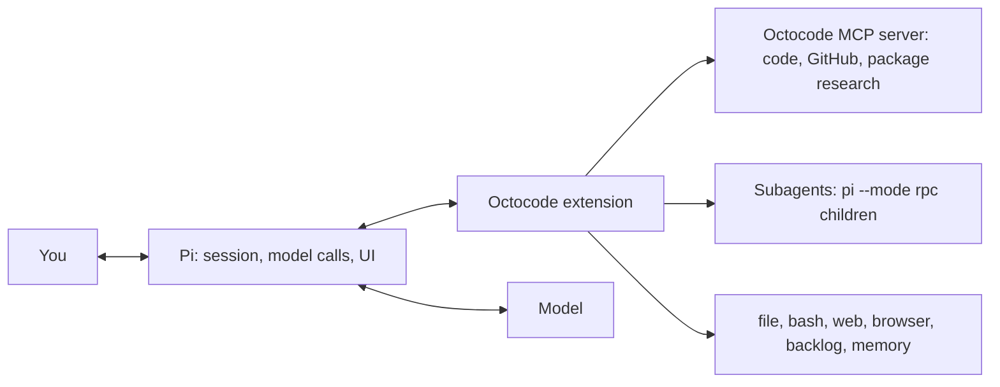

# Octocode for Pi

Turn [Pi](https://pi.dev) into a research-driven coding agent. Octocode adds code research (local search, LSP, GitHub and package registries through [Octocode MCP](https://github.com/bgauryy/octocode)), subagents, a safer file tool, a per-repository backlog and memory, and a browser. It builds on Pi's own tools, MCP, sessions, compaction and UI.

```bash
pi install npm:@octocodeai/pi-extension    # install for every session
pi -e npm:@octocodeai/pi-extension         # or try it once
```

Requires Pi 1.2 or later in the 1.x line and Node.js 24.15 or later (24.x).

This is the Pi front end of the [Octocode](https://github.com/bgauryy/octocode) toolchain; the same research engine and skills run in Claude Code, Codex and the `octocode` CLI, with config and state in one `.octocode` layout ([where files go](docs/CONFIGURATION.md#where-files-go)).



Subagents are separate Pi processes the extension supervises ([Architecture](docs/ARCHITECTURE.md)).

## Quick start

1. Install the extension and start Pi in a repository:

   ```bash
   pi install npm:@octocodeai/pi-extension
   cd my-repo && pi
   ```

2. Type `/octocode` to check the setup: version, Octocode MCP tools, subagent profiles, loaded skills, hooks.
3. Ask a research question, for example `Where is the session token refreshed, and who calls it?` The agent searches with `mcp__octocode__*`, reads only the lines it needs and cites `path:line`.
4. For GitHub research, run `gh auth login` or export `GITHUB_TOKEN` before starting Pi; the MCP server inherits Pi's environment ([authentication](https://github.com/bgauryy/octocode/blob/main/docs/AUTHENTICATION.md)).

## What you get

Each item links to its full behavior.

- **Research**: the Octocode MCP tools from the first request, plus skills from `.octocode/skills` and other agents' skill folders ([MCP](docs/FEATURES.md#mcp), [Skills](docs/FEATURES.md#skills)).
- **A safer `file` tool and `bash`**: batched edits that refuse stale writes, rewindable checkpoints, a shell deadline, background jobs and a destructive-command flag ([File tool](docs/FEATURES.md#file-tool), [Bash](docs/FEATURES.md#bash)).
- **Permission modes**: `full` (default: nothing asks, every action is recorded), `workspace`, `manual`; `OCTOCODE_PERMISSION` sets the start mode. Not a sandbox ([Permissions](docs/FEATURES.md#permissions)).
- **Subagents and team**: parallel `agent` runs with the bundled `researcher`, `reviewer`, `implementer`, `webHeadless` and `webLive` profiles, background runs, git-worktree isolation, file reservations, messaging ([Subagents](docs/FEATURES.md#subagents), [Team](docs/FEATURES.md#team)).
- **Backlog, memory, sessions**: a task board and durable notes per repository; `/sessions` resumes with a brief of what changed ([Backlog](docs/FEATURES.md#backlog), [Memory](docs/FEATURES.md#memory), [Sessions](docs/FEATURES.md#sessions)).
- **Web and browser**: `web` fetches and searches; `browser` drives Chrome over DevTools, with private-address requests checked ([Web and browser](docs/FEATURES.md#web-and-browser)).
- **Compaction, context, cost**: Octocode writes the summary, archives what it removes and shows list-price cost estimates ([COMPACTION.md](docs/COMPACTION.md), [CONTEXT-AND-COST.md](docs/CONTEXT-AND-COST.md)).
- **TUI**: banner, two-line footer, a working line naming the running step, agents panel, answer-ready notifications ([UI](docs/FEATURES.md#ui)).
- **Integrations**: Claude Code and Codex command hooks, external agents and a JSON-RPC API (both opt-in), `askUser` ([Hooks](docs/FEATURES.md#hooks-opt-in), [API.md](docs/API.md)).

## Tools the agent gets

| Tool | Purpose |
|---|---|
| `read` | Pi's read tool, unchanged |
| `bash` | Shell commands, with a deadline and background jobs |
| `file` | Batched edit, write and delete |
| `mcp__octocode__*` | Code, LSP, GitHub and package research |
| `web` | Fetch a URL or search the web |
| `browser` | Drive Chrome over DevTools |
| `agent` | Run a subagent |
| `coordinate` | List agents, reserve files, see recent changes |
| `sendMessage` | Message another agent |
| `backlog` | Track repository tasks |
| `memory` | Search and save durable notes |
| `archive` | Search and read earlier history: compacted messages, forked-from and parent sessions, this repository's other sessions |
| `askUser` | Ask you questions, with choices or free text |
| `externalAgent` | Prompt agents outside this team: ACP hosts, other Pi instances (main session only) |

Subagents get a reduced set: no `agent`, `askUser` or `externalAgent`, and each profile drops what it does not need (`researcher` and `reviewer` have no `file`). The main session leaves `browser` to `webHeadless` and `webLive` unless you name it in `--tools` ([why](docs/FEATURES.md#web-and-browser)).

## Commands

Everything lives under `/octocode` (Tab completes subcommands). `/agents`, `/backlog`, `/hooks`, `/memory` and `/sessions` are also top-level shortcuts; `/mcp` is Pi's own command for your other MCP servers.

| Command | Does |
|---|---|
| `/octocode [status]` | Version, Octocode MCP tools, profiles, skills, hooks |
| `/octocode help` | Subcommands, arguments and shortcuts |
| `/octocode models` | Usable models (price, window, abilities) and the one each subagent purpose and profile runs on |
| `/octocode mcp [status\|restart]` | The Octocode MCP server's state, version, tool count and process, or restart it |
| `/octocode rewind [turns]` | Undo the `file` changes of the last turns (default 1) |
| `/octocode archive [<n>]` | List this session's [archive of compacted history](docs/COMPACTION.md#archive-of-compacted-history), or print segment `<n>` |
| `/octocode permission [manual\|workspace\|full\|grants [clear]\|log]` | Show or set the mode, list or clear session grants, show recent decisions |
| `/octocode jobs [kill <id>]` | List or stop background bash jobs |
| `/octocode trust [off]` | Review and trust this project's hooks, agent profiles and skills |
| `/octocode external <JSON>` | Discover, connect, prompt, cancel or disconnect external agents |
| `/octocode api [on [http] \| off]` | Start or stop the external API |
| `/agents [tell <agent\|all> <message> \| interrupt <id> <message> \| kill <id> \| merge <id>]` | List the team, message or redirect agents, stop or merge a subagent |
| `/sessions [all \| <words>]` | Find and resume sessions |
| `/backlog [add <title> \| do <id> \| export \| html \| <id> [state\|delete]]` | Open, edit or work the board; `html` opens it in your browser |
| `/memory [search <words> \| add \| auto on\|off \| last]` | Browse, search and add memories |
| `/hooks` | Loaded hooks, files to edit, each hook's runs, average and slowest time |

Shift+Tab in the main editor cycles the permission mode instead of Pi's thinking level; use `/thinking <level>`, or bind `app.thinking.cycle` in Pi's `keybindings.json`. Without a UI (print or JSON mode) commands write text to stderr instead of opening a picker.

## Best practices

- **Ask for evidence.** Phrase research as a question about the code ("who calls X?"). Before changing shared code, have the agent confirm callers with `lspSearch`.
- **Delegate wide work.** Ask for parallel subagents when work splits cleanly (one per module to review); keep small sequential edits in the main session. Use `isolate: true` when a subagent's edits might collide with yours.
- **Let background work come back.** Run long builds as `bash` background jobs and long tasks as background subagents; results arrive as messages.
- **Keep follow-ups in the backlog.** "Add a backlog item to…", then `/backlog do <id>` in any session.
- **Teach it once with memory.** "Remember that we use pnpm." Store where a secret lives, never the secret; credential-like text is refused.
- **Review risky edits.** Use `manual` mode in unfamiliar repositories and `/octocode rewind` to undo a turn's `file` changes. Run untrusted work in a container.
- **Trust deliberately.** Run `/octocode trust` only after reading what it lists: project hooks run commands with your permissions.
- **Split dependent steps.** Calls in one message run in parallel: put an edit and the test that checks it in separate messages. Keep `PreToolUse` hooks fast; each delays every call in its batch.
- **Keep the context lean.** Prefer `web` for static pages, `browser` only for JavaScript or interaction, and `webHeadless` for multi-page browsing so screenshots stay out of the main context.

## Documentation

Most users need no configuration.

| Page | Covers |
|---|---|
| [docs/FEATURES.md](docs/FEATURES.md) | Behavior of every feature |
| [docs/CONFIGURATION.md](docs/CONFIGURATION.md) | Environment variables, file locations, trust, hooks, subagent profiles, MCP, retention |
| [docs/API.md](docs/API.md) | External JSON-RPC API and the `octocode-pi-api` command |
| [docs/OPENCODE.md](docs/OPENCODE.md) | Running on OpenCode Console models: where the API key goes, choosing a model |
| [docs/COMPACTION.md](docs/COMPACTION.md) | Compaction in the main session and in subagents, the archive of compacted history |
| [docs/CONTEXT-AND-COST.md](docs/CONTEXT-AND-COST.md) | Repeated reads, spilled outputs, prompt cache, pricing and the usage display |
| [docs/ARCHITECTURE.md](docs/ARCHITECTURE.md) | Source layout, layering, start-up and liveness, for contributors |

## Development

```bash
yarn workspace @octocodeai/pi-extension build   # tsc → dist/, then the Pi entry
yarn workspace @octocodeai/pi-extension test    # unit and end-to-end tests
pi --no-extensions -e packages/octocode-pi-extension/dist/pi-entry.cjs -e builtin:mcp -e builtin:tool-search
```

After `yarn build`, `/reload` in a running Pi loads the new code. `/reload` loads only what the build produced: in a development checkout (a `src/` folder beside `dist/`), Pi warns once at session start when a `src/**/*.ts` file is newer than the current bundle, and names the fix (`yarn build`, then `/reload`). An installed package never warns.
