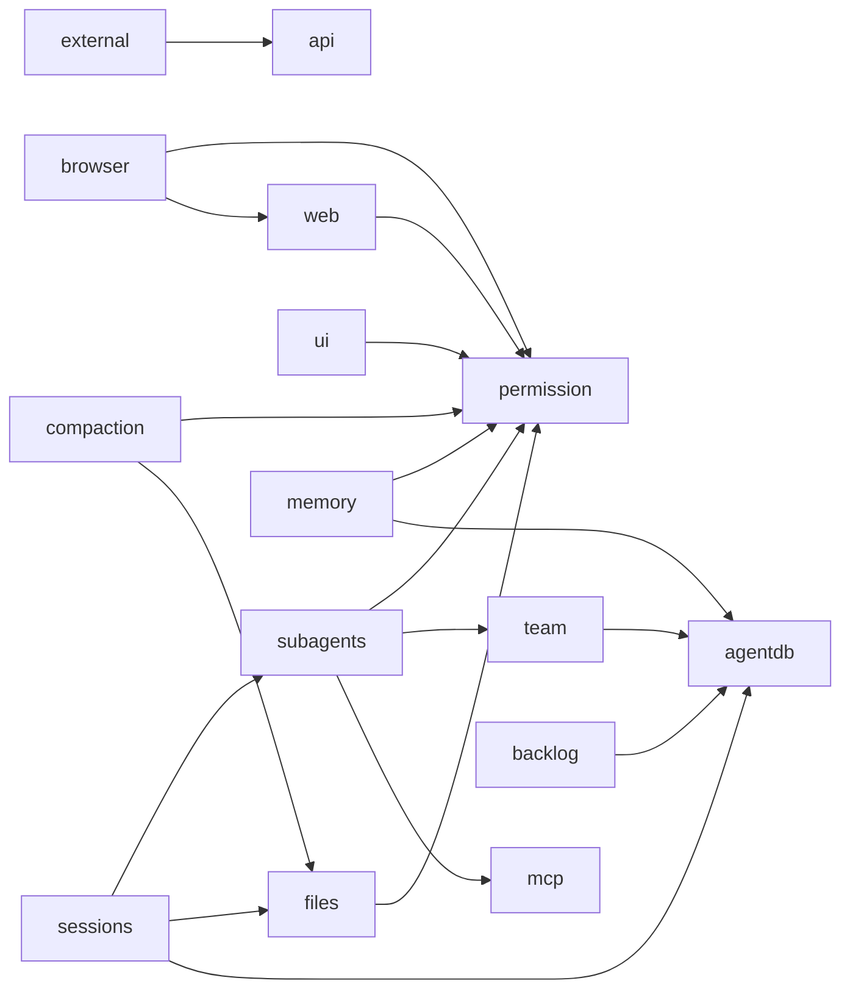
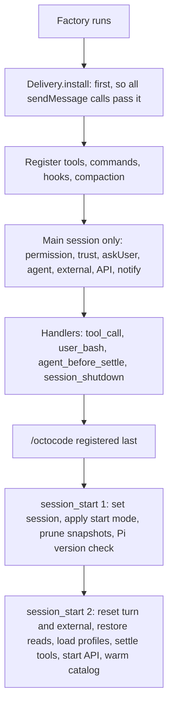
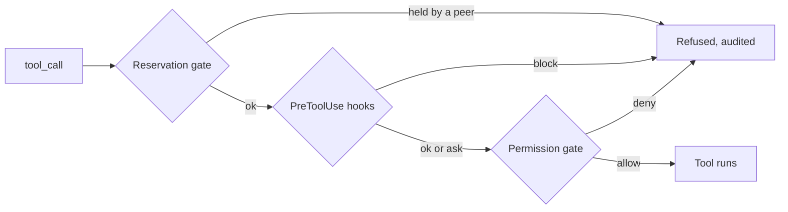
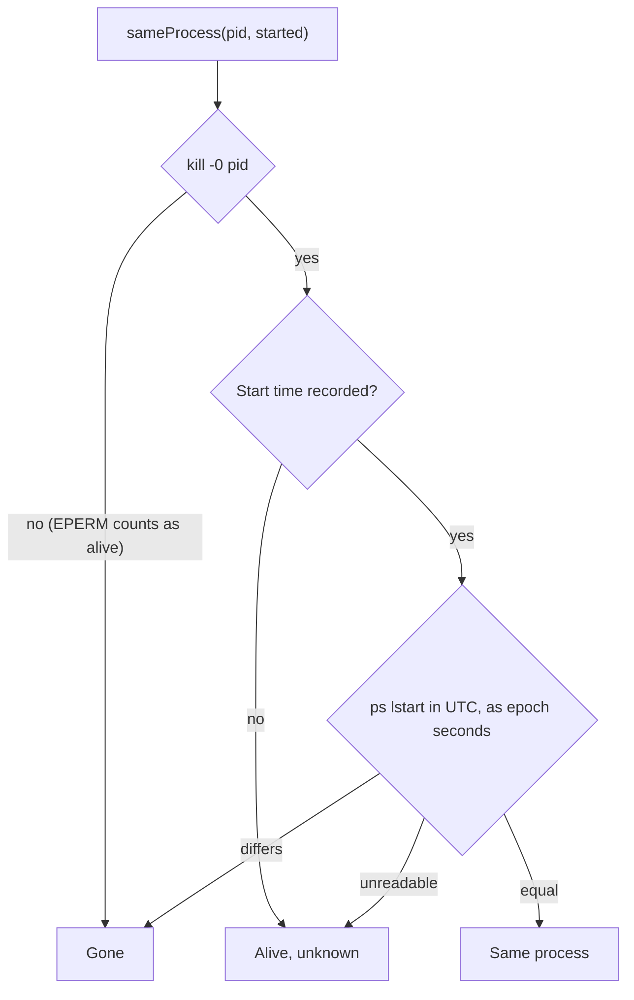
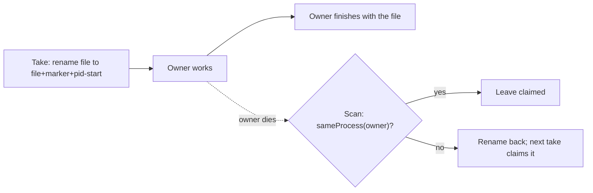

# Architecture

How the extension is laid out, for contributors. Users start with the [README](../README.md).

```bash
yarn workspace @octocodeai/pi-extension build      # tsc → dist/, then the Pi entry (scripts/bundle-pi.mjs)
yarn workspace @octocodeai/pi-extension test       # unit + end-to-end (real Pi session, scripted model, stdio MCP servers)
yarn workspace @octocodeai/pi-extension lint
pi --no-extensions -e packages/octocode-pi-extension/dist/pi-entry.cjs -e builtin:mcp -e builtin:tool-search
```

Pi loads `dist/pi-entry.cjs`. Pi evaluates an entry once per process but calls its factory on every `/reload`, and Node caches ES modules by URL, so loading `dist/index.js` directly kept running the first build. The build bundles `dist/index.js` into `dist/pi/octocode-<content hash>.js` (dependencies external); the entry's factory imports the bundle `dist/pi/current` names, so `/reload` runs new code (`tests/reload-entry.test.ts`). In a development checkout (`src/` beside `dist/`), `session_start` warns once when a `src/**/*.ts` file is newer than the current bundle (`src/shared/stale-bundle.ts`); an installed package skips the check. The previous bundle stays for a process that read the old pointer. Subagents start fresh processes and load `dist/index.js`.

## Layering

`src/index.ts` composes the features (each registers its own tools, hooks and commands), `src/turn.ts` settles starting tools and each turn's prompt section, `src/prompt.ts` is the prompt text. `tests/architecture.test.ts` enforces:

- Each domain imports only the domains it declares; `shared/` is the leaf and every domain may import it.
- Root modules may import any domain; no domain imports `index.ts` or a root module.
- No import cycles.
- One owner per helper: process signals in `shared/process`, error messages in `shared/util`, SHA-256 in `shared/atomic`, environment switches in `shared/env`, abort reasons in `browser/abort`.
- Only `shared/home` names `.octocode`.
- Only declared packages are imported: Pi is a peer dependency, `@octocodeai/config` is never imported, and no other package imports Pi.



An arrow means "may import". Every domain may also import `shared`; a domain with no outgoing arrow imports only `shared`. File names can change within these boundaries; split modules by responsibility.

| Folder | Role |
|---|---|
| `shared/` | Leaf helpers, one owner each. `util` errors, caps, time constants; `env` `OCTOCODE_*` names and parsing; `atomic` crash-safe writes, SHA-256; `process` liveness, process-tree kill; `winpath`, `winhelper*`, `winclassify` Windows helper and PowerShell rules; `claims` rename claims; `fence` the one way non-user text reaches the model; `interactive` whether a person can be asked (`hasUI` is also true for a subagent's RPC session); `tokens` the one token estimate; `home` Octocode and workspace paths, owner-only folders, repository root; `sweep` aged-output removal; `spill` oversized results saved whole to `output/`; `trust` project-config trust; `package` manifests; `commands` the `/octocode` router and `say`; `locks` per-tool lock and the one dialog queue; `format`, `render`, `visible-error`; `sanitize` ([policy](CONFIGURATION.md#sanitizing-policy), `storedSecret`); `rotating-log`; `octocode-tools` MCP name prefixes; `net` loopback check; `vision` image limits; `thought`, `open`, `status`, `messages`; `archive` the [archive of compacted history](COMPACTION.md#archive-of-compacted-history) and the session record, here because `compaction/` writes it, `subagents/` names it and `sessions/` sweeps it; `history` which history a session reads without asking, and its search and read paging, shared by the `archive` tool and the permission gate. |
| `files/` | `file` tool, read tracking (`reads`, `coverage`), repeated-read notes (`dedupe`), checkpoints and `/octocode rewind`, the `manual`-mode change `review`, the `bash` override with deadline and jobs, and their rendering. |
| `permission/` | Modes and the action-class table (`mode`), ask dialogs and effect cards (`request`, `effect`, `ask`), the `tool_call` permission step (`gate`), shell parser (`shell`), provenance tripwire, audit log, git snapshots, the `!` command gate, Shift+Tab override, `/octocode permission`. Nothing here is a sandbox; [integrity invariants](FEATURES.md#permissions) run first. |
| `agentdb/` | `octocode.db`: one connection per process, owner-only files, additive schema (`sessions`, `backlog`, `backlog_notes`, `memories`, `memories_fts`, `meta`, team tables), session liveness. |
| `sessions/` | Session extras, resume brief, `/sessions` picker, unreported background work, retention `sweep`. |
| `backlog/` | Store, `backlog` tool, `/backlog` board, text, Markdown and HTML export. |
| `memory/` | Store with FTS5 / `LIKE` search, `memory` tool, automatic injection, `/memory`. |
| `ask/` | `askUser` tool and dialog. |
| `mcp/` | Octocode MCP client: connect, retry, `list_changed`, tree close (`client`); tools as Pi tools (`tools`); launch and ownership (`octocode`); `/octocode mcp`. |
| `web/` | `web` tool: fetch and cache, HTML to text, search, saved-page leads, and `guard`, the one outbound fetch (checks the host and every redirect hop). Keyed search APIs use it as a POST with `redirect: 'error'`; every body read stops at the shared 5 MiB cap. |
| `browser/` | DevTools `browser` tool: snapshots, screenshots, input, tabs, dialogs, page-request policy (`network`, `policy`, `page-network`), filtering proxy, Chrome launch, CDP client, console log. |
| `api/` | External API: JSON-RPC over a Unix socket and loopback HTTP + SSE, instance registry, event replay, send receipts, client and CLI. |
| `external/` | Outgoing sessions: protocol, connection manager, ACP and native Pi backends, permission dialog. Depends on `api/` and `shared/`. |
| `team/` | Team store, edit log, reservations (`held`, `lease-key`), agents-communication lease check (`peer-leases`), message signing and spill, inbox and delivery, `coordinate` and `sendMessage`, the 1 s ticker, agents panel. |
| `subagents/` | Profile loading, model routing and the models.dev catalog, `pi --mode rpc` child lifecycle, event reducer, relay of a child's dialogs, reports, handoff, lingering runs, the `agent` tool, worktree isolation, screenshots. |
| `hooks/` | Optional Claude Code / Codex hooks: config, runner, Pi event mapping. |
| `compaction/` | Summary, cold-cache clearing, stale thinking left out of requests, file restore, thrash stop, archive writer and `archive` tool, session record, fork lineage, cache lifetimes, `413` recovery. Behavior: [COMPACTION.md](COMPACTION.md), [CONTEXT-AND-COST.md](CONTEXT-AND-COST.md). |
| `ui/` | Banner, footer, working line, queued-message ledger, terminal notifications. |
| root | `prompt.ts` prompt section, `turn.ts` active tools and prompt per turn, `skills.ts` extra skill directories. |

## Start-up wiring

Pi runs an event's handlers in registration order, so the order in `src/index.ts` is behavior. The factory registers everything, then `/octocode` last so its description names every subcommand. A subagent (`OCTOCODE_SUBAGENT=1`) skips the main-session-only parts.



A headless run (print, JSON, subagent) holds `agent_before_settle` until bash jobs and background subagents report. Before a session switch or fork, `confirmLeave` asks to stop running work.

Every `tool_call` passes three gates, cheapest and most certain first; the first block wins and is audited. A hook's `ask` goes on to the permission gate, so you are never asked about a call a hook would deny.



## MCP client

The extension runs its own MCP client because Pi's can publish an older `tools/list` response after a newer one and discard a refresh received during initial discovery. `tests/fixtures/relist-mcp.mjs` exercises both cases; our client guards refresh revisions and connection identity. Revisit when Pi's client passes the same checks.

## Liveness: who is still running

Every "is it alive" question is answered in `shared/process`: `processAlive` for a pid, `sameProcess` for a pid plus start time, so a recycled pid never counts. `sameProcess` is lenient: an owner that cannot be judged keeps what it owns. Before signalling a process, `processMatch` is used instead, where `unknown` is no match.



`sameProcess` is true for Same and Alive-unknown. The team store caches a live pid's start-time comparison for 30 s (a dead pid needs no `ps`). A claim is a rename, so only one process holds a file, and its owner is in the name:



Each record lives where its readers can reach it; none duplicates another.

| Source | Answers |
|---|---|
| `agents` table (`team/store`) | Is this team member or lease owner running? Heartbeat every 5 s; silent for 60 s means *stale* (hidden, row and mail kept); retired only when `sameProcess` is false. |
| `sessions.pid` (`agentdb/liveness`) | Is this Pi session open? Backlog claims, `/sessions` and the sweep ask; most sessions never join the team. |
| `OCTOCODE_PARENT_PID` (`team/session`) | Should this subagent exit? Value `<pid> <start time>`, checked every second without the database; a changed `process.ppid` also counts, and every 15th check compares the start time (a `ps`). |
| API instance files (`api/registry`) | Which APIs run here? Works without SQLite. |
| Worktree owner files (`subagents/worktree`) | May this worktree be pruned? Works when the database is unusable. |
| Bash job records (`files/bash-jobs`, `<id>-<ts>.job.json`) | Did a dead Pi leave this job running? Reaped at the next start. |
| Claim names (`shared/claims`) | Did the claimer die? Markers `.claim-` (pending subagent reports), `.reaping-` (bash job records), `.pruning-` (worktrees). |
| Scratch owner files (`subagents/handoff`) | May this handoff folder go? Its `agents` row is already gone. |
| `_pid-<n>` session folders (`sessions/sweep`) | Is the session-less process gone? The folder name is its only record. |
| Chrome `SingletonLock` (`browser/launch`) | Does another Chrome own this profile? Chrome's own record. |
