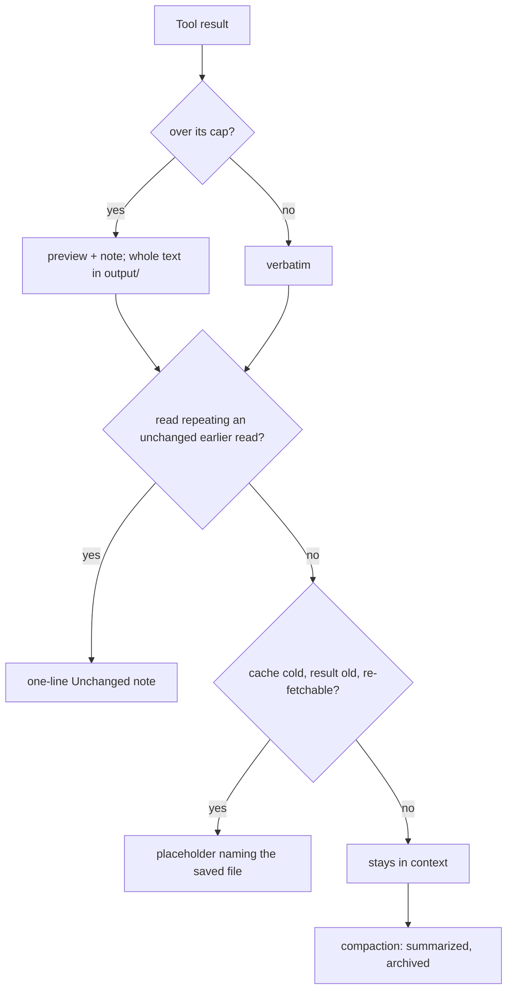
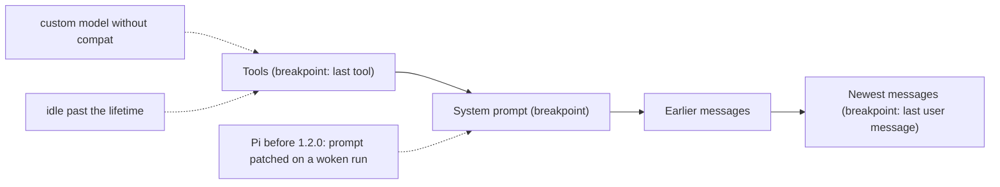
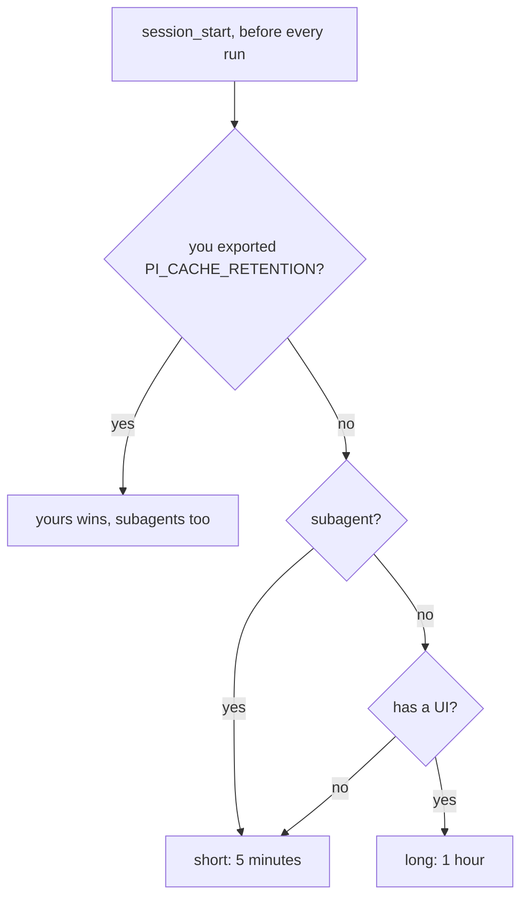
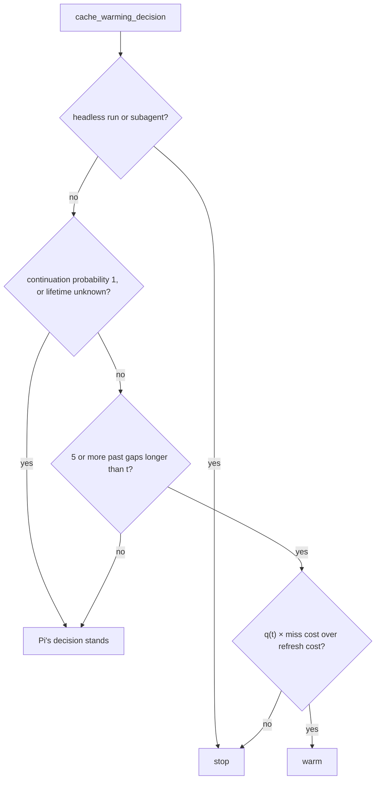
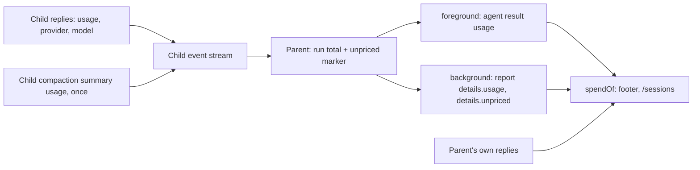

# Context, cache and cost

How Octocode keeps long Pi sessions inside the context window, the prompt cache warm, and shows what a session costs.
Measured numbers come from the user's last 40 Pi sessions on 2026-10-12 (6.3k replies, 938M prompt tokens, Opus 5.5 behind an
Anthropic-compatible gateway) unless stated.

## Who owns what

| Concern | Owner | Where |
|---|---|---|
| Compaction, clearing, 413 recovery | Pi's trigger, Octocode's rest | [COMPACTION.md](COMPACTION.md) |
| Cache breakpoints | Pi (pi-ai) | system prompt, last tool, last user message |
| Retention (5 minutes or 1 hour), lifetimes for models that declare none | Octocode | `src/shared/env.ts`, `src/compaction/cache.ts` |
| Warming | Pi's warmer, Octocode's decisions | Pi `cacheWarming`; `cache_warming_decision` in `register.ts` |
| Price of a reply | Pi (pi-ai `calculateCost`) | the model's `cost` in `models.json` or Pi's catalog |
| Showing usage and cost | Octocode | `src/shared/format.ts`, `src/ui/footer.ts`, agents panel, subagent rows |
| Subagent retention and cost roll-up | Octocode | `src/subagents/process.ts`, `tool.ts` |

## Context window

Tool results, call arguments and images stay verbatim until compaction, except below; each exception is a note saying what
happened and where the full text is.



Details: [413 recovery](COMPACTION.md#too-large-413) (images only, after a rejection),
[cold-cache clearing](COMPACTION.md#clearing-old-results-when-the-cache-is-cold), [repeated reads](#repeated-reads).

### Repeated reads

When `read` (or `mcp__octocode__localFetch`) returns exactly the text an earlier call with the same arguments returned, and
that result is still in the context, `registerReadDedupe` (`src/files/dedupe.ts`) replaces it with `[Unchanged since your
earlier read of <path> (same range); that result is above in your context.]`. Identical text is the proof; modification times
are not used. The note keeps the read's `details` and adds `unchangedOf` (the earlier call's id). Other arguments or text, a
compacted or cleared earlier result, errors and images keep their result. The file guard digests the text first, and a note
counts as a read only while its target is in the context.

### Spilled outputs

An over-large result is bounded when written, never silently: a preview stays, the whole text is saved, a note names it.

| Output | Kept in context | Saved whole |
|---|---|---|
| `capOutputToFile` (`src/shared/spill.ts`) | head (about 70%) and tail (about 30%) with an omitted-lines marker between that names the lines left out and the read that shows them (`(lines A–B of N; read them from the full output with offset A and limit L)`), and a closing `Output trimmed` note naming the file; if the file cannot be written, a plain cap marked `[full output could not be saved]` | `output/<label>-….txt` |
| MCP text part (`src/mcp/tools.ts`) | whole up to 60,000 UTF-16 characters (`TEXT_MAX_CHARS`); over it a head and tail preview, the tail keeping the `next.*` continuation | the part |
| MCP text of one assistant message (`TurnBudget`) | whole under 200,000 characters (`TURN_MAX_CHARS`); a part passing it keeps a preview within the remaining allowance (4,000 at least) | each cut part |
| MCP image over 600,000 base64 characters (`IMAGE_MAX_CHARS`) | resized by Pi with an "Image fitted for context" note; if Pi cannot resize, only the path | the original |
| `web` fetch (`src/web/web.ts`) | first `maxChars` (20,000 default, 50,000 max) with a note naming the file, then Pi's 50 KB / 2,000-line cap | whole page in `output/web-….txt` |
| `browser` evaluate, console | Pi's 50 KB / 2,000 lines | spilled as above |
| `browser` screenshot (`src/browser/screenshot.ts`) | the capture, or a smaller retake over 600,000 base64 characters; only the path when none fits | full-size capture |
| `browser` snapshot text, change lists (`capChars`) | each list's character budget with a note | take a snapshot |
| `bash` (Pi's truncation) | tail within 50 KB / 2,000 lines | the session's `bash/` folder |
| Subagent report (`src/subagents/report.ts`) | first 8 KB / 200 lines | the run's scratch folder |
| Hook context, block reasons, asks (`src/hooks/runner.ts`) | 16 KB via `capOutputToFile`; hook output past 64 KB is not read, a note says how much | spilled as above |

Spilled files follow the session's [retention](CONFIGURATION.md#retention). The `file` tool refuses to write one of these
notes into a file that does not already hold it.

### Compaction cost

What compaction does: [COMPACTION.md](COMPACTION.md). What it costs:

- **When it runs.** A 1M window with the default reserve compacts near 980k tokens: every request re-reads the whole history
  (cache reads were 36% of a measured 565k-token session's spend) and recall degrades long before. Compact on a token
  budget instead (like Codex's `model_auto_compact_token_limit`) with a per-model reserve ([example](COMPACTION.md#settings)).
- **Summary** ([methods](COMPACTION.md#the-summary)). Live run on `claude-haiku-5-5` (108k context, thinking `high`):
  cache-shared read 107,821 tokens from cache, 4 uncached input, 1,132 written; standalone has no cache read.
- **Archive** ([format](COMPACTION.md#archive-of-compacted-history)), local measurements:

  | Measure | Value |
  |---|---|
  | Segment, 18 compactions of about 160k tokens | median 205 KB, largest 386 KB (Pi's JSONL: about 330–420k characters) |
  | Segment, whole local store of 406 segments | p50 428 KB, max 2.7 MB |
  | Write (render, atomic write, library rebuild) | median 22 ms, largest 47 ms |
  | `LIBRARY.md`, 18 segments | 10.6 KB |
  | Pointer in Recovery, five earlier segments | about 1,250 characters (8 lines) |

  Only the pointer enters the context, in a summary that is new anyway (after a default summary, one hidden message behind
  the cached prefix): no cache miss. A subagent's task gets one line of about 480 characters.

### Scan cost of a large web result

`permission/provenance` indexes a tool result so that a later call repeating it is flagged. It reads at most 256 KB of a
result (`MAX_BYTES_PER_RESULT`), and that scan, not the HTML-to-text pass of `web/scan` (about 8–13 ms for 256 KB), was the
56.5 ms measured for a 256 KB web result: 200,000 rolling hashes, each stored in a `Map`. `node scripts/bench-web-scan.mjs`
(build first; `--runs N`, `--json`) measures it in CPU milliseconds, best / median / worst of 15 runs after a warm-up:

| Scan of 256 KB | Before (`Map`) | After (`KeyTable`) |
|---|---|---|
| `record`, text with no repeated window | 44.9 / 59.3 / 138.0 | 13.4 / 14.2 / 50.3 |
| `record`, prose | 47.6 / 54.3 / 66.8 | 15.4 / 15.7 / 17.5 |
| `check`, a 500-character command | 0.0 / 0.0 / 6.6 | 0.0 / 0.0 / 0.0 |

The hashing itself is 2–14 ms; the rest was the `Map`'s per-key allocation and rehashing. The index is now an
open-addressing table over two typed arrays (`permission/key-table`), sized once from the ring: the same hits (every
provenance test passes unchanged), about a quarter of the CPU. The first scan in a fresh process is not faster (66–134 ms
before, 77–88 ms after, one-shot runs on a loaded machine): it is dominated by the JIT compiling the hash loop, and the
benchmark's "first" column shows it.

## Prompt cache

Anthropic caches a request's prefix (tools, system prompt, messages) at the breakpoints pi-ai marks. Opus 5.5 list price per
million tokens: $4 input, $5 write, $8 1-hour write, $0.20 read (a write costs 25× a read). In measured sessions 94% of
prompt tokens were cache reads, yet cache writes were 44% of the spend.

### Keeping the prefix stable

A change before the newest messages re-bills all after it.



Two causes rewrote whole contexts in measured sessions (45% of spend over 12 sessions):

- **Pi older than 1.2.0** (below this package's peer range). A run a background report wakes starts without
  `before_agent_start`, so from its second request the `octocode` prompt section is patched away and back: two full
  rewrites per report ([pi#10267](https://github.com/earendil-works/pi/issues/10267), fixed in 1.2.0). An interactive
  session warns at start.
- **A custom model without the catalog's `compat`.** Without `supportsMidConvoSystemMessages` (and
  `supportsMidConvoToolChanges`), `anthropic-messages` folds every prompt or tool change into the head, so a late MCP connect
  rewrites the cache. Copy the built-in entry's `compat`, `promptCache`, `reasoning` and `thinkingLevelMap` into your
  `models.json` (the footer warns if `reasoning` is missing).

### Retention

At `session_start` and before every run, Octocode sets `PI_CACHE_RETENTION`
([CONFIGURATION.md](CONFIGURATION.md#environment-variables)):



| Session | Retention | Why |
|---|---|---|
| Interactive | `long` | 55% of cache-write spend was entries that expired after 5 to 60 minutes idle (186 of 195 misses had gaps under an hour) |
| Headless (print, JSON) | `short` | no one idles between requests |
| Subagents | `short`, in the child's environment | a child runs briefly, back to back |

pi-ai and Pi's warmer read the same variable, so they agree on the lifetime. A 1-hour write costs 2× input instead of 1.25×;
the saving outweighs it (about −$45 of idle rewrites against +$23 on other writes per $200). On a live gateway an
interactive session's cache write reported `cacheWrite1h`, a headless one's did not. `long` asks every provider for its
longer entry: 1 hour on Anthropic and Bedrock, `prompt_cache_retention: "24h"` on OpenAI-style APIs; others ignore it.

### Lifetimes for models that declare none

A catalog model declares its lifetime (`promptCache`); a custom `models.json` model usually does not. Once its replies report
cache use it is known to cache until the extension reloads (an aborted reply without usage does not undo that; after
`/reload` its next cached reply teaches it again). Its lifetime is 300 s, 3,600 s with `long`, or 300 s when replies show
`cacheWrite1h: 0` (the provider granted only 5 minutes) or its `compat` denies long retention. For an `anthropic-messages`
model Octocode also puts these into Pi's registry (`pi.registerProvider`), adding `promptCache` only to models seen
caching; Pi applies overrides last, so your own `promptCache` wins. A provider with resolved headers (a built-in one) is
left alone, and a refused registration is not retried. Other models use the inferred lifetime for warming decisions only.

### Warming

Pi's warmer refreshes an entry before it expires when that pays: during a run (`cacheWarming: "streaming"`, default) or
between runs (`"idle"`). Octocode decides through `cache_warming_decision`:



q(t) is the share of past gaps longer than the current idle time t that ended after t + τ/10 and by t + τ (τ is the
lifetime), replacing Pi's constant 15% chance that the user continues.

## Cost and usage

### Where a price comes from

Octocode never prices tokens: every amount sums the `usage.cost.total` Pi attaches to each reply (pi-ai `calculateCost`,
the model's `cost` rates):

`cost = input × in + output × out + cacheRead × read + (cacheWrite − cacheWrite1h) × write + cacheWrite1h × 2 × in`

A rate `tier` (Haiku 5.5 above 100k prompt tokens) applies when the request's prompt tokens exceed its threshold. A model
with no `cost` is free. So every amount
is an **estimate at list price**, not what a gateway bills (no data-residency ×1.1, fast-mode or batch modifiers). A
`models.json` entry overrides a stale catalog one (add `cost` and `tiers`). Anthropic's prices:
[platform.claude.com pricing](https://platform.claude.com/docs/en/about-claude/pricing).

### How it is shown

One money format and one token format (`src/shared/format.ts`) are used everywhere: the footer, agents panel, `coordinate
list`, `/agents`, subagent rows, reports, `/sessions`.

| Shown | Meaning |
|---|---|
| `≈$2.28` | summed list-price estimate (`≈$<0.01` for tiny amounts) |
| `≈$2.28 + n/a` | part of the usage came from a model with no pricing, not in the amount |
| `cost n/a` | none of it was priced |
| `↑1.2M (94% cached) ↓35k` | ↑ every prompt token (uncached input, cache reads, cache writes), with the share read from cache; ↓ output |
| `ctx ▰▰▱▱ 45% of 200k` | context against where Pi compacts automatically (window less `compaction.reserveTokens`; the window when compaction is off) |

The footer and `/sessions` count the same messages (`spendOf`, `src/shared/util.ts`): replies, a foreground subagent's `agent`
result (`usage`) and a background subagent's report (`details.usage`, `details.unpriced`). `coordinate list` and the agents
panel show each agent's own replies, a running child as its own row. A forked session's `/sessions` cost counts only what it spent since the fork; the footer
shows the whole branch.

A reply is unpriced when its model's rates are all zero (a subagent's `agent` result names no model: `details.unpriced`
decides). The first unpriced reply warns once: `<provider>/<model> has no pricing in models.json; its usage
is not in the cost`. Team totals live in the shared agent database (`agents.cache_read`, `agents.unpriced`; a session's flag in
`sessions.unpriced`); builds add columns and remove nothing, so builds of different ages share the file.

## Subagents

A subagent is a separate `pi --mode rpc` process running this extension: everything above applies, with `short` retention
and no warming.



A stopped run reports what it spent. What a child spills lands in its own session folder (named by its id), swept like the
parent's.

**Cache sharing.** Per-child data (id, name, goal, scratch folder, parent) and the [archive](COMPACTION.md#archive-of-compacted-history)
line ride in the task message, and the coordination rule only in the main session's prompt, so children of the same profile
and options (`collaborate` changes the prompt) send the same tools and system prompt and read each other's cached prefix
within its lifetime. Each child still pays one write of what differs (about 19k tokens, roughly $0.10 on Opus 5.5). A child
in an isolated worktree has a different working folder in its prompt and shares nothing.

## Check it yourself

- **Fixed context:** `tests/prompt-size.test.ts` budgets extension-owned descriptions, schemas and guidelines;
  `tests/e2e.test.ts` a real Pi request with the local MCP (base prompt, active tools, server instructions). Personal
  skills, repository instructions, other MCP servers and history add to it.
- **This session:** the footer shows `↑… (N% cached)` and `≈$`; Pi's `showCacheMissNotices` shows misses.
- **Past sessions:** each reply's `usage` in `~/.pi/agent/sessions/*/*.jsonl` has `input`, `cacheRead`, `cacheWrite`,
  `cacheWrite1h` (above 0: a 1-hour entry) and `cost`.
- **Session health:** `scripts/session-health.mjs` reads transcripts (next section).

### Session health

Tests cannot see what a transcript shows: the stale-thinking bug dropped 2,581 blocks in one session while every test
passed. `scripts/session-health.mjs` (plain Node, no dependencies) reads Pi session JSONL files and prints, per session
and per segment between compactions:

- **Thinking drops:** `thinking_dropped` transformations Anthropic recorded in each request's `diagnostics`: total,
  per-request minimum and maximum (`constant` or `varies`), requests with drops, reasons, first dropped path.
- **Cache:** hit rate `cacheRead / (cacheRead + cacheWrite + input)`, and the requests whose `cacheRead` fell to 0
  (`zero`) or below half of the previous request's (`drop`), with timestamps.
- **Compaction:** `tokensBefore`, summary characters, method, usage and cost, and what it kept: the messages from
  `firstKeptEntryId` up to the compaction entry, their characters (text, thinking, tool-call arguments, tool-result text)
  and thinking blocks. Session cost includes the compactions.

```bash
node packages/octocode-pi-extension/scripts/session-health.mjs                 # newest 5 under ~/.pi/agent/sessions
node packages/octocode-pi-extension/scripts/session-health.mjs --limit 2 --json
node packages/octocode-pi-extension/scripts/session-health.mjs path/to/a.jsonl --page-size 100 --page 2
```

`--session <text>` keeps files whose path contains the text; `--dir` changes the sessions folder. Text output is paged
by lines (`--page`, `--page-size`) with a footer naming the next page; `--json` prints everything. `--help` lists all.

Reading it:

- **Thinking-drop baseline.** A healthy segment has `total 0`. A constant nonzero count per request (say `12..12`) means
  every request replays the same history with the same blocks dropped: a stable baseline, not growth. Compare it with
  the compaction's `kept … thinking blocks`: on the measured sessions the two matched (12 kept, 12 dropped per
  request; 44 and 44), so the kept messages' thinking is what is dropped. A count that climbs with each request is the
  stale-thinking bug. `first dropped path` (`messages.2.content.0`) says where in the request it starts.
- **Cache reset.** `fell to 0` with a large `cacheWrite` means the whole prefix was rewritten: an expired entry after an
  idle gap longer than the retention (check the timestamps against the previous request) or a prefix change. A `dropped
  sharply` flagged `first request after a compaction` is expected: the summary replaced the history, and the tools and
  system prompt (about 28k tokens) still hit. The same flag in the middle of a segment is not expected.

Tests: `tests/session-health.test.ts` runs the script on a fixture transcript.

## Known limits

- The cache-shared summary needs a warm cache. Compaction's other limits: [COMPACTION.md](COMPACTION.md#limits).
- Idle warming needs Pi's `cacheWarming: "idle"`; with the default `"streaming"`, 1-hour retention covers pauses.
- Background reports saved before their usage was recorded count nothing.
- Usage Pi records separately (cache refreshes, compaction and branch summaries) is in Pi's `/session` totals, not the footer.

## Tests

Under `tests/` (compaction's: [COMPACTION.md](COMPACTION.md#tests)): `read-dedupe`, `compaction-cache`, `files`, `elision`,
`sessions*`, `bash`, `hooks`, `shared`, `key-table`, `footer`, `team-panel`, `subagent-goal`, `agentdb`, `subagent-tool`, `session-health`.
