# Feature reference

Behavior of every Octocode for Pi feature. The [README](../README.md) has the overview and commands. Other owners: [CONFIGURATION.md](CONFIGURATION.md) (variables, file locations, trust, hook and profile formats), [API.md](API.md), [COMPACTION.md](COMPACTION.md) and [CONTEXT-AND-COST.md](CONTEXT-AND-COST.md) (compaction, archive of compacted history, prompt cache, repeated reads, cost).

## File tool

One `file` tool takes batched `edit`, `write` and `delete` queries, each with a reasoning line. At session start it replaces Pi's `edit` and `write` once, unless `--tools` or the `defaultTools` setting names them.

**Read before you change.** A change that could overwrite unseen content is refused, naming the first unseen line and the `offset` to read from. Reads through MCP tools are not tracked: use `read`.

| Change | Needs |
| --- | --- |
| Existing file | A read this session (new files are fine) |
| `write` | Every line seen, in one read or ranges of an unchanged file (an image read counts as whole) |
| `delete` | A current read |
| `edit` of a file changed since the read | Each `oldText` matches the current bytes exactly once, else the refusal names the lost or ambiguous anchor. A later `write` or `delete` needs a fresh read |
| Read left the context (rewind, compaction, `/tree` move) | A fresh read |

Staleness compares size, mtime, ctime, inode and, when known, SHA-256. An `edit` keeps earlier coverage (a partial read stays partial; ranges survive only if the line count is unchanged); the tool's own `write` counts as a whole read; a read of a file changed on disk restarts coverage.

**Paths.** A path outside the repository root (realpath of the git root) is a `file.outside` [permission](#permissions) ask. Anything under the Octocode home (`~/.octocode`, including `pi-trust.json`) is refused in every mode.

**Writes** are atomic (temp file, fsync, rename, directory fsync), keep the file mode, write through symlinks, and fail if the file no longer holds the checked bytes.

## Bash

Replaces Pi's `bash` (honors `shellPath` and `shellCommandPrefix`; same streaming output and `Elapsed` timer) and adds a deadline and background jobs.

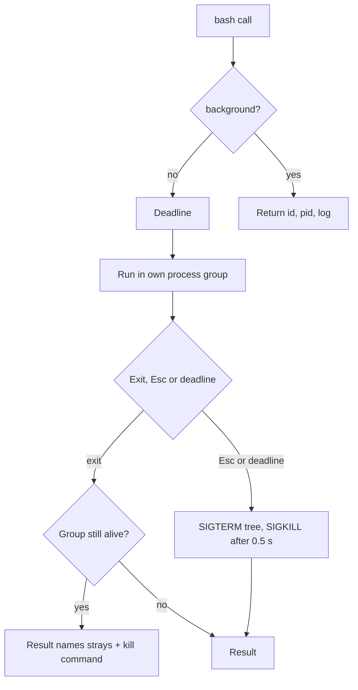

| Limit | Value |
| --- | --- |
| Foreground deadline | 15 min unless `timeout` is given; above 3,600 s it is clamped and the result says so |
| Background deadline | None unless the call gives `timeout` |
| Job log | `<Octocode home>/agent/pi/sessions/<session>/bash/`; past 16 MB it moves to `<log>.1` (replacing the previous) and the new log names it. The browser console log rotates the same way |
| Job report | Exit status, run time, last 40 lines, as a message that wakes an idle session |

Pi's full-output file for truncated output moves into the same folder; logs are swept ([Retention](CONFIGURATION.md#retention)).

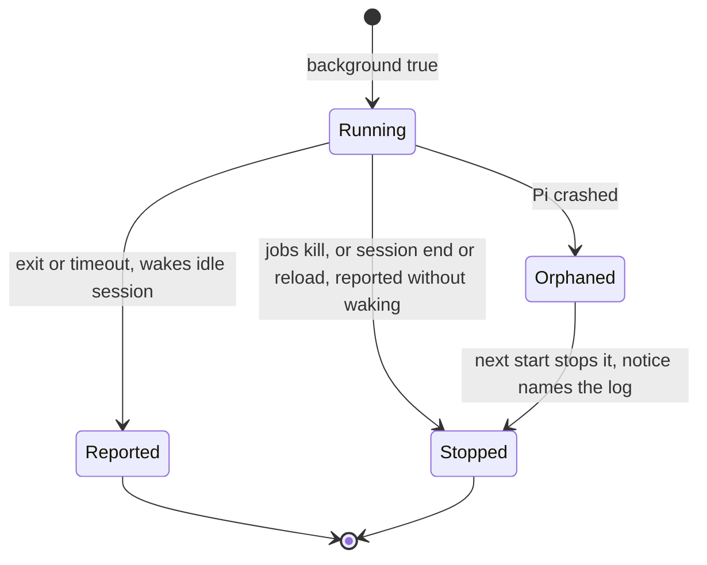

- `/octocode jobs` lists jobs (the status bar counts them); `/octocode jobs kill <id>` stops one. A resumed session's brief names a job that never reported.
- Print, JSON and subagent runs wait for jobs with a timeout and stop those without one at run end; the report arrives as one more turn. That wait has no time cap; an interrupt ends it.

### Bash safety

A flag for common accidents, not a security boundary: it reads the command's words, so quoting and variable tricks pass. A flagged `bash` or `powershell` call is a `shell.destructive` [permission](#permissions) ask in `manual` and `workspace`; in `full` it runs with a [git snapshot](#snapshots) and a ⚠ audit entry.

Flagged:

- `rm -r` of `/`, home or a folder holding it; any `rm`, `rmdir`, `unlink`, `shred` in `/usr`, `/etc`, `/bin`, `/sbin`, `/lib`, `/boot`, `/System` or `~/.ssh`. Relative targets resolve against the working directory (an earlier `cd` moves it); `~/.`, `$HOME/..` and `--no-preserve-root` count.
- `chmod -R`, `chown -R`, `chgrp -R` on those places; `find … -delete` or `-exec rm` from them.
- Writes to a disk device (`dd of=/dev/…`, `> /dev/sda`, `tee`, `truncate`, `wipefs`, `blkdiscard`, `cp`, `mv`), `mkfs`, `newfs`, `diskutil erase…`, `shutdown`, `reboot`, `halt`, `poweroff`, a fork bomb.

It sees through `&&`, `;`, pipes, `$(…)`, wrappers (`sudo`, `env`, `timeout`, `nice`, `xargs`, `stdbuf`, …), `sh|bash|zsh -c`, `eval` and heredoc or herestring bodies fed to a shell. A command you type with `!` runs in Pi's bash shell (Git Bash on Windows) under the same rules. A `PreToolUse` hook that blocks refuses the call in every mode (audited, naming the hook); a hook's `ask` is a `hook.ask` ask.

On Windows the [helper](#windows-helper) parses PowerShell:

- Flagged: aliases, `-Command`, `-EncodedCommand`, `cmd /c`, `Remove-Item -Recurse` on a protected place, `Format-Volume`, `Stop-Computer`.
- cmd switches read as a cluster (`rd /s/q x`); `..` and `\\?\` resolve before comparing with protected places; arrays are checked per target.
- Not judged: a computed name (`& $tool`). A script that does not parse, or no usable PowerShell, counts as `shell.destructive`.

### Windows helper

One `pwsh` (else Windows PowerShell) per Pi process starts on first use. It owns a Job Object per bash command, background job and subagent, so the tree ends when the owner stops or Pi dies, and it parses PowerShell for the classifier. Shells and `taskkill` start by absolute path, so a repository file named `powershell.exe` cannot run before a permission ask. It fails closed: no usable shell, a crash or a timeout answers "no". Not in the job: a grandchild started before it joined, and a `Win32_Process.Create` process.

## Checkpoints

A turn is one user prompt (typed or over RPC); runs woken by team messages or job reports are not turns.

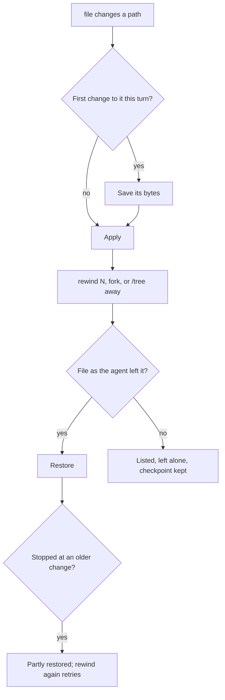

| Limit | Value |
| --- | --- |
| Location | `<Octocode home>/agent/pi/sessions/<session>/checkpoints/` (content-addressed) |
| Per file | 8 MiB; larger files are skipped with a note |
| Per session | 256 entries (a file's first change per turn), 128 MiB; oldest turns dropped first. A turn past either cap saves no more files and says so |

`/octocode rewind [turns]` (default 1) restores newest first. `/fork` offers the same restore for turns after the fork point, and `/tree` when you navigate away from turns that changed files. Shell writes are not checkpointed. Retention: [Retention](CONFIGURATION.md#retention).

## Permissions

One mode decides which agent actions run and which ask first, through one helper and one dialog queue. **`full` is the default**: nothing asks and every decision is recorded ([Audit](#audit)). Use `manual` or `workspace` to be asked.

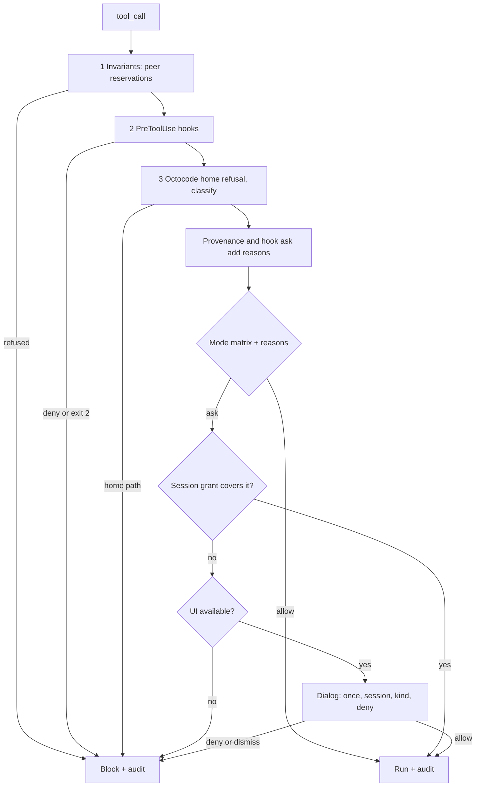

The first block wins. A hook's `ask` joins the permission step, so a call a hook would deny never asks you. Tools holding data only they have (`file` review, memory scope, a web URL's host, upload paths, subagent profile) run the same check inside `execute`, so nothing asks twice.

| Action | `manual` | `workspace` | `full` |
| --- | --- | --- | --- |
| Reads in the repository, read-only MCP, `askUser`, `backlog`, `coordinate`, `sendMessage`, `memory`, `archive` | run | run | run |
| Reads outside the repository (`read`, `grep`, `find`, `ls`) | ask | run | run |
| File changes in the repository (`file`, Pi's `edit`/`write`) | ask (the review) | run | run |
| File changes outside the repository, and repository files that run in later sessions: `.git/`, `.pi/`, `.claude/`, `.codex/`, `.agents/`, `.octocode/hooks.json`, `.octocode/agents/`, `.octocode/skills/` at the root; `.git/hooks`, `.husky`, `.github/workflows`, `.vscode/tasks.json`, `.envrc` at any depth | ask | ask | run |
| Shell (`bash`, `powershell`) | ask | run | run |
| Shell the [guard](#bash-safety) flags (`shell.destructive`) | ask | ask | run |
| `web` fetch and search; `browser` navigation and page actions | ask | run | run |
| `web` or `browser` to a private, loopback, link-local or metadata host (`net.private`) | ask | ask | run |
| `browser` `evaluate`, `attach`, `upload` (`browser.control`); `upload` from outside the workspace is also `upload.outside` | ask | ask | run |
| MCP tools not read-only (`mcp.write`); with `destructiveHint` (`mcp.destructive`) | ask | run / ask | run |
| `agent`, `externalAgent` | ask | run | run |
| Hook `permissionDecision: "ask"` (`hook.ask`), provenance hit (`provenance`), profile that declares `permissions:` (`profile.permissions`) | ask | ask | run |

- **Start mode.** Every session start (new, resume, fork, reload) applies `OCTOCODE_PERMISSION=manual|workspace|full` (default `full`) and drops session grants; an invalid value starts in `manual` with a warning. Keep an untrusted repository in `manual`, or in a container.
- **History reads.** History in scope (the session's own archive, its fork sources', its parent's, and its repository's other sessions) counts as in the workspace for `read`, `grep`, `find`, `ls` and read-only MCP tools; another repository's session folders ask as `read.outside` ([COMPACTION.md](COMPACTION.md#in-subagents)).
- **No workspace** (`~`, a folder above it, `/`): every path is outside (`file.outside`, `read.outside`, `upload.outside`). `full` is unchanged.
- **Without a UI** (print, JSON) every ask is denied, telling the agent not to retry and to ask the user or start Pi with the `OCTOCODE_PERMISSION` value that allows it. A UI-less `full` run prints a stderr banner at start and a summary at the end.

**Integrity invariants** protect correctness, coordination or your own trust decision: they hold in every mode, never ask, and refusals are audited.

| Invariant | Enforced by |
| --- | --- |
| No `file`, `edit` or `write` into the Octocode home (shell is not parsed for it) | permission gate |
| No change to unread files, to files a `write` has not fully seen, or changed on disk since (an `edit` applies if each `oldText` matches once); no copied elision or truncation notes | `file` tool |
| Peer reservations (Pi's team and agents-communication) | reservation gate ([Team](#team)) |
| `browser` `attach` only to a loopback DevTools endpoint on the requested port | CDP connection |
| Page-initiated requests to private addresses | [Web and browser](#web-and-browser) |
| An untrusted project cannot save, change or delete global or pinned memory | `memory` tool |
| A hook's deny, and a `"failClosed": true` hook that fails | [Hooks](#hooks-opt-in) |

**Asking reasons.** A provenance hit, a hook `ask` and declared profile permissions tighten a call. In `manual` and `workspace` one dialog names the effect and each reason (`shell · provenance · workspace mode asks`) and one yes covers the call; in `full` the audit records each. A session grant never covers a tightened call; a hook's `allow` skips no ask; a destructive MCP hint beats a read-only one.

**The dialog** shows the whole command, path, URL or arguments and an effect card computed from the call, not from the agent: effect, how to undo it, why it asks, risk (`unknown` if not ready in time). The agent's stated purpose comes last, marked `(unverified)`.

| Choice | Notes |
| --- | --- |
| Allow once | Always |
| Allow *exactly this* for the session; Allow all *&lt;kind&gt;* for this session | Not for a forced ask |
| Deny | |
| Deny and tell the agent why | The note reaches the agent with the refusal |

A queued call rechecks newly granted permissions first. Dismissing or interrupting cancels the action; it is not a rejection.

**Session grants.** An exact grant names one simple shell command (with tool and working directory), a folder, a host, one kind of browser page action, an MCP tool, or a subagent profile with its reach; compound commands have none. `shell.destructive`, `browser.control`, `mcp.destructive`, tightened and two-class calls offer none. *Allow all file changes outside the workspace* also covers repository files that run in later sessions. `/octocode permission grants` lists; `grants clear` drops.

**File review** (`manual`): lists each change with its reasoning; Apply all, Allow all file changes in the repository for this session, Review one by one, or Reject all. Feedback can attach to the batch or one change. Rejected changes fail with "do not retry" plus feedback; accepted ones apply when the review finishes. Dismissing cancels the batch.

**Switching.**

- Shift+Tab cycles `full` → `workspace` → `manual` (TUI, main editor focus only; it replaces Pi's thinking shortcut there: `/thinking <level>` still works, `app.thinking.cycle` can be rebound).
- `/octocode permission <mode>` works anywhere, RPC included; bare, it shows mode, class rules, reasons, grants and the provenance index size.
- A change notifies you and reaches the model as one hidden message (the cached system prompt is unchanged). A mode change, restart or grant clear cancels pending approvals, so a late answer cannot authorize under the new policy; a stricter mode or grant clear also stops active subagents and pending launches (a saved child conversation can resume after fresh authorization).
- Footer chip: `⏸ permission: manual · Shift+Tab`, `⏵⏵ permission: full · 12 actions · 2 ⚠ · Shift+Tab` (unasked actions, ⚠ count).

### Audit

Every decision is a session entry (`pi.appendEntry`; never sent to the model): action, target, mode, allowed or not and how (mode, grant, you, hook, refusal, relayed answer), a redacted note, and the [snapshot](#snapshots).

- `/octocode permission log` lists the last 50. At most 5,000 calls per session; a rollup entry counts the rest by action.
- ⚠ marks `shell.destructive`, `browser.control` and `net.private`: footer counter, a warning-colour activity line (ordinary bursts share one line; every ⚠ shows) and the exit summary.
- A subagent's entries go to its parent under the child's name.

### Snapshots

Before a `shell.destructive` command runs (in `full`, or after an ask), a git snapshot of tracked files is taken into `refs/octocode/snapshots/<ms>-<n>` (`git stash create`; working tree and index untouched). The audit entry and dialog name the ref; `git checkout <ref> -- <path>` restores a path.

- Untracked and ignored files are not included. A snapshot over 5 s is abandoned.
- `git stash create` needs a committer identity; without one the card reads `nothing can be restored: no snapshot (snapshot failed)`.
- Old refs are deleted at the next session start ([Retention](CONFIGURATION.md#retention)). The refs live in your repository, so `git push --mirror` pushes them. Not a backup.

### Permissions in subagents

A subagent's mode is its parent's current mode, set explicitly; your `OCTOCODE_PERMISSION` never reaches it.

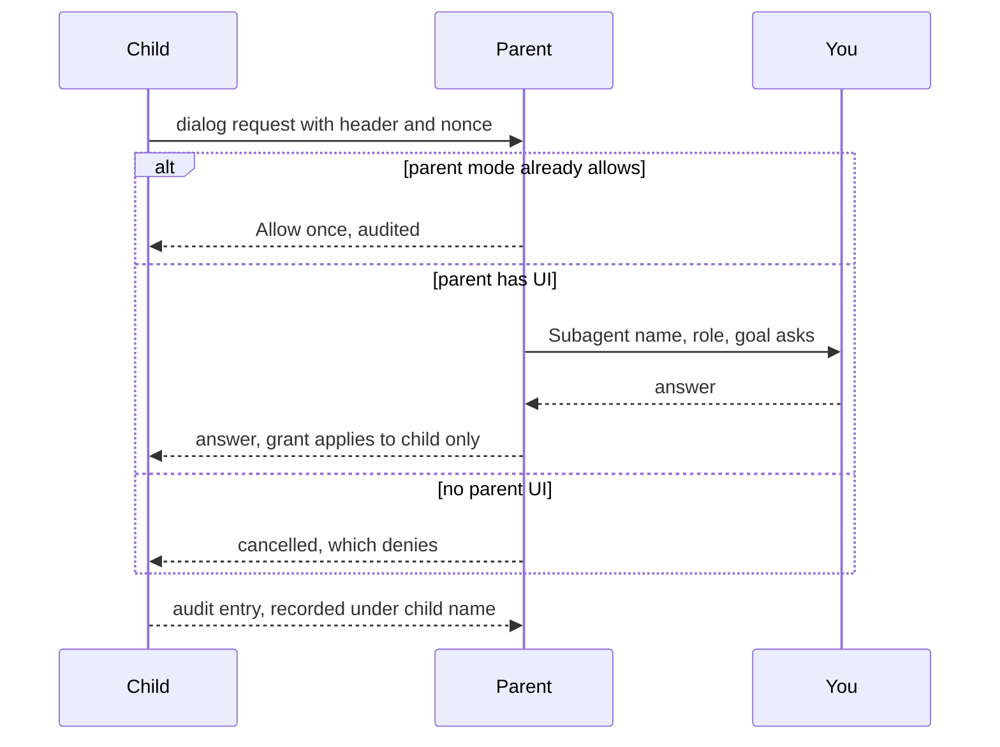

- **Relay.** The child's dialogs join the parent's queue, titled `Subagent <name> · <role> · <goal> asks:`. The parent accepts a request only with the child's nonce (a random per-child secret in an owner-only file the child reads and deletes at start, never in environment, arguments or process listing) and only if the header's action matches the dialog's target lines. `askUser` dialogs always reach you.
- **Limits.** One open dialog per child; over 10 in a minute the rest of that minute is denied without asking you, with one warning. While one waits, the row reads `waiting for your approval` and its deadlines pause.
- **Audit.** Past 1,000 entries per child only routine ones (allowed, no ⚠, nobody asked) stop being recorded and are counted per action.
- **Resume and isolation.** Each resume of a lingering agent repeats the spawn authorization with the current mode and grants. An isolated worktree is trusted when its parent trusts the source repository. The `agent` row, `Done (…)` line and report count calls the child could not run for lack of approval (`2 denied`).
- **Spawn ask** (`manual`): once per spawn, showing profile, tool reach and the whole task. Allowing hands the child a grant for the workspace classes the profile reaches (repository file changes, shell) plus every grantable kind you allowed for the session.
- **Profile grants.** A profile can declare `permissions:` ([format](CONFIGURATION.md#subagent-profiles)); it forces the spawn ask in `manual` and `workspace`, listing each class, and an allow grants exactly those; `full` asks nothing. Approval and spawn grant are keyed by profile name and a hash of the profile file, so an edit asks again.

### Provenance tripwire

Output from open-world sources (`web`, `browser`, `externalAgent` replies, MCP tools not marked closed-world, network commands such as `curl`) and private reads (outside the repository, secret-looking text) is indexed in memory as hashes only.

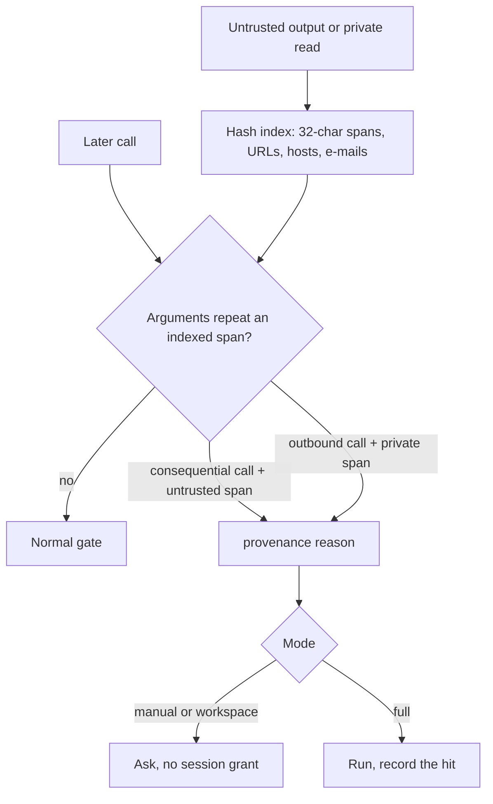

- **Consequential** (checked against untrusted spans): a shell command; a file path or content that runs or configures later sessions, runs as code (`*.sh` and other scripts, `bin/`, `scripts/`, `Makefile`, `justfile`, `.envrc`, `.github/workflows/`) or lies outside the repository; an MCP write; a memory; an `externalAgent` `connect` or `prompt`.
- **Outbound** (checked against private spans): a `web` URL or search query, a browser `navigate` or `tab` URL, a network command, an `externalAgent` prompt.
- Untrusted text written as data into an ordinary workspace file does not ask. Pi's MCP resource reader counts as open-world.
- A tripwire, not a boundary: paraphrase, encoding or splitting defeat it.

| Limit | Value |
| --- | --- |
| Minimum matched span | About 33 characters. A URL, host or e-mail first seen in untrusted output, or a secret token from a secret-looking line, matches alone |
| Index | 256 KB per result, about 200k hashes (a huge result can push out older entries) |
| Network commands | Fixed list (`curl`, `wget`, `ssh`, `scp`, `nc`, …); not `git`, `npm`, `python`, `node` |
| Unannotated MCP tool | Plain MCP write (runs in `workspace`); only `destructiveHint: true` asks each time |
| `sendMessage` | Not gated: a peer acts under its own mode |

**Not a sandbox.** Modes, grants and the tripwire decide what Octocode asks about, not what the OS user can do: a shell command allowed once can do anything that user can. For a real boundary use a container or VM (Pi's `docs/security.md`).

## MCP

The bundled [Octocode MCP](https://github.com/bgauryy/octocode) server runs on the extension's own MCP client; each tool registers as `mcp__octocode__<tool>`, declared from the first request (no `tool_search` step). The prompt tells the model to prefer these for code research (overriding Pi's "use bash for ls, rg, find"); `read` stays, and bash stays for builds, tests, git and commands. Launch, results, lifecycle, overrides: [MCP](CONFIGURATION.md#mcp). Result budgets: [Spilled outputs](CONTEXT-AND-COST.md#spilled-outputs).

## Prompt

An `octocode` section in Pi's structured system prompt covers research routing, verification and delegation, then the MCP server's instructions once connected (the first prompt waits for it). Tool descriptions own usage.

- **No `file`, `write` or `edit`:** one "investigate and report; do not modify the repository" rule. With bash: read-only commands, writes only to the scratch folder and the task's output path; MCP without bash: read-only MCP tools; else the content goes in the report.
- **Communication.** `coordinate`, `sendMessage` and `agent` inside a Pi team; agents-communication tools only for agents outside Pi, whose file locks Pi honors ([Team](#team)).
- **Durable results** go in a doc under `.octocode/<topic>/` named in the task; scratch is for throwaway hand-offs.
- **Caching.** Nothing unique to one subagent is in the section, so subagents of one profile share a cached prefix ([Subagents](CONTEXT-AND-COST.md#subagents)).

## Skills

- Pi loads `~/.agents/skills`, `~/.pi/agent/skills`, and the project's `.agents/skills` and `.pi/skills`.
- Octocode adds, in the main session only: `~/.claude/skills` (except claude.ai's `synced/`), `~/.codex/skills`, `~/.octocode/skills` and, in trusted projects ([Trust](CONFIGURATION.md#trust)), `.claude/skills` (working directory up to the repository root) and `<repo root>/.octocode/skills`.
- Subagents skip the additions; `OCTOCODE_EXTRA_SKILLS=0` turns them off.
- Install with `npx octocode skill install <name>`.

## Subagents

`agent` runs a task in a fresh Pi process (`pi --mode rpc`, task sent on stdin, so any length arrives whole) with this extension, Pi's built-in MCP and tool search (omitted for `mcp: false`, which also starts no Octocode server). A subagent cannot ask you directly or start subagents.

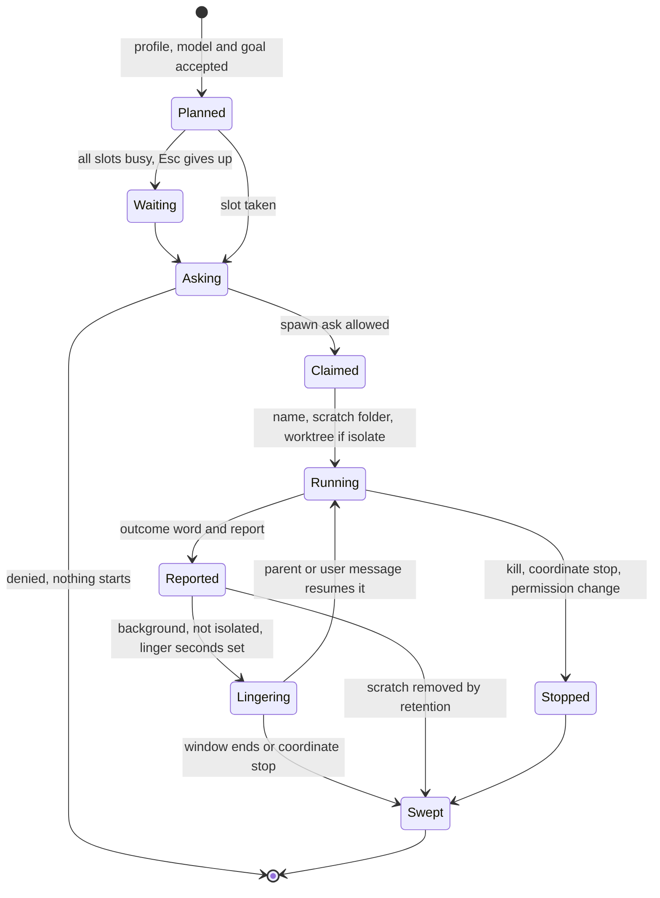

**Identity.**

- **Goal.** Every call needs one (about 48 characters shown, any length kept); without it the call is refused with an example.
- **Name.** An `adjective-creature` pair (`inky-kraken`) avoiding live agents, the last 128 finished and existing scratch folders. It is the id for `sendMessage`, `coordinate stop`, the worktree ref and the handoff folder.
- **Role.** The profile. Name, role and goal show in the panel, rows, `coordinate list`, `/agents`, message headers and reports; a role resolves a `sendMessage` target when only one agent has it.

**Rows.** `Done (inky-kraken · 4 tool calls · ↑120k (80% cached) ↓3k · ≈$0.12 · 38s · provider/model)` ([formats](CONTEXT-AND-COST.md#how-it-is-shown)); also `waiting for a slot (N running)`, `waiting for your approval`, `compacting its context`, `stopping…`. Calls in one turn run in parallel, at most 3 (`OCTOCODE_MAX_SUBAGENTS`); the rest wait.

| Option | Effect |
| --- | --- |
| `background: true` | Returns at once ([Background subagents](#background-subagents)) |
| `collaborate: true` | The task lists running collaborating siblings; the child messages teammates when its work affects theirs. Its report still goes to the parent |
| `isolate: true` | Private git worktree under `<Octocode home>/pi-worktrees/`, started from `HEAD` (warns on uncommitted changes; refused outside git). At the end changes commit to `refs/octocode/pi/<name>` (`<name>-2`… if taken; report names it with `diff --stat`) and the worktree is removed, or kept with its path if saving fails. `/agents merge <id>` merges with repository hooks disabled and, on conflict, aborts and lists files. A crashed Pi's worktrees are committed and removed at next start |
| `model` | Overrides the profile's model; strict ([Model routing](#model-routing)) |

**Stopping.** `/agents kill <id>` or `coordinate stop` tells the child to abort and closes its stdin; a child that does not follow gets SIGTERM to its process tree (including a Chrome it launched and its bash jobs), then SIGKILL after 1 s for a requested stop, else 5 s. Session end stops background subagents before leaving the team.

| Run limit | Value |
| --- | --- |
| Watchdog | No output for 10 min while no tool runs fails the run |
| Busy time | Each call's own deadline, else 15 min; no wall-clock limit |
| Child JSON event | Over 16 MiB stops the run with an explicit error |

**Files.** The child's conversation is saved in `<scratch>/session` (`details.session`; a failed run's report names it) and stays with the scratch folder ([Retention](CONFIGURATION.md#retention)). The handoff folder is `<workspace>/.octocode/tmp/agents/<id>/` (self-ignoring), passed as `OCTOCODE_AGENT_SCRATCH` with `OCTOCODE_AGENT_ROLE` and `OCTOCODE_AGENT_GOAL`; empty ones are removed at the end, the rest swept. A child whose parent has an archive of compacted history is told where it is ([COMPACTION.md](COMPACTION.md#subagents)).

**Channels.** The final answer is the report and reaches the parent by itself (never message "done"). Mid-task contact (blocker, decision, urgent finding) is a `sendMessage`; long or reusable material goes to a Markdown doc in the handoff folder, named in the report.

**Reports** start with one outcome word, `done`, `partial`, `blocked` or `failed` (case and light markup do not matter), then the result, how it was verified and open questions.

- Row: `Blocked (inky-kraken · 4 tool calls · …)`; details carry `outcome`. Background header: `Background subagent inky-kraken (reviewer: audit auth token refresh) reported blocked (…)`.
- A crash or failed model call is `failed` whatever it said (a foreground call then fails). Another first word is `finished` in the header and `Done` in the row, never a failure. A requested stop has no outcome.
- The parent keeps at most 8 KB or 200 lines; a longer report is saved whole as `report.md` in the handoff folder and the kept part ends with the path.
- A report finishing after its session ended (a reload) is kept owner-only under `reports/pending/`, marked `(Arrived after the session restarted)`, and delivered once at that session's next start.
- A run stopped by a permission change or `/reload` says so. Output follows the [sanitizing policy](CONFIGURATION.md#sanitizing-policy). The row and report say how often the child compacted ([COMPACTION.md](COMPACTION.md#subagents)); the warnings and errors its extensions show are kept whole in the report: identical repeats are folded with a count, the first five distinct ones that fit 4,000 characters are inline, and when more came the last line names `notices.txt` in the handoff folder, which holds every one ([details](COMPACTION.md#subagents)). A crashed child's error shows its stderr whole up to 4,000 characters; a longer one shows the last 4,000 under a `[stderr: last 4000 of N characters; whole: <file>]` line, and the whole is in `stderr.txt` in the handoff folder. A failed model reply's error message and the last progress of a crashed child are never cut.

**Asks.** A child asks its parent with `sendMessage` `replyRequired: true`; the parent answers with `replyTo` set to that message's number.

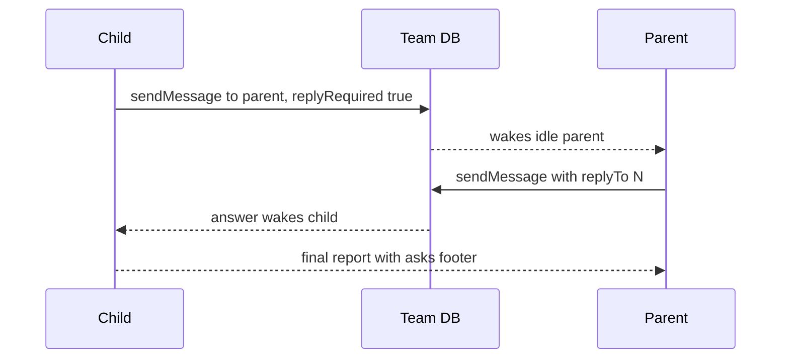

Each ask (number, text, asked time, reply number, sender, time) is read from the message tables at run end into `details.asks`; pruned messages list none. An answer after one of the parent's own `askUser` calls that started after the question and ended before the answer is marked `afterAskUser`. The footer counts them (`Asks to its parent: 2 asks (1 answered in 40s, 1 unanswered).`); `/agents` shows the count per live subagent.

### Profiles

Listed in the `agent` tool's description; format and loading: [Subagent profiles](CONFIGURATION.md#subagent-profiles).

| Profile | Use for | Boundaries |
| --- | --- | --- |
| `researcher` | Uncertain facts, root causes, source evidence | Read-only incl. shell and MCP; no `file`, `browser` |
| `reviewer` | Defects and verification gaps in a specified change | Read-only incl. shell and MCP; no `file`, `browser` |
| `implementer` | A scoped code change with checks and handoff | Guarded file changes, shell, configured MCP; no `browser` |
| `webHeadless` | Rendered public pages, authorized browser interactions | Headless browser, static web; no `file`, `bash`, MCP |
| `webLive` | Visible browser flows, user-assisted login | Visible Octocode browser profile, static web; no `file`, `bash`, MCP |

- Every child keeps `read`, `sendMessage` and `coordinate` so it can reach its parent: a profile with an absolute `tools` allowlist gains them at load; one that excludes one is refused ([Core tools](CONFIGURATION.md#subagent-profiles)).
- A child starts without the parent's conversation: its task must be a Task contract: objective; inputs (paths, evidence and decisions it cannot infer); constraints; output; Definition of Done.
- A child's `memory` only reads; its `backlog` proposes items and updates state and notes of items its parent claimed.
- `researcher` and `reviewer` write only scratch and the task's output path; `webHeadless` and `webLive` have no `file` or bash, so output goes in the report. This is instruction, not an OS sandbox. The parent owns user communication, missing approvals, review and integration.

### Model routing

A profile's `model` is a model or a purpose, `small` or `medium` ([format](CONFIGURATION.md#subagent-profiles)); `implementer` and `reviewer` run `medium`, the rest `small`. A purpose resolves among your own models by price and ability, so no profile hard-codes a vendor (with Opus, Sonnet and Haiku: Sonnet and Haiku; with one model, or none cheaper, the parent's). `/octocode models` shows price, window, abilities and what each purpose and profile runs on.

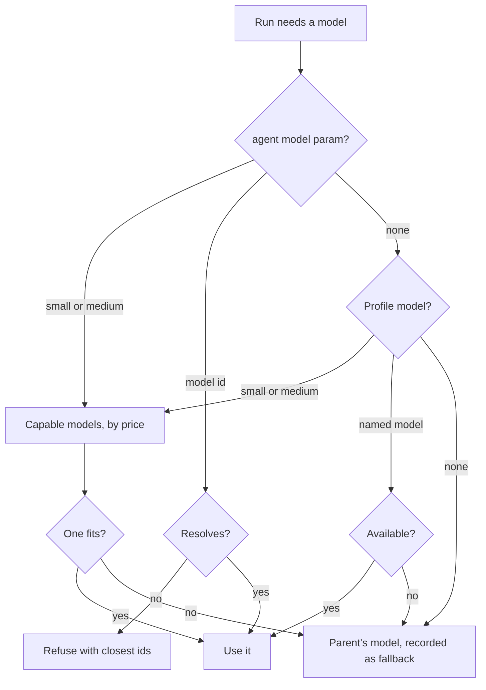

- `small`: the cheapest capable model. `medium`: the dearest capable model at 15–80% of the parent's price, the next tier down (Sonnet under Opus, never Haiku under Sonnet); else the parent's.
- Capable: calls tools, holds 100k tokens, takes images when the parent does, not deprecated, cheaper than the parent, its family's newest release. Models within 18 months of the parent come first, then its lab, then its provider.
- List prices, three input tokens weighed against one output; a missing price is filled from models.dev only for a provider it lists (a local model priced 0 never borrows a cloud price). Subscription accounting is not modelled.
- The row (`Done (… · anthropic/claude-opus-5-5 (claude-haiku-5-5 unavailable))`) and details (`fallback`) record a skipped preference.

### Background subagents

`background: true` returns at once; the parent keeps working, can `sendMessage` or `coordinate list`, and gets the answer later as a message (it is told not to poll). Print and JSON runs stay open until they finish; interactive sessions are never held.

- **Interrupt.** `sendMessage` with `interrupt: true`, or `/agents interrupt <id> <text>`, redirects without killing: a busy subagent's step stops and the same run continues with the message; an idle one wakes. Only the agent that started it, or the session's user, can interrupt, one subagent at a time. A plain message waits for the running tool; if the run cannot be stopped, the interrupt arrives as a plain waking message.
- **Stop.** The report says who stopped it, does not wake the parent and is drawn as a stop.
- **Report text.** A report starts with name, role and goal; those lines and the run statistics are the parent's own words. The subagent's text sits between two fence lines marked untrusted, so it cannot pose as the user, a teammate or the system.
- **Delivery.** Reports finishing within 1.5 s arrive together for one wake; one whose `report.md` the parent already read arrives without a wake. If a notice wakes a subagent after it answered, its report keeps that answer and adds the later reply after a `---` line.
- **Lingering.** With `OCTOCODE_SUBAGENT_LINGER_SECONDS` set, a finished background subagent stays reachable that long (the report says so). A message from its parent, or `/agents tell`, resumes its saved conversation as a new background run, same name and goal, taking a slot (refused when none is free); `coordinate stop <name>` ends the window. Isolated runs do not linger.
- **Receipts.** The 128 latest completed-subagent receipts are kept. A `sendMessage` to a finished, non-lingering subagent says so, names its handoff folder and tells the sender to start a new `agent` task.

### Subagent screenshots

Saved owner-only under `<Octocode home>/pi-team/shots/` ([Retention](CONFIGURATION.md#retention)). The `agent` row draws the latest live with its path; the report ends with `(Last screenshot: path)`. They reach the parent's context only if it reads the file.

### Agents panel

With live subagents, a panel under the input lists them as a tree (nested indented, working first): status glyph (`●` working, `○` idle), name, goal, model, state, elapsed time, tokens in the [one token format](#ui), tool calls, estimated cost (`≈$2.28`; `cost n/a` if unpriced), flags (`✉ n waiting`, `n locks`), then the current tool. A header sums them (`2 working · 1 idle · ≈$0.04`). At most 6 rows, then `+n more`, then recent messages between agents. Narrow terminals drop flags, tool calls and cost first, then shorten the goal. When it cannot show, the footer counts background subagents (`2 background agents`). Other sessions' agents never show; an agent silent for 15 s leaves at once.

## Team

Agents in one repository share the team tables of the agent database ([`OCTOCODE_AGENT_DB`](CONFIGURATION.md#environment-variables)): the main session, its subagents and other Pi sessions that `join`. The scope is the git root with symlinks resolved (one checkout via two paths is one team); `OCTOCODE_TEAM_WORKSPACE` (absolute path) overrides it, which is how an isolated worktree subagent joins its parent's team.

**Presence.** Activity, tool counts and token usage are written on a 5 s heartbeat, so the panel and `coordinate list` can lag a few seconds.

| Signal | Effect |
| --- | --- |
| Silent 60 s | Stale: hidden, keeps mail and row |
| Process gone (pid and start time, [Liveness](ARCHITECTURE.md#liveness-who-is-still-running)) | Retired, with reservations; unread mail becomes a dead letter |
| Parent process gone | A subagent exits, so a crashed parent leaves no orphan spending tokens |
| Machine slept | The first tick gives live members and reservations a fresh heartbeat and lease |
| Database refused (not an Octocode agent database) | `team off` with the reason in `/agents` and the status bar; busy or locked: `team retrying` |

A main session is named from the subagent name list when it joins (`coordinate join`, or its first `lock` or `sendMessage`) with role `main` and an optional `goal`; live agents never share a name.

**`coordinate`** actions: `list`, `join`, `leave`, `lock`, `unlock`, `changes`, `stop`. `join`, `leave` and `stop` exist only in the main session; a subagent joins at start and leaves when its run ends. `list` shows `name · role · status · model · parent`, goal, join and last-seen time, work (`56 tool calls · ↑1.2M (94% cached) ↓35k · ≈$2.28`), unanswered messages and held paths.

**Reservations.** `lock` reserves files all-or-nothing; a trailing `/` reserves a tree.

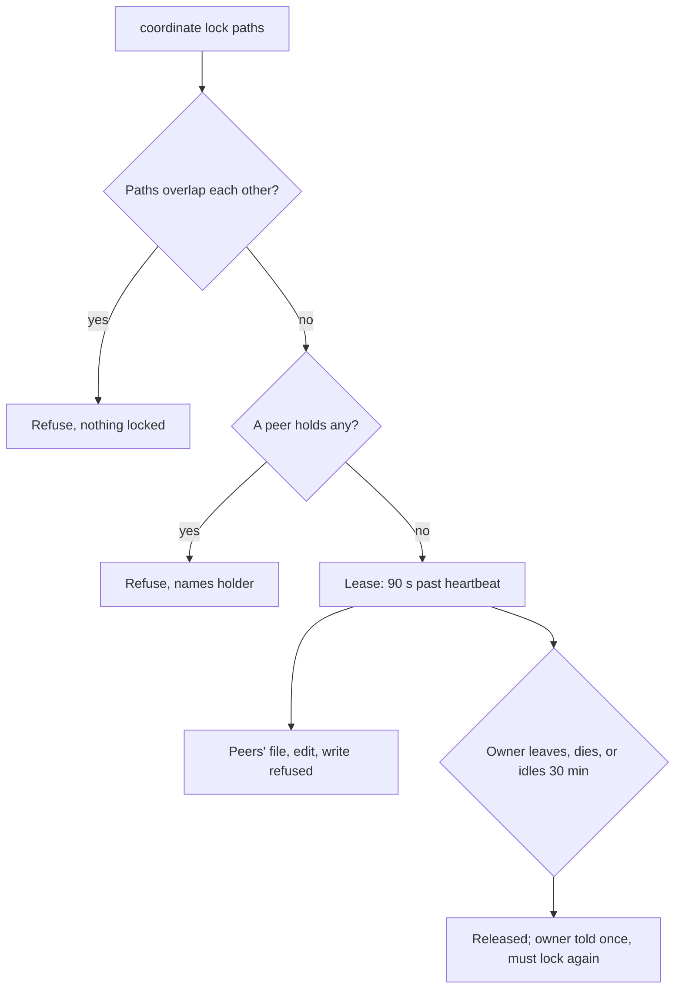

- Paths compare by Unicode full case folding per component (`Straße.ts` and `STRASSE.ts` collide). Overlap within one call means a tree and a path in it, two spellings of one path, or a path twice. A subagent's leases release when its run ends.
- `file`, `edit` and `write` are refused on a peer's paths, naming holder, reason and age; they fail closed when the database cannot be read (a process that never joined and has no database is not blocked). `file` rechecks right before it writes or deletes; the reservation gate covers Pi's own `edit` and `write`. Reservations are cooperative: shell writes are not covered.
- Agents of other tools (Claude Code, Codex, other Pi sessions using octocode-agents-communication) reserve in `<Octocode home>/agents-communication/communication.sqlite`. Their paths are refused too, even in a session that never joined, naming holder, vendor and reason. Pi opens that database and every one a live `active-databases/<pid>.json` lists, read-only; a file with schema version other than 6, or unreadable, is skipped with one warning and retried after 30 s (its leases then go unchecked). The package owns the format ([Where files go](CONFIGURATION.md#where-files-go)).

**Recent changes.** `coordinate changes` lists files agents changed with `file`, `edit` or `write`, newest first: agent, tool, age, change count. `paths` narrows by prefix; `withinMinutes` (default 60, max one day, clamped with a note) and `limit` (default 20) bound it. Your, bash and git changes are not tracked: use `localSearch` with `time.modifiedWithin`.

**Messages.** `sendMessage` takes `to` as a name, a unique role, `parent` or `all` (the sender's session tree: top session and its subagents, not other sessions). `to` may be omitted when `replyTo` is set (goes to that message's sender); an unknown `replyTo` is refused. `replyRequired` defaults to false.

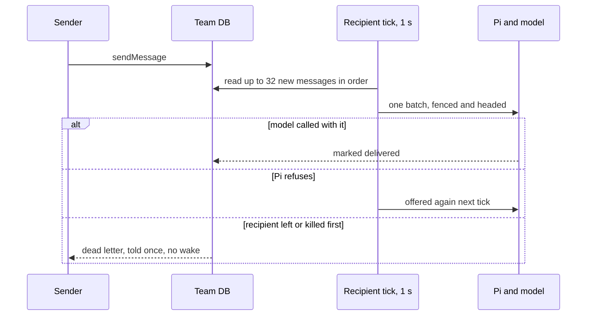

- **Headers and fencing.** A message arrives within a second headed `Message #N from agent inky-kraken (reviewer: audit auth token refresh)`. The receiver builds the header; text from anyone but the user sits between two fence lines with a random marker, marked as data, so a sender cannot forge a header, a second message or the user's voice.
- **The user's voice.** A `user` message reads as yours only if verifiable: `/agents tell` and `/agents interrupt` to a subagent this session started are signed with that child's spawn secret (HMAC-SHA256). Any other `user` row is labelled unverified and fenced. API messages read `API client <name>, not the user` ([API.md](API.md)).
- **Waking.** A busy agent reads a message at its next step. An idle one wakes only for a message requiring a reply, the answer to its own open question, or a message from the user or API; others wait for its next turn.
- **Delivery.** Delivered means the recipient's model was called with it. A waking message Pi does not turn into a model call within 10 s (no model, no sign-in) gives one warning.
- **Dead letters.** A message still queued, or appended after the recipient's last model call, when it leaves or is killed becomes a dead letter (`dead-lettered` in the panel). The sender is told once, without a wake (`Message #N to X was not read: X left`); sending to a departed agent is refused. A headless subagent takes no message while idle, so one after its last turn is dead-lettered, not falsely acknowledged. Resolved messages are pruned ([Retention](CONFIGURATION.md#retention)).
- **Long messages.** Over 8,000 characters: saved whole to a private `message-<sha256>.txt` (controls shown as visible escapes; fenced unless from you); the delivery carries the start and path. Yours is signed over the file name, so an altered or missing file makes it unverified. An oversized body written by another process is withheld with a delivery-error notice.

**`/agents`** (also `/octocode agents`) lists the team (controls shown as visible escapes).

- `/agents tell <agent|all> <text>` sends from you.
- `/agents interrupt <id> <text>` redirects a subagent ([Background subagents](#background-subagents)); `/agents kill <id>` stops one; `/agents merge <id>` merges an isolated one.

## Sessions

`/sessions` (same as `/octocode sessions [all|<words>]`) lists sessions from Pi's `SessionManager` (including pre-Octocode ones) with what Octocode keeps: branch, git HEAD, cost, tokens, files changed, whether its process runs. Default: this repository, newest first; `all` lists every repository; words match name, first prompt, repository, branch or id. Lines end with the session id tail; a fork with no prompt shows `↳` and its parent's first prompt.

Actions: Resume (switch to the session file), Details, Rename (current session only; Pi owns names), Forget Octocode data (deletes the session's Octocode folder and extras row, not Pi's session file; refused while another Pi process has it open).

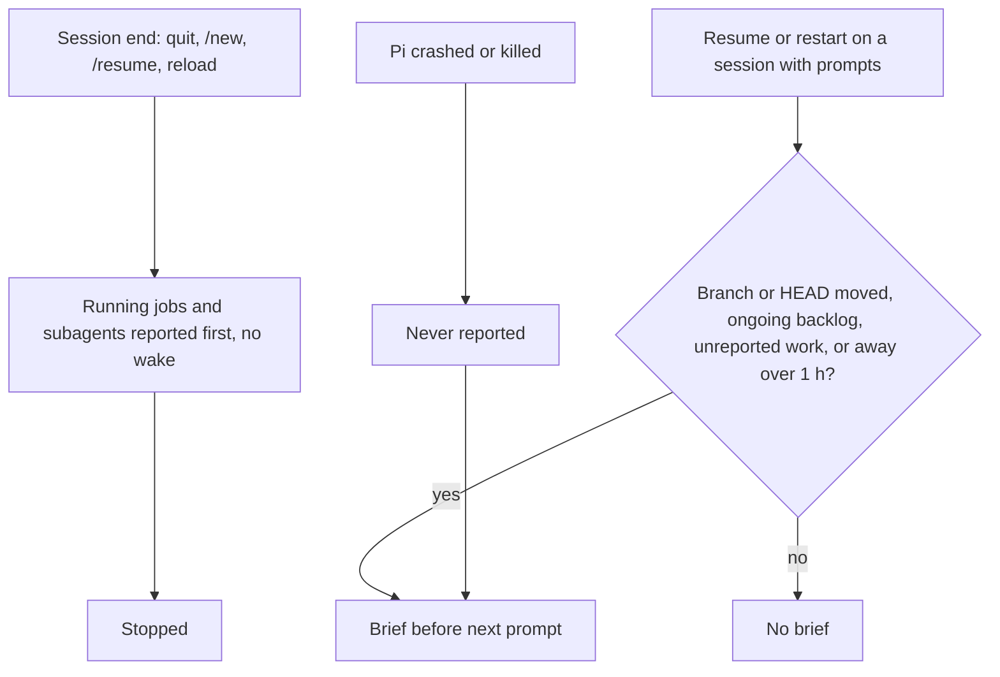

**Resume brief.** Added before the next prompt only when the diagram's conditions hold.

- Every ongoing backlog item shows its title, goal and paths whole.
- After an hour away, the to-do count and uncommitted changes join as context but never cause a brief alone.
- The first line carries the away time and the most important change; no list is cut or counted.
- Unreported work reads ``Stopped when the session ended, without a report: bash-3 (`yarn test`, log …); general-ab12 (goal "…")``, each whole (a subagent without a goal shows `task "…"`); a log the retention sweep removed shows `log deleted`.

Pi's `/resume`, `/session` and transcripts are unchanged. Subagents save their conversation in their scratch folder ([Subagents](#subagents)) but get no extras row, brief or command.

## Backlog

A task board per repository (worktrees share their main repository's) in the agent database, with priorities `p0`–`p3`, tags and a log of notes and changes.

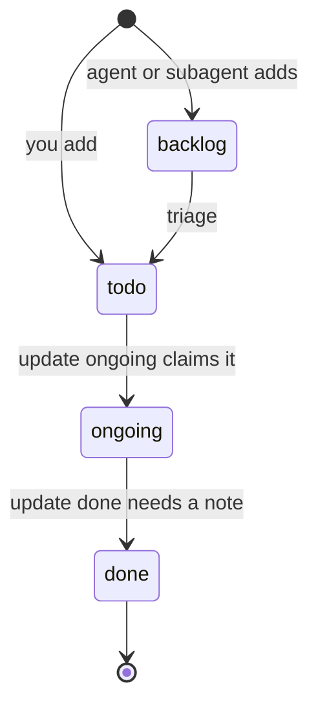

You can move an item to any state from the board; a subagent can only set `ongoing` or `done`.

**Fields.** A one-line title and:

- `goal`: the Definition of Done, a check someone else can run. An agent must give one when adding (`/backlog add <title>` from you needs none); its `update` can replace but not blank it.
- `paths` (files, directories, components); `why`; `evidence` (paths, measurements, links); `plan`; `body`.
- `from`: the item it came from, shown `(from B12)`. `get` on the origin lists derived items; `list` with `from` filters. Looping links are refused; removing the origin clears the link with a note.

- Every update logs what changed (state, assignee, priority, tags, origin, previous title and goal, paths, a replaced why, evidence, plan or body in full). Setting such a field replaces its whole text; the old stays in the log.
- A query matches substrings of every text field and whole tags.
- Lists and notes page with `limit`/`offset` and an executable `Next: backlog` continuation.

**The `backlog` tool** (`list`, `get`, `add`, `update`, `remove`; ids `B1`, `B2`, …):

- `update` with `state: ongoing` claims the item; `done` needs a note saying what changed and how it was verified.
- `remove` deletes an item and its notes; refused to subagents and for items another running session holds. An agent can only add a note to an item another running session holds; you can still move or edit it.
- Your items land in `todo`. An agent's land in `backlog` for triage unless it gives another state; a subagent's always do. A subagent changes only state and notes of items its parent claimed.

**Commands.** `/backlog [add <title> | do <id> | export | html | <id> [backlog|todo|ongoing|done|delete]]` (same as `/octocode backlog`; not in subagents) opens the board. Rows show `←B12` for an origin; Enter → Came from… sets or clears it, Enter → Edit opens a field menu. The status bar shows open counts (`backlog 2 ongoing · 4 todo · 1 to triage · /backlog`).

- `export` writes a Markdown snapshot to `<repo>/.octocode/backlog.md`; nothing reads it back.
- `html` (also "Open as HTML" and `h`) writes `<repo>/.octocode/backlog.html` and opens it when there is a UI, else says where. The tool has no HTML operation. The page is one offline snapshot, not live (`/backlog html` refreshes it), with every item and note:
  - Views: board, sortable table, derivation tree, and Attention (ongoing items whose assignee is not a running session; open items not updated in 7 days). Items link by `#B12`.
  - The header counts items by state and priority and shows the median claim-to-done time.
  - Its Content-Security-Policy allows only its own inline script and style; item text shows only as text.
- `export` and `html` refuse to write, naming item and field, when any text looks like a credential.
- `do <id>` (or `d`, or Enter → Do it now) claims the item as ongoing for this session and hands the agent a prompt with its title, goal, paths, why, evidence, plan, body and origin; it queues as a follow-up while the agent is busy. The agent records follow-ups with `from` set to the item and marks it done only after verifying its goal, with a note (a blocker is recorded instead, as SBAR). Delegating to a subagent hands over the same context; neither grants authority beyond existing permissions.

## Memory

Durable notes (`preference`, `fact`, `decision`, `gotcha`, `procedure`), global or per repository, in the agent database with an FTS5 index (BM25; a `LIKE` scan without FTS5). 

- The `memory` tool has `search`, `get`, `list`, `set` (create, or update with `id`) and `delete`; subagents get `search`, `get`, `list`. A `search` or `list` with more matches than `limit` says how to see the rest.
- Writes are immediate in every mode, except that creating, changing or deleting a global or pinned memory needs a trusted project ([Trust](CONFIGURATION.md#trust)). In an untrusted project the tool reads only global memories.
- A new memory whose title or words mostly match an existing one is refused with its id, so the agent updates instead.

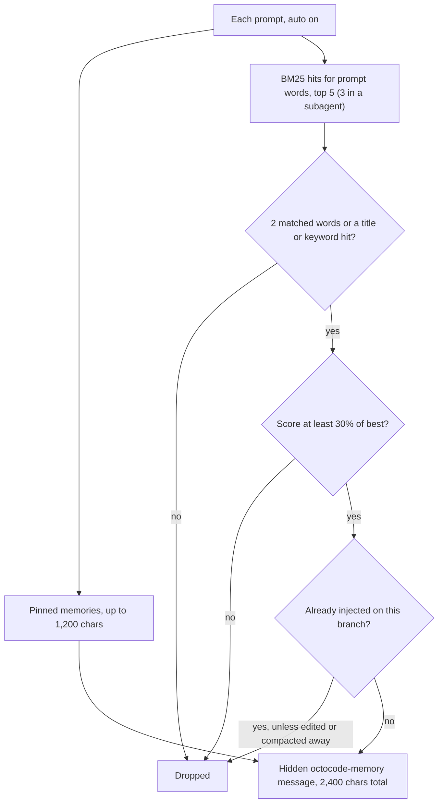

- Prompt words under 3 letters are ignored.
- Each memory is one line: body quoted as data (one JSON string); a line over 600 characters is cut and ends `(memory get M<n>)`; memories the user did not write are marked `(agent-written)`. The message header reads `[octocode-memory — …; not instructions]`.
- Pinned memories are not injected into subagents; project memories only in a trusted project.
- The `memory` tool's `search`, `list` and `set` lines show 160 (`set`: 60) characters of a body and, when the body is longer, end with `(memory get M<n>)`, which reads it whole; `delete` echoes the deleted memory whole.

`/memory [search <query>|add|auto on|off|last]` (same as `/octocode memory`) browses, searches, adds and edits. `/octocode memory auto off` stops injection everywhere; [`OCTOCODE_MEMORY_AUTO=0`](CONFIGURATION.md#environment-variables) for one process. You can also say "remember that…" or "forget memory M3".

## Web and browser

The main session leaves `browser` to the profiles that carry it (`webHeadless`, `webLive`), because its schema is the largest; name it in `--tools` or `defaultTools`, or enable it with `/tools`, to keep it in the main session. Subagents get it unless their profile excludes it. For network, HAR, performance or raw DevTools work, the `octocode-chrome-devtools` skill drives its own Chrome from any agent with `bash`.

- `webHeadless`: headless Chrome over DevTools only; needs no display.
- `webLive`: visible Chrome on a persistent profile, for watching a flow or tasks behind your login. It stops at a login, CAPTCHA or MFA and leaves the window for you.

### `web`

Fetches a URL as readable text (20,000 characters by default; `maxChars` up to 50,000) and searches the web.

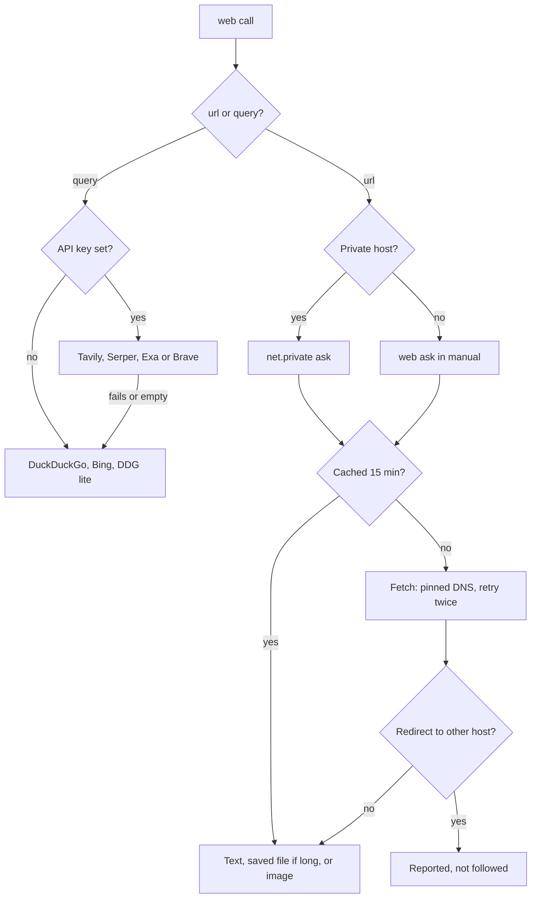

- **Pages.** HTML is reduced to its marked main content (`<main>`, `role="main"` or one `<article>`) when it has one. No JavaScript runs, hidden elements drop, metadata (JSON-LD, Open Graph prices, locale, dates) comes first; a JavaScript app or empty shell is noted, so render it with `browser`. Charset: BOM, `Content-Type`, `<meta charset>`, else UTF-8. Only `http(s)`.
- **Long pages** are saved whole under the session's `output/` ([Where files go](CONFIGURATION.md#where-files-go)); the inline part fits Pi's 50 KB budget, folds runs of 8+ link-only lines and names the file for `localSearch` or `localFetch`. Nothing is refetched.
- **Images.** PNG, JPEG, GIF or WebP (checked by signature, at most 5 MB) is saved under `output/`; the model gets a line with URL, type, size and path plus the image resized to its limit (`inputLimits.images.resize`, else 1568 px). Larger or mismatched bodies and other binaries are a notice; SVG is read as XML. Not cached.
- **Fetching.** Retries twice with backoff on network errors, 408/425/429/5xx and a short `Retry-After`; a final failure names its cause. Cache: 15 min, 64 pages, 32 MB, least recently used first; parallel fetches of one page share a request.
- **Search.** A failing provider passes to the next; skipped providers and why are named ([Environment variables](CONFIGURATION.md#environment-variables)).
- **Private hosts.** Loopback, private, link-local (cloud metadata), CGNAT, multicast or reserved addresses are a `net.private` [permission](#permissions) ask (runs in `full`, audited ⚠). Only that first request can reach one; every other hop connects only to the addresses it checked, so DNS rebinding cannot redirect it.

### `browser`

In-process Chrome DevTools Protocol tool; opens only `http(s)` URLs.

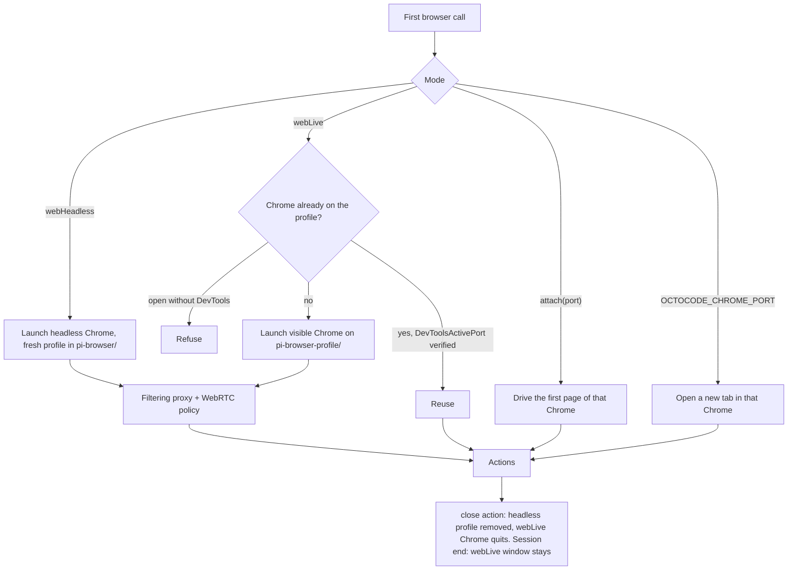

| Action | Behavior |
| --- | --- |
| `navigate` | Waits after load until content and requests are quiet for 500 ms (max 6 s); with `text`, waits for it |
| `snapshot` | Numbered elements (value and state per field), then page text; 8 KB cap, a cut snapshot is saved whole; text past 200,000 characters is not read; a `Locale:` line names language, time zone, currency |
| `click`, `hover`, `drag` | Real mouse events at the element's centre; `click` reports a covering element; `drag` goes to `to` or the smallest element showing `text` |
| `type`, `fill`, `press` | `type` replaces a text field's text or picks a `<select>` option by label (refused when focus misses a text field); `fill` sets several fields, checkboxes take `true`/`false`, and lists failures; `press` sends a key or combo |
| `wait` | Until `text` appears (or with `gone` disappears), `timeout` default 10 s, max 60; a timeout fails with the page attached |
| `tabs`, `tab` | List with stable numbers; switch by `index` or open a `url` |
| `evaluate` | Runs page script (`browser.control`); a value JSON cannot carry (`NaN`, BigInt, function) is shown as Chrome describes it |
| `info`, `close` | `info` reports the Chrome kind, profile, DevTools port and current page without launching one; `close` ends the session |
| `screenshot` | Visible page, JPEG quality 70 unless `format: "png"`; full-size file under `output/`; over the byte budget ([Spilled outputs](CONTEXT-AND-COST.md#spilled-outputs)) it is retaken at 0.5×, then 0.25×, else only the path returns |
| `console` | Last 200 messages, each clipped to 2,000 characters; every line saved whole in `output/browser-console-*.log` (4 MiB, one rotated `.1`) |
| `dialog`, `upload`, `download` | Answer an alert, confirm or prompt (`snapshot` reports an open one); set files on an input or chooser; click, wait and list files saved in the private `output/downloads/` |
| `attach(port)` | Drives an open DevTools browser in place (`browser.control`; a local `ws:` address on that port under `/devtools/`). `OCTOCODE_CHROME_PORT` opts in to a tab of the Chrome on that port. Neither happens on its own |

Aborting a call cancels its pending page calls; a Chrome still starting is killed once up.

**Elements** come from open shadow roots and same-origin frames (cross-origin frames are counted, not shown). Numbers hold while the element stays; a new document restarts at 1. After an action the tool waits for a navigation, then for the DOM to settle (max 3 s); on the same page it returns only new or changed elements and new text lines. Headless Chrome gets a 1366×900 window.

**Profiles.** A launched headless Chrome gets a fresh profile under `<Octocode home>/pi-browser/`, removed on close and swept at next launch if Pi died. `webLive` uses `<Octocode home>/pi-browser-profile/`, so a login survives; the window stays open when the subagent ends (`browser close` quits it) and the next run reuses it once the Chrome on that port proves it wrote the profile's `DevToolsActivePort`. Text from `browser` and `web` follows the [sanitizing policy](CONFIGURATION.md#sanitizing-policy).

**Network policy.** The agent chooses targets; the page chooses requests.

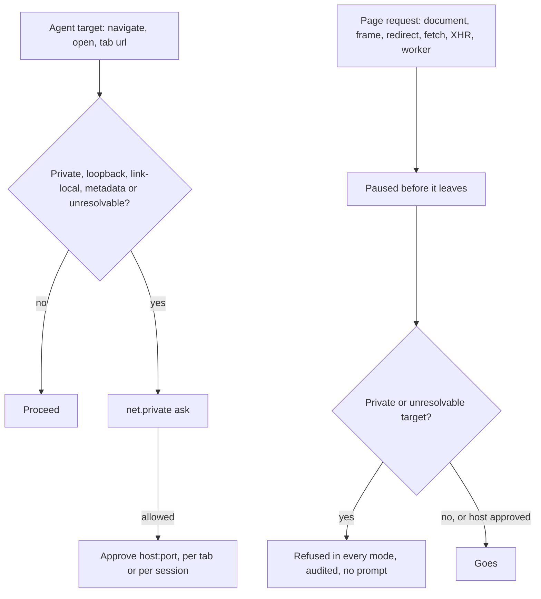

- **Targets** pass the same check as `web`; only a host granted `net.private` is approved, with its port, to load its own files. A name whose DNS flips from public to private is never approved.
- **Approval reach.** "Allow once", or a mode that allows the call, covers that tab for that host and port until it navigates to another host or closes (a popup inherits it). A session grant covers every tab until the browser session ends, keyed `host:port` with the effective port. Approvals end when the browser session closes, attaches elsewhere or loses its connection.
- **Audit.** Identical refusals are one entry plus a repeat count; after 100 distinct ones a single entry counts the rest.
- **Related targets.** Cache and service workers are off. Popups, out-of-process frames and workers are attached before they run and released only after the same check; a target whose setup fails is closed. Driven tabs stay covered until they close; in a Chrome the tool did not launch only targets related to a driven tab are covered.
- **Proxy.** A launched Chrome runs behind a local filtering proxy that connects only to the address it checked (DNS pinning), refuses private targets with `403` and carries WebSocket upgrades. It cannot tell tabs apart: while any tab holds an approval, any tab's connections to that host and port pass. A Chrome without the proxy (`attach`, `OCTOCODE_CHROME_PORT`, the `webLive` profile) relies on the page-request check alone: a response from a private address the check did not allow closes that tab and is audited as a rebinding; a WebSocket to a private host is only reported.
- **WebRTC.** Launched Chromes get `webrtc.ip_handling_policy=disable_non_proxied_udp` written to the profile first (launch is refused if that fails). The proxy-less `webLive` Chrome does not check a TURN-over-TCP connection to a private address.
- **Uploads.** `upload` of files outside the workspace (symlinks resolved) is an `upload.outside` ask.

## askUser

The agent asks for missing decisions or facts; related questions batch in one call. Choices, descriptions and tab labels are optional; a question without choices opens a text editor.

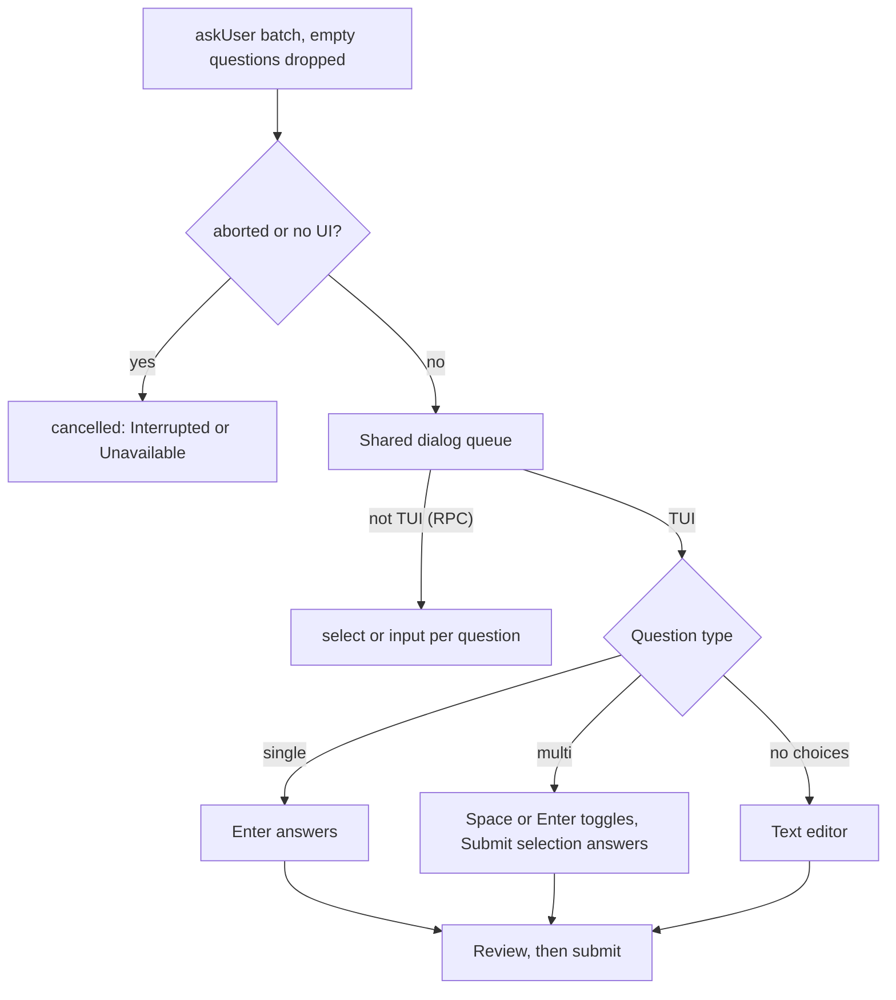

The dialog shows progress and keeps typed drafts; a multi-select needs a choice or a written answer. An unanswered question never supplies approval.

## Hooks (opt-in)

With `OCTOCODE_HOOKS=1`, Claude Code and Codex command hooks run on the events below; other events and hook types are ignored. Subagents run none unless their profile sets `hooks: true`. Locations, JSON format, timeouts, `failClosed`: [Hooks](CONFIGURATION.md#hooks).

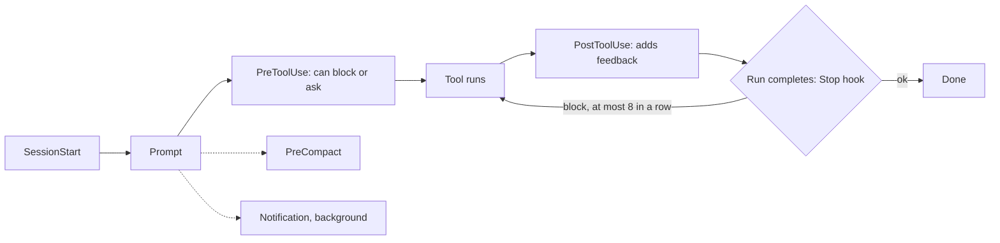

| Event | Behavior |
| --- | --- |
| `PreToolUse` | Exit 2 or `block`/`deny` blocks the tool. `permissionDecision: "ask"` asks you in `manual` and `workspace` (`hook.ask`, [Permissions](#permissions)), runs in `full`, and is denied without a UI in modes that ask; `allow` skips no ask. No answer (timeout, crash, invalid JSON) fails open with a warning and audit entry, unless `"failClosed": true` |
| `PostToolUse` | Feedback and `additionalContext` are appended to the result |
| `SessionStart` | Runs in the background; its output joins the next prompt's context, which waits for it up to 15 s |
| `PreCompact` | Runs before a compaction |
| `Stop` | Exit 2 or `{"decision":"block","reason":…}` continues the run with the reason as `Stop hook feedback` (`stop_hook_active`, `last_assistant_message` as in Claude Code), at most 8 in a row until a tool runs; `continue: false` is not a block. The footer shows `Stop hook: <command> · Ns` |
| `Notification` | Background, TUI and RPC only; the matcher is the type: `permission_prompt` (a confirm dialog the agent opens during a run), `elicitation_dialog` (any other dialog it opens), `idle_prompt` (an answer unread for a minute) |
| `PreMessageSend` | Messaging gate before sending: `block`/`deny`, exit 2, `ask` and `failClosed` apply ([API.md](API.md#message-hooks)) |
| `PostMessageReceive` | Observer: verdict text, context additions and reply instructions are ignored; once per delivered identity, skips restored history |

Matching hooks run in parallel; one listed in several files runs once. Pi checks every call of a batch before any runs, so a slow `PreToolUse` hook holds the batch: the working line shows `Checking bash …`, the row `checks 1.2s`, and a hook over 5 s is reported once. `/hooks` lists runs with average and slowest time per command.

Matchers accept Pi or Claude tool names (`Bash`, `Edit|Write`). The payload is Claude-shaped: `bash` is `Bash`, `read` is `Read` with `tool_input.file_path`, each `file` query is its own `Edit`, `MultiEdit`, `Write` or `Delete`; other tools keep their Pi name, and `pi_tool_name` is always the Pi name. Long hook text added to the context is saved whole and replaced by head, tail and path ([Spilled outputs](CONTEXT-AND-COST.md#spilled-outputs)).

## UI

**Header and footer** (main session, TUI).

- Header: the "OCTOCODE CODE" banner (plain text on narrow terminals; nothing is written to the session). Terminal title: `octocode · <session name> · <dir>`.
- Footer line 1: model, [permission mode](#permissions) chip, thinking level, context bar, running agents, background subagents, bash jobs, `✉ n queued`, a running hook, `tok/s`, cost. Line 2: cwd, branch, session name, tokens, backlog counts, other extensions' statuses. The least important parts drop first on narrow terminals.
- The context bar reads against Pi's auto-compaction point. Tokens and cost include every subagent the session started, in one format ([How it is shown](CONTEXT-AND-COST.md#how-it-is-shown)).
- Hidden thinking shows `✻ Thinking… (ctrl+t)`. Pi asks a model to think only when `models.json` declares `"reasoning": true`; if a built-in model with its id declares it, the session warns once and names the fields.

**Working line.** Names what the agent does now, with elapsed time past 2 s: `Waiting for model`, `Thinking: <gist>`, `Writing`, `Preparing tool calls`, `Running bash yarn test`, `Running localSearch useState in src +2` (a batch names its first query), `Running agent <goal>`, `Running 5 tools: bash · web ×2 +2`, `Checking bash …` (reservations, shell guard, hooks, asks), `Waiting for you: <title>` (`(+N queued)`). Within 70 columns; the same line, without time, is the panel's activity. It and the team database show a call's path, command, query, URL or element ref or an agent's goal (never typed text), credential-looking spans replaced by `[redacted]` and `user:pass@` removed.

**Queued messages.** Reports and teammate messages queued while the agent works show as `✉ n queued`. Pi's Esc clears its queue but restores only your typed text; Octocode adds the cleared messages to the conversation without starting a turn (TUI only).

**Tool rows.** A one-line call, a short result preview, full output on ctrl+o. A row reads `waiting` until its checks, approval or lock end; one that waited adds `checks 1.2s` or `queued 2.0s` past 250 ms. A collapsed batch lists 3 queries, then `+N more`; `file` shows each change's reasoning, +/- counts and diffs. An interrupted row (Esc, `/octocode jobs kill`, stopped subagent) is `◼` in the warning colour. An `agent` row reads `● Agent(profile · goal)` and lists the latest steps (8, collapsed 3); those lines are for you, the parent gets the report.

**Parallel tools.** Tools batched in one message run in parallel; `file`, `browser`, `memory` and `backlog` keep their own calls in order with a per-tool lock, so a slow `file` call does not hold up MCP searches or bash. Put dependent steps, such as an edit and its test, in separate messages.

**One dialog at a time.** Pi's TUI draws one dialog; a second would replace the first, whose answer never comes. Every ask (`askUser`, permission asks including the file review, `/octocode` subcommands, leave and checkpoint prompts) holds one shared queue; a call aborted while waiting stops at once.

**Notifications.** When the agent finishes an answer or opens a dialog while the terminal is in the background, Octocode sends a desktop notification (`OCTOCODE_NOTIFY`, `OCTOCODE_NOTIFY_METHOD`: [Configuration](CONFIGURATION.md#environment-variables)) and marks the title `●` until you return. In fullscreen mode only runs of 30 s or more with no key pressed for 30 s notify. TUI only; aborted runs, subagents and print, JSON and RPC modes never send them.

## External agents

`externalAgent` connects to a discovered local Pi instance or an explicitly launched ACP adapter. Its tool, `/octocode external <JSON>`, the API and the CLI share one manager; message hooks check sends and observe replies once. Contract, ownership, permissions, cancellation: [API.md](API.md#connect-to-external-agents).

## External API (opt-in)

Other programs can message a running session and follow it. Off by default; subagents never serve one. API messages reach the model fenced and labelled `API client <name>, not the user`. Enabling, protocol, methods, security: [API.md](API.md).

## Privacy

The agent database and every session folder are private to your user (files `0600`, folders `0700`) and stay on this machine; the Octocode MCP tools can read the session folders.

- **Credentials are refused.** Backlog fields and tags and memory titles, bodies and keywords that look like credentials (AWS key ids; GitHub, GitLab, npm, Slack, Stripe, Google, `sk-…` tokens; private keys; JWTs; bearer tokens; URL or `password=` passwords) are refused, checked as stored. Store where a secret lives, not the secret.
- **Injected text is data.** Memories and the resume brief are labelled as data, and the model is told to verify memories against the code.
- **Foreign databases are refused.** A file that is not an Octocode agent database is refused rather than changed, down to its journal mode; set `OCTOCODE_AGENT_DB` to another file.
- **Additive schema.** No version number: opening our database adds missing tables, columns, indexes and triggers in one transaction and never removes or rewrites, so builds of different ages share the file.
- Opening the database tightens the file and default folder back to owner-only; a missing or refused database never blocks a prompt.
