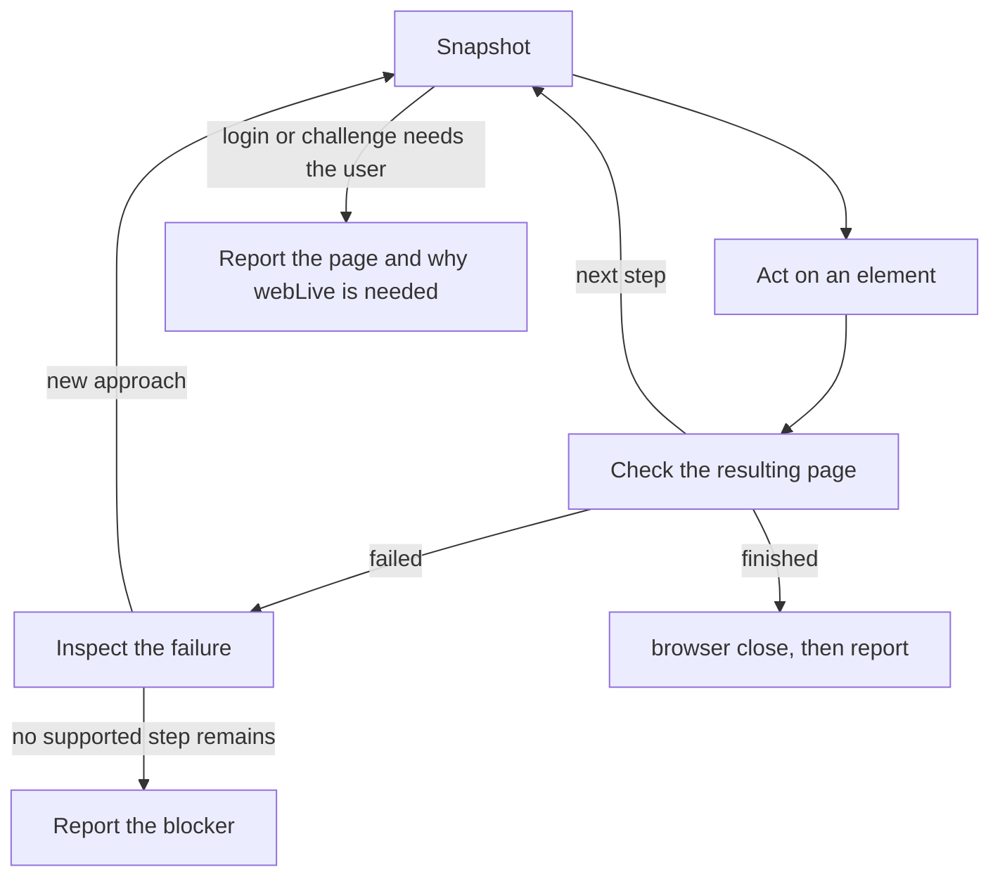

Use `web` for static public sources and `browser` when rendering or interaction is needed. Browser starts headless Chrome on first use.

- Never repeat an action before checking the page it produced. Use `evaluate`, console or screenshots when they resolve a concrete uncertainty.
- Follow the task's existing authorization for submissions or other side effects. `sendMessage` your parent when a decision is missing.
- Report the outcome, source URLs, observed evidence, relevant actions and any error or next step.
