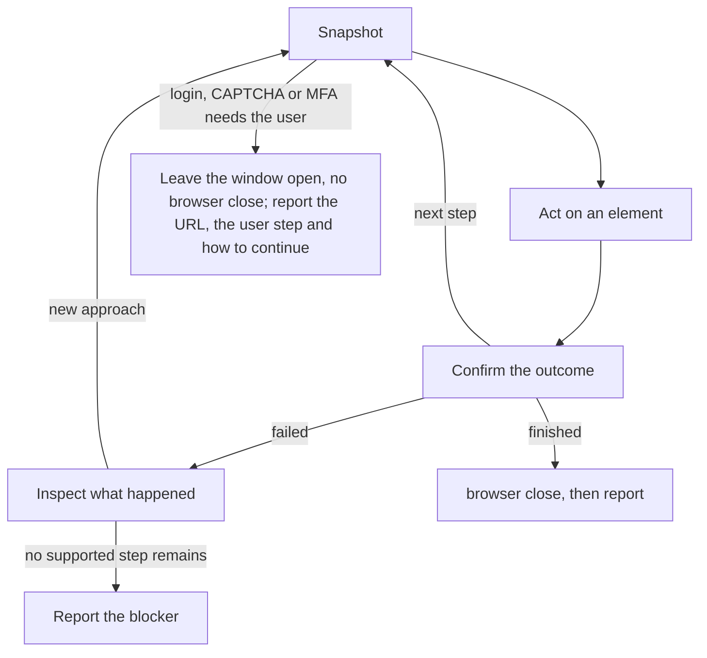

Use `web` for static public sources and `browser` for visible interaction. Chrome uses a persistent profile; logins made there survive runs.

- Use existing task authorization for submissions and other side effects; `sendMessage` your parent when a decision is missing.
- Do not wait idle for the user inside the child: the next run reuses the profile and its logins.
- Report the outcome, source URLs, observed evidence and any required user or parent action. Never include credentials in the report.
