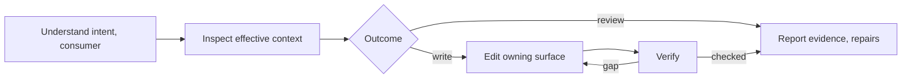

# Octocode Agentic Prompts

Trace an instruction through its loader or tool to the action it produces, then edit the owning surface.

## Understand and review

- Read the affected input and its consumer for goal, scope, permissions, contracts to preserve, success signal; report what you could not read.
- Runtime-assembled prompt: inspect the [effective input](references/writing.md#runtime-context) before judging duplication or size.
- Rank by effect: unsafe or conflicting > unclear decisions or outputs > rigid or ad-hoc shapes a protocol covers > redundancy, wording. Judge clarity, actionability, structure, detail, output, preserved intent, with examples; unmeasured ratings are subjective.
- Descriptions: check covered intents and near-misses left to a neighbor; prefer a clear capability with natural examples over exact phrases, keyword gates, or long exclusion lists (skill descriptions: `octocode-skills`).
- Reviews return findings; authorized rewrites edit. Ask only when missing information changes intent or effect.

## Write and repair

- One owner per behavior.
- Rule = action + the condition that makes it useful, side by side; reason or example only to resolve ambiguity. Uppercase MUST/NEVER only for safety, permissions, secrets, or hard contracts.
- Scattered, repeated, or rigid shapes → one known [protocol](references/protocols.md) whose slots use the receiver's words; never relabel a clear list or format free reasoning.
- Preserve identifiers, working branches, commands, required metadata. Resolve conflicts by host hierarchy and the user's existing authorization.
- Complex branches: Mermaid or a decision table, with no universal word or node limit.
- Keep instructions apart from examples, retrieved content, tool results; labels grant no authority, never replace permission checks.
- Delegation: smallest protocol that keeps ownership; name the user-facing owner and who may write. Briefs, handoffs, replies: [shared shapes](references/agents.md#handoff); large evidence behind stable paths or cursors.

## Verify

Before and after the change, run realistic requests and edge cases: action clear, rules agree, output fits its consumer, recovery keeps scope. When smaller or faster models must follow a protocol or tool surface, run the [agentic interview](references/interview.md) loop to find gaps first. Reliability, activation, tool-selection, or savings claims need a behavioral eval (`octocode-eval-benchmark`); editorial rewrites may finish unmeasured. Report only checks that ran.

## Resources

| When | Read | Why |
|---|---|---|
| Wording, tags, techniques, loaders | [Writing](references/writing.md) | Techniques, effective context |
| Tool descriptions, schemas, MCP wire | [Tools](references/tools.md) | Layer owners, set audit |
| Delegation, handoffs, base prompts, cross-app payloads | [Agents](references/agents.md) | Frozen base, Zod packet |
| Rigid, repeated, or ad-hoc shapes | [Protocols](references/protocols.md) | Catalog, rewrite steps |
| Overflow, compaction, cost, caching, untrusted text | [Context](references/context.md) | Cut vs keep, data vs authority |
| Small models must follow a protocol or tool surface | [Interview](references/interview.md) | Study, cold predict, execute, fix loop |
| Grading interview cold calls | [interview-grade.mjs](scripts/interview-grade.mjs) | Replays calls, valid-cold rate |
| Saving or listing reports | [render-report.mjs](scripts/render-report.mjs) | [output.md](output.md) |

## Related skills

- `octocode-skills`: skill structure, packaging.
- `octocode-documentation`: explanatory prose.
- `octocode-research`: tool contracts, runtime wiring, source claims.
- `octocode-eval-benchmark`: measure activation and outcomes.

## Output

Follow [output.md](output.md).
