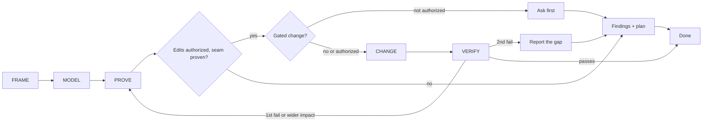

# Octocode Architect

Scale rigor to consequence; never invent layers, findings, or work.

Tools: `octocode` MCP or `npx -y octocode`. Topology: `npx octocode graph` (persisted snapshot; `graph --help`) or beta `npx octocode astTopology` (needs `OCTOCODE_BETA=true` in the environment or `<HOME>/.octocode/.env`).

## Steps

1. Frame: decision, benefit, scope, use case, contract owner. Pin the revision; baseline before claiming a gain.
2. Model: trace representative flows to their consumers, noting shapes, owners, invariants, failure modes.
3. Prove: per finding, Hypothesis test: claim, strongest rival, distinguishing check, result (confirmed, dismissed, or candidate: unresolved, naming the missing check); the only finding-status words.
4. Change: smallest change at the proven boundary, with a focused test that detects the failure.
5. Verify: production-path checks, affected wiring, exit status and payload errors; compare before/after on one measurement.

## When making a claim

- Label rules declared, observed, or inferred; each [view](references/analysis.md#model-the-wiring) answers a different question.
- Static claim: source suffices. Runtime or performance claim: execution evidence.
- Distinguishing checks use distinct IDs, paths, versions, roots and assert the specific failure; when a sharper fixture rejects a finding, keep the disproof.
- Topology edges are syntactic candidates; an edge or style preference is no defect, a type-only cycle no runtime proof. Run the [coverage checks](references/analysis.md#choose-the-narrowest-evidence-lane) before a completeness or absence claim.

## Gates

| When | Do |
|---|---|
| Scope, flow, symbol identity, runtime impact, or measurement unresolved | Report a candidate, not a defect. |
| Public-contract rewire, cross-package move, schema/storage migration, delete, or rename | Ask first unless that exact scope is authorized. |
| Cleanup beyond the change | Clean only what the change caused or touches; broader refactoring needs evidence, an acceptance sensor, authorization. |
| Bookkeeping | Update only what the repo contract requires (docs, manifests, versions, lockfiles, changelogs, snapshots); regenerate derived files, never hand-edit. |
| Reachable path unimplemented | Fail explicitly; tests prove outcomes, not calls. |
| Others' uncommitted work | Coordinate on overlapping paths; never stash, reset, overwrite, or discard it. |

## Resources

| When | Read | Why |
|---|---|---|
| Layers, flows, blast radius, task decomposition; topology, cycles, dead code, duplication, hot paths | [analysis](references/analysis.md) | Evidence lanes, coverage, proof |
| Trust, process, package, or persistence boundary; algorithm or concurrency decides the outcome; reviewing agent work | [checks](references/checks.md) | Contract, data-flow, algorithm, agent-defect checks |
| Before any source edit | [change-discipline](references/change-discipline.md) | Safe moves, slice verification |
| Consequential result | [output.md](output.md#decision-record) | Decision record fields |
| Saving or rendering a report | [render-report.mjs](scripts/render-report.mjs) | HTML view, manifest |

## Related skills

- `octocode-research`: repo, GitHub, package, symbol facts; owns tool choice and live schemas.
- `octocode-rfc-generator`: reviewed decision document.
- `octocode-clean-agentic-code`: behavior-preserving removal.

## Output

Follow [output.md](output.md).
