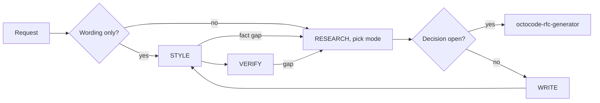

# Octocode Documentation

Write and review technical docs with verified claims.

## When a fact needs evidence

- Verify commands, paths, APIs, env vars, and behavior in the repo; take commands only from manifests, Makefiles, or CI.
- A claim no further search will settle: mark it unresolved with its impact, or omit it.
- Code and docs disagree: judge by contract, tests, decision history; fix stale docs, flag contract-violating code, or document the discrepancy without a promise.
- Link stable source paths; line anchors only in reviews. Explain behavior, never copy implementation.

## When choosing the mode

- One mode per request ([mode table](references/write.md#mode)).
- Wording-only on a named file is a style pass; a page needing an unverified fact is not.
- Unclear: choose the smallest deliverable; ask only if the choice changes audience or content.
- One Diátaxis [page type](references/write.md#page-type) per page; split unless one reader needs both.

## When writing

- A request naming a document authorizes writing it, in scope, for the session; ask only about an unresolved destination or effect.
- Lead with the fact; conditions beside actions; concrete verbs; short steps.
- Flow, branch, or state hard in prose: [Mermaid](references/style-guide.md#diagrams).
- Link related pages by repo-relative path; deep facts stay in their owning page.

## When running the style pass

- Preserve verified meaning.
- Precedence: user request, project style, local convention, this pack.
- Run the project's doc check, if any; this skill ships no prose grader.

## When verifying

Definition of Done: changed claims, paths, commands, links, and examples match their sources and style passes; report what stays unresolved.

## Resources

| When | Read | Why |
|---|---|---|
| Mode, page type, repo facts, ADR, `AGENTS.md`, drafting, verifying | [write](references/write.md) | Tables, claim map, ADR, agent files |
| Style pass, review, wording ruling, controlled English, or a Mermaid diagram | [style-guide](references/style-guide.md) | Review procedure, rules, diagrams, audience, [word list](assets/google-word-list.tsv) |
| Saving or rendering a report | [output.md](output.md), [render-report.mjs](scripts/render-report.mjs) | Format, renderer, manifest |

## Related skills

- Claim needs verification: `octocode-research`.
- Decision still open: `octocode-rfc-generator`.
- Wording changes agent behavior: `octocode-agentic-prompts`.
- Skill structure or triggers: `octocode-skills` (this skill reviews the prose).
- For an orchestrated multi-actor task: [octocode-workflows composition](../octocode-workflows/references/composition.md).

## Output

Follow [output.md](output.md).
