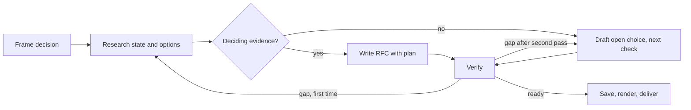

# Octocode RFC Generator

Produce one self-contained RFC: the decision and how to carry it out.

## One document

- Other deliverables only on explicit request ([output](output.md#delivery)).
- Link source code, authoritative docs, and external evidence; don't copy them.
- Plan-only request for a settled decision: one plan, no invented open decision.

## Research and decide

- Frame problem, users, goals, constraints, and current behavior; verify deciding facts with `octocode-research`.
- Decision (ADR): context, decision, status (header `status`), consequences. Compare viable alternatives (status quo when useful); each recommendation carries its because (evidence) and the check that would reverse it.
- Open deciding blocker: a direction with explicit open questions, never a final recommendation ([readiness](references/checklist.md#before-declaring-ready)).
- Plan: observable success first; order steps by dependency (`S2 consumer` after `S1 contract`); each step names what changes, its check, compatibility, rollout, rollback. Risky plan: optional Premortem (assume it failed; list reasons independently); each reason becomes a risk.
- Flow or boundary hard to state in prose: add an example or [diagram](references/checklist.md#diagrams); text keeps the meaning.
- Auditing an existing RFC: [workflow](references/workflow.md#audit-an-existing-rfc).

## Write, verify, deliver

- Write per [output](output.md): proposal and effect first, then design and tradeoffs.
- Check against current sources, dependencies, acceptance criteria, and project checks; `octocode-documentation` for readability. Report material gaps outside the RFC.
- An RFC does not authorize implementation; reuse the user's authorization for scoped saves and edits.
- Save and render every RFC per [output](output.md#saved-report); check `--manifest` for earlier RFCs first.

## Resources

| When | Read | Why |
|---|---|---|
| Planning evidence, auditing an RFC, or a disagreement survives source review | [workflow](references/workflow.md) | Evidence per question, audit, optional `clasify` |
| Finding or closing blocking questions; a section needs a diagram | [checklist](references/checklist.md) | Question areas, closure rules, readiness, diagram types |
| Saving, rendering, or listing RFCs | [render-report.mjs](scripts/render-report.mjs) per [output](output.md#saved-report) | HTML page, JSON catalog |

## Related skills

- `octocode-research`: verify option claims and current behavior.
- `octocode-architect`: boundary and structural tradeoffs.
- `octocode-brainstorming`: issue or option space still open.
- `octocode-documentation`: RFC language, or an ADR for a settled decision.
- `octocode-eval-benchmark`: deciding claims need measurement.

## Output

[output.md](output.md): structure, language, delivery. Only the optional [clasify review](references/workflow.md#optional-clasify-review) needs a key.
