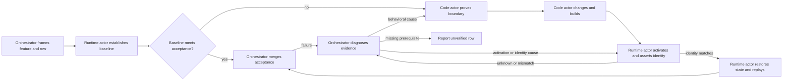

Load when a running feature must be improved with separate code/architecture and runtime actors.

# Runtime surgery

The orchestrator selects one feature at a time, owns authority and the ledger, and assigns the code/architecture actor and runtime actor. No actor recursively spawns. If the runtime role cannot access the decisive process/interface, report the execution limitation.

| Actor | Owns | Returns |
|---|---|---|
| Code/architecture actor | Source research, proven boundary, authorized edit, focused checks, build request | Changed paths, expected identities, acceptance replay, source evidence |
| Runtime actor | Process lifecycle, scenario state, real-interface calls, activation, loaded identity, replay observation | Preconditions, actual result/error, loaded identity, state/reset needs, raw evidence |

## Process lifetime and handoff

The runtime actor owns a started process and its host process/session lifetime: establish that lifetime before external replay, then keep the owner/session alive through replay or use an explicitly durable supervisor it owns. A receiver treats a handoff as live only after checking the endpoint and artifact identity; delivery or completion does not make a process persist. If the process is missing, reconcile endpoint, process, artifact, and durable-state evidence before a new action; do not kill a remembered or stale PID, or assume prior process state survives.

1. Agree a Task contract for the feature: inputs (checkout, baseline including uncommitted work, endpoint, configuration, scenario, build-to-process route) and Definition of Done (the acceptance condition). Use `octocode-agents-communication` for separate identities, leases, durable requests, and completion.
2. Runtime actor captures exact inputs, durable state, expected/actual output, process/build identity, and error/exit evidence through the real interface. If the baseline already meets the acceptance condition, it returns that observation for orchestrator acceptance without an edit. It returns a ledger-row observation, not a verdict.
3. Code actor owns source research, proven boundary, authorized edit, and build request. It uses Research's exact reads/AST/LSP semantics and Architect's Frame → Model → Prove → Change → Verify, including strongest rival and distinguishing check. It sends only ready build identities and replay instructions.
4. Runtime actor uses the [identity guard](verification.md#automatically-check-artifact-identity), establishes the actual loaded build, restores required state, and repeats the same acceptance and material edge checks.
5. Orchestrator merges the result and diagnoses failure before assigning another action. An identity mismatch or unknown identity repairs activation and identity proof first, never triggers a behavioral patch by itself. A timeout, expired request, or unavailable partner is not acceptance; follow [recovery](verification.md#diagnose-and-replan-from-evidence) and inspect durable effects before any repeated mutation.

Finish one feature's baseline → proof → change → activate → replay loop before another. Release owned leases and clean up only processes started for this workflow unless the user asks otherwise.
